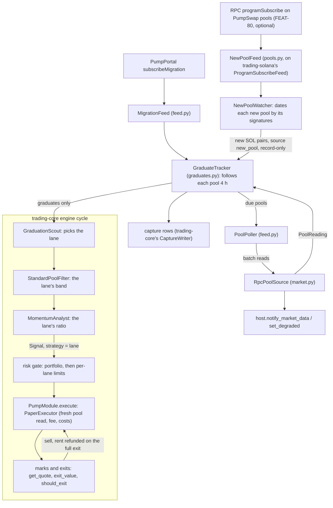

# Architecture

trading-pump is a trading-core module. trading-core owns the run (the loop,
sizing, risk, the circuit breaker, exits, accounting, persistence, alerts,
the dashboard, the audit tools) and, since 0.5.0, the plumbing every module
shares (the capture writer, the WebSocket stream loop and the replay
harness, its FEAT-110); trading-solana, a library (trading-core FEAT-111),
owns the Solana plumbing every Solana module shares (the RPC pool, the
client core and transaction transport, Jito, costs, mint decoding, wallet
decoding, the program-subscribe feed); this package owns everything that
knows Pump.fun and PumpSwap (FEAT-115, trading-core ADR-010 and its
`docs/dev/REPOSITORIES.md`). The contract with the engine is trading-core's
`docs/MODULE-GUIDE.md`; trading-solana's names are in its `docs/API.md`.

## 1. How the module meets the contract

| `TradingModule` | `PumpModule` (`module.py`) |
|---|---|
| `name`, `quote` | `"pumpfun"`; SOL, 9 decimals, µSOL for prices |
| `start(host)` / `stop()` | Opens the capture, records unread-variable warnings, starts the migration feed and the pool poller as tasks, and the new-pool feed when `new_pools` is on (FEAT-80); `stop` ends them and flushes the capture |
| `get_quote(id)` | The latest pool reading, re-read when older than `quote_max_age_seconds`; bid / ask = price ∓ the swap fee; stale (`QuoteUnavailable`) when the read fails or the pool is drained |
| `get_balance()` | Wallet SOL via `getBalance` (live); raises without a key or a balance (BUG-158) |
| `execute(order, paper=)` | `PaperExecutor` (pool-priced fills, every cost) or `LiveExecutor` (refuses until the live gate) |
| `exit_value(position, quote)` | The SOL a sell of the position would return after the fee (BUG-136) |
| `pipeline()` | One pipeline for both lanes (`strategies/pumpswap_momentum.py`): `graduations → standard_pool → [anti_rug] → momentum`. The scout gives each graduate to the lane whose first-reading band it is in (the instant band is checked first); the filter and the analyst apply that lane's band, ratio and slippage; the signal carries the lane as its `strategy`. None when both lanes are off |
| `market_book()` | The graduates' listings and readings for trading-core's lanes (FEAT-117), translated from the capture rows as they are written (`lanes.py`); made on the first call, trimmed by `graduation.book_retention_seconds` on every call, held graduates kept |
| `should_exit(position, quote, now)` | The position's lane exits (`lane.exits`, `instant.exits`, FEAT-79) on the pool mark; nothing for a lane without exits, so the engine's `exits` decide |
| `format_price`, `status_rows`, `strategy_rows` | µSOL prices; feed, new-pool feed, graduates, pool reads, RPC, capture rows; each lane's signal, pool band and exits |
| `files` | The capture file (when on), listed in the Engine panel with the engine's files |
| `provenance()` | Lane, graduation and execution settings, capture path, RPC endpoint count, fees seen |
| `is_public_identifier` | Solana public keys (mints, pools) are public, not secrets (trading-solana's `is_solana_pubkey`) |
| host callbacks | `notify_market_data()` on every good pool read; `set_degraded("pumpportal feed" / "pumpswap pool feed" / "solana rpc" / "rpc network", ...)` |
| start-up checks | Every RPC endpoint's genesis hash: an endpoint not on mainnet-beta is dropped, or `rpc network` degraded when none is (BUG-160) |

`module_settings` are validated by `PumpSettings` (`config/settings.py`),
credentials read by `config/env.py`; the two never mix.

## 2. Data flow



New pools are followed and recorded like graduates but never reach a lane.
The per-lane limits are trading-core's (0.2.3 and later, FEAT-81, keyed by
the lane's name under the engine's `strategies`).

Replay (`replay.py`) replaces the feed with the capture's migrations
(`GraduationFeed`) and the pool source with `CapturePoolSource`, and hands
them to trading-core's replay harness (`trading_core.replay.run_replay`),
which drives the same engine and module on a `ReplayClock`.

Meteora DAMM v2 pools (FEAT-107) were recorded here in `v0.4.0` and are
trading-meteora's since 0.5.0 (ADR-011).

## 3. Package layout

```text
trading_pump/
├── module.py            # PumpModule: the TradingModule implementation
├── market.py            # PoolReading, SwapFee, pool maths, RpcPoolSource
├── graduates.py         # GraduateTracker: who is followed, readings, capture rows
├── feed.py              # MigrationFeed (PumpPortal) and PoolPoller
├── pools.py             # NewPoolFeed (trading-solana's ProgramSubscribeFeed) and NewPoolWatcher: new non-graduate pools (FEAT-80)
├── execution.py         # PaperExecutor, LiveExecutor, Holdings
├── replay.py            # what a capture's rows mean, for trading-core's replay harness
├── lanes.py             # captures as trading-core's strategy library records (lane-rows, the market book)
├── config/              # env.py (credentials only), settings.py (PumpSettings)
├── strategies/          # pumpswap_momentum (both lanes' pipeline), filters / enrichment / cluster (screening), observation
├── sdk/                 # curve and PumpSwap maths, fee config, Pump.fun and PumpSwap transaction builders
├── api/client.py        # Pump.fun public API
├── streams/websocket.py # PumpPortal's subscriptions and API-key handling
├── cli/                 # trading-pump (main.py: replay, lane-rows, env)
└── tests/               # unit/ (mirrors the source), integration/, property/, support/
```

From trading-solana (since 0.5.0): `rpc_pool` (was `infra/rpc_pool.py`),
`client` and `transport` (`sdk/execution_base.py`, `sdk/transport.py`),
`jito`, `costs`, `constants` (the shared part of `sdk/execution_types.py`),
`identifiers`, `mints` (`names.py`, the mint decoders of `market.py` and
`sdk/pumpswap.mint_supply`), `wallet` (`decode_keypair`) and `program_feed`
(`pools.pool_notice` and the feed base). From trading-core: `ops.capture`
(`recorder.py`), `ops.stream` (the loop of `streams/websocket.py`) and
`replay` (the engine-driving part of `replay.py`). Retired in 0.5.0:
`services/slow_lane.py` and `cli/record.py` (FEAT-65, NO-GO).

Boundaries kept from pumpfun-trading: PumpPortal's stream stays in
`streams/`; Pump.fun and PumpSwap maths and transaction building in `sdk/`; strategy
decisions and screening in `strategies/`; CLI handlers delegate to library
functions. Nothing in this package renders a dashboard or owns risk.

## 4. Decisions

The migration's decisions are recorded in
[dev/ARCHITECTURE-DECISIONS.md](dev/ARCHITECTURE-DECISIONS.md) (ADR-009):
why the venue layer was ported and the lanes rebuilt, why credentials are
environment-only, why the capture keeps pumpfun-trading's row shape, and why
live execution waits.
