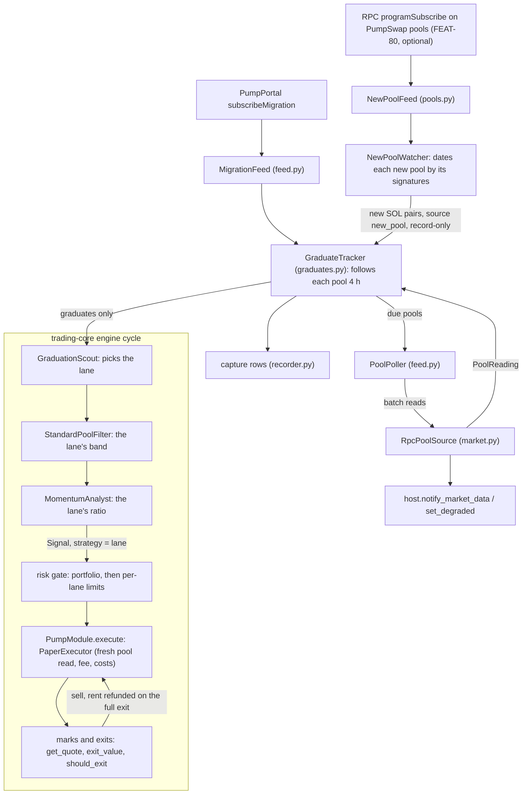

# Architecture

trading-pump is a trading-core module. trading-core owns the run (the loop,
sizing, risk, the circuit breaker, exits, accounting, persistence, alerts,
the dashboard, the audit tools); this package owns everything that knows
Solana, Pump.fun and PumpSwap. The contract between the two is trading-core's
`docs/MODULE-GUIDE.md`.

## 1. How the module meets the contract

| `TradingModule` | `PumpModule` (`module.py`) |
|---|---|
| `name`, `quote` | `"pumpfun"`; SOL, 9 decimals, µSOL for prices |
| `start(host)` / `stop()` | Opens the capture, records unread-variable warnings, starts the migration feed and the pool poller as tasks, and the new-pool feed when `new_pools` is on (FEAT-80); `stop` ends them and flushes the capture |
| `get_quote(id)` | The latest pool reading, re-read when older than `quote_max_age_seconds`; bid / ask = price ∓ the swap fee; stale (`QuoteUnavailable`) when the read fails or the pool is drained |
| `get_balance()` | Wallet SOL via `getBalance` (live); raises without a key or a balance (BUG-158) |
| `execute(order, paper=)` | `PaperExecutor` (pool-priced fills, every cost) or `LiveExecutor` (refuses until the live gate) |
| `exit_value(position, quote)` | The SOL a sell of the position would return after the fee (BUG-136) |
| `pipeline()` | One pipeline for both lanes (`strategies/pumpswap_momentum.py`): `graduations → standard_pool → [anti_rug] → momentum`. The scout gives each graduate to the lane whose first-reading band it is in (the instant band is checked first); the filter and the analyst apply that lane's band, ratio and slippage; the signal carries the lane as its `strategy`. None when both lanes are off |
| `should_exit(position, quote, now)` | The position's lane exits (`lane.exits`, `instant.exits`, FEAT-79) on the pool mark; nothing for a lane without exits, so the engine's `exits` decide |
| `format_price`, `status_rows`, `strategy_rows` | µSOL prices; feed, new-pool feed, graduates, pool reads, RPC, capture rows; each lane's signal, pool band and exits |
| `files` | The capture file (when on), listed in the Engine panel with the engine's files |
| `provenance()` | Lane, graduation and execution settings, capture path, RPC endpoint count, fees seen |
| `is_public_identifier` | Solana public keys (mints, pools) are public, not secrets |
| host callbacks | `notify_market_data()` on every good pool read; `set_degraded("pumpportal feed" / "pumpswap pool feed" / "solana rpc" / "rpc network", ...)` |
| start-up checks | Every RPC endpoint's genesis hash: an endpoint not on mainnet-beta is dropped, or `rpc network` degraded when none is (BUG-160) |

`module_settings` are validated by `PumpSettings` (`config/settings.py`),
credentials read by `config/env.py`; the two never mix.

## 2. Data flow



New pools are followed and recorded like graduates but never reach a lane.
The per-lane limits are trading-core's (0.2.3 and later, FEAT-81, keyed by
the lane's name under the engine's `strategies`).

Replay (`replay.py`) replaces the feed with the capture's migrations and the
pool source with `CapturePoolSource`, and drives the same engine and module
on a `ReplayClock`.

## 3. Package layout

```text
trading_pump/
├── module.py            # PumpModule: the TradingModule implementation
├── market.py            # PoolReading, SwapFee, pool maths, RpcPoolSource
├── graduates.py         # GraduateTracker: who is followed, readings, capture rows
├── feed.py              # MigrationFeed (PumpPortal) and PoolPoller
├── pools.py             # NewPoolFeed and NewPoolWatcher: new non-graduate pools (FEAT-80)
├── execution.py         # PaperExecutor, LiveExecutor, Holdings
├── replay.py            # capture playback through the engine
├── recorder.py          # ReplayRecorder: the capture file (core RotatedFileSink)
├── identifiers.py       # is_solana_pubkey (registered with core redaction)
├── config/              # env.py (credentials only), settings.py (PumpSettings)
├── strategies/          # pumpswap_momentum (both lanes' pipeline), filters / enrichment / cluster (screening), observation
├── sdk/                 # curve and PumpSwap maths, fee config, transaction builders, costs, Jito, transport
├── infra/rpc_pool.py    # multi-endpoint RPC pool with breaker and failover
├── api/client.py        # Pump.fun public API
├── streams/websocket.py # PumpPortal WebSocket host (reconnect, pings, key handling)
├── services/            # slow_lane (FEAT-65); the FEAT-74 market recorder moved to trading-scout
├── cli/                 # trading-pump (main.py), the recorders (record.py)
└── tests/               # unit/ (mirrors the source), integration/, property/, support/
```

Boundaries kept from pumpfun-trading: streaming and decoding stay in
`streams/`; on-chain maths and transaction building in `sdk/`; strategy
decisions and screening in `strategies/`; CLI handlers delegate to library
functions. Nothing in this package renders a dashboard or owns risk.

## 4. Decisions

The migration's decisions are recorded in
[dev/ARCHITECTURE-DECISIONS.md](dev/ARCHITECTURE-DECISIONS.md) (ADR-009):
why the venue layer was ported and the lanes rebuilt, why credentials are
environment-only, why the capture keeps pumpfun-trading's row shape, and why
live execution waits.
