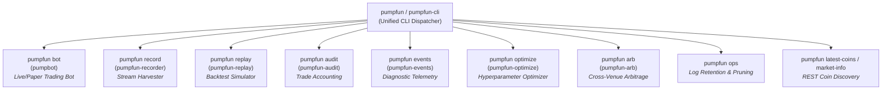

# PumpFun Trading System: Complete CLI Reference Manual

Welcome to the comprehensive command-line interface (CLI) reference manual for `pumpfun-trading`. The system provides a suite of dedicated, high-performance CLI utilities and a unified command dispatcher designed for automated trading, market data harvesting, historical strategy backtesting, forensic trade auditing, and real-time Solana on-chain discovery.

---

## 1. CLI Architecture & Command Surface

The package exposes two operational paradigms for command-line execution:

1. **Dedicated Standalone Binaries**: Direct, purpose-built executables installed in your Python environment path:
   * `pumpbot`: Live and paper-trading runtime orchestrator with Rich alternate-screen console monitoring.
   * `pumpfun-recorder`: Non-blocking market stream harvester, synthetic scenario generator, and historical trade exporter.
   * `pumpfun-replay`: Historical market replay and strategy backtesting simulation engine.
   * `pumpfun-audit`: Forensic JSONL audit trail query, filter, and accounting inspector.
   * `pumpfun-events`: Diagnostic runtime event inspector, filter, live tailer, and latency analytics tool.
   * `pumpfun-optimize`: Multi-objective genetic and random backtest hyperparameter optimization engine.
   * `pumpfun-arb`: Cross-venue spot disparity monitor and atomic Jito arbitrage simulation tool.

2. **Unified CLI Wrapper (`pumpfun` / `pumpfun-cli`)**: A consolidated multi-subcommand dispatcher offering a unified interface for all bot operations, analytics, and coin discovery tools:
   * `pumpfun bot [options]`: Alias for `pumpbot`.
   * `pumpfun record [options]`: Alias for `pumpfun-recorder`.
   * `pumpfun replay [options]`: Alias for `pumpfun-replay`.
   * `pumpfun audit [options]`: Alias for `pumpfun-audit`.
   * `pumpfun events [options]`: Alias for `pumpfun-events`.
   * `pumpfun optimize [options]`: Alias for `pumpfun-optimize`.
   * `pumpfun arb [options]`: Alias for `pumpfun-arb`.
   * `pumpfun latest-coins [options]`: Queries and displays newly created Pump.fun coins via REST API.
   * `pumpfun market-info [options]`: Fetches detailed bonding curve metrics for a specific token mint.



---

## 2. Market Stream Recorder (`pumpfun-recorder` / `pumpfun record`)

### Purpose & Operational Utility
The `pumpfun-recorder` utility (also available via `pumpfun record`) is a high-throughput, non-blocking telemetry and market data capture engine. It addresses three critical operational needs:

1. **Zero-Capital Live Market Harvester**: Ingests real-time bonding curve account updates, token creation announcements, and trade events directly from Yellowstone Geyser gRPC streams or PumpPortal WebSockets. It records these streams into structured, timestamped `.jsonl` datasets without executing trades or risking capital.
2. **Deterministic Synthetic Scenario Generator**: Generates mathematical, reproducible price trajectory datasets (e.g. parabolic rallies with multi-tier take-profits, flash developer rugs, gradual liquidity grinds, stagnant curves, and pump-and-dump scenarios) for unit testing, offline strategy calibration, and regression validation.
3. **Historical REST Trade Exporter**: Queries Pump.fun REST endpoints to retrieve historical transaction logs for a specific token mint address and formats them into standard replay datasets for backtesting.

Datasets captured by `pumpfun-recorder` can be directly loaded into `pumpfun-replay` to backtest algorithms, evaluate Kelly position sizing, and tune trailing stop parameters against real-world or adversarial market conditions.

### Command Syntax
```bash
# Standalone binary
pumpfun-recorder [OPTIONS]

# Unified CLI subcommand
pumpfun record [OPTIONS]
```

### Options & Parameter Reference

| Flag | Short | Type | Default | Description |
| :--- | :---: | :---: | :---: | :--- |
| `--output` | `-o` | String | `market_replay.jsonl` | Destination file path for the recorded `.jsonl` replay dataset. |
| `--duration` | `-d` | Float | `None` (Infinite) | Maximum recording duration in seconds before automatically stopping. |
| `--limit` | `-l` | Integer | `None` (Infinite) | Maximum number of market snapshot records to capture before stopping. |
| `--geyser-endpoint` | — | URL | `None` (Env) | Yellowstone Geyser gRPC streaming endpoint (overrides `PUMPFUN_GEYSER_ENDPOINT`). |
| `--ws-url` | — | URL | `None` (Env) | WebSocket streaming URL (default: `wss://pumpportal.fun/api/data`). |
| `--batch-size` | — | Integer | `50` | In-memory record batch threshold before flushing writes to disk. |
| `--synthetic` | — | Choice | `None` | Generates synthetic market scenario. Choices: `pump_and_dump`, `stagnant_curve`, `multi_tier_take_profit`, `gradual_grind`, `flash_rug`. |
| `--synthetic-steps`| — | Integer | `60` | Number of price update steps generated in synthetic scenarios. |
| `--from-mint` | — | Base58 | `None` | Exports historical trades for a specific token mint via Pump.fun REST API. |

### Execution Examples & Recipes

#### Recipe 1: Harvest Live Yellowstone Geyser gRPC Market Stream
Capture 10 minutes of live on-chain market stream data for backtesting:
```bash
pumpfun-recorder \
  --output runtime/geyser_harvest_10m.jsonl \
  --duration 600 \
  --geyser-endpoint http://your-geyser-grpc.helius.xyz:10000
```

#### Recipe 2: Harvest Live PumpPortal WebSocket Stream with Record Cap
Capture the next 1,000 market quote events from WebSocket:
```bash
pumpfun record \
  --output runtime/ws_stream_1000.jsonl \
  --limit 1000 \
  --ws-url wss://pumpportal.fun/api/data
```

#### Recipe 3: Generate Synthetic Multi-Tier Take-Profit Scenario
Create a 120-step synthetic dataset simulating a parabolic 4.0x runner to test multi-tier scale-outs and trailing stop-losses:
```bash
pumpfun record \
  --synthetic multi_tier_take_profit \
  --synthetic-steps 120 \
  --output runtime/synth_runner.jsonl
```

#### Recipe 4: Generate Synthetic Flash Rug Scenario
Create an adversarial dataset where the developer dumps 90% of supply after a brief pump:
```bash
pumpfun record \
  --synthetic flash_rug \
  --synthetic-steps 50 \
  --output runtime/synth_rug.jsonl
```

#### Recipe 5: Export Historical Token Trades from REST API
Download historical trades for a specific token mint for offline forensic inspection:
```bash
pumpfun record \
  --from-mint 7EYnhcWvdqPB2DdJ6DXZsMvT8GqgE4F8V9m1pump \
  --output runtime/token_history.jsonl \
  --limit 250
```

---

## 3. Trading Bot Runtime (`pumpbot` / `pumpfun bot`)

### Purpose & Operational Utility
The `pumpbot` CLI launches the core automated trading bot runtime. It establishes sub-millisecond Geyser/WebSocket streaming feeds, applies anti-rug screening algorithms, manages position sizing, builds private Jito MEV bundles, and renders real-time state telemetry via an interactive Rich alternate-screen console dashboard.

### Command Syntax
```bash
# Standalone binary
pumpbot [OPTIONS]

# Unified CLI subcommand
pumpfun bot [OPTIONS]
```

### Options & Parameter Reference

| Flag | Type | Default | Description |
| :--- | :---: | :---: | :--- |
| `--preset` | Choice | `balanced` | Trading strategy profile: `conservative`, `balanced`, or `aggressive`. |
| `--buy-amount-sol` | Float | Preset Default | SOL to allocate per token entry (e.g. `0.10`). |
| `--take-profit` | Float | Preset Default | Take-profit price multiplier (e.g. `2.0` = +100%). |
| `--stop-loss` | Float | Preset Default | Stop-loss price floor multiplier (e.g. `0.85` = -15%). |
| `--min-market-cap-sol` | Float | Preset Default | Minimum bonding curve market cap in SOL before buying. |
| `--min-balance-sol` | Float | `0.10` | Minimum wallet SOL reserve buffer required to trade. |
| `--slippage-bps` | Integer | `250` | Maximum entry slippage tolerance in basis points (`250` = 2.5%). |
| `--dry-run` | Flag | `false` | Ingests live data and runs full logic without broadcasting transactions. |
| `--paper-trade` | Flag | `false` | Runs simulated paper trading with mock balances. |
| `--headless` | Flag | `false` | Disables interactive terminal UI; emits structured logs (ideal for VPS services). |
| `--config` | File Path | `None` | Path to custom JSON strategy and risk configuration file. |
| `--record-replay` | File Path | `None` | Asynchronously logs market quotes and trades to `.jsonl` for replay backtesting. |

### Execution Examples & Recipes

#### Recipe 1: Standard Live Execution with Balanced Preset
Launch the live bot with the default balanced strategy and interactive terminal dashboard:
```bash
pumpbot --preset balanced
```

#### Recipe 2: Aggressive Alpha Hunt with Custom Buy Sizing
Execute with an aggressive preset, 0.25 SOL per trade, and 3.5% slippage tolerance:
```bash
pumpbot --preset aggressive --buy-amount-sol 0.25 --take-profit 3.0 --stop-loss 0.80
```

#### Recipe 3: Safe Paper Trading & Live Market Replay Recording
Run paper trading while simultaneously saving streaming market data to a replay file:
```bash
pumpbot \
  --dry-run \
  --preset balanced \
  --record-replay runtime/live_harvest.jsonl
```

#### Recipe 4: Headless Background VPS Deployment
Run the bot headlessly inside a systemd service or background tmux session:
```bash
pumpbot \
  --preset conservative \
  --headless \
  --config configs/production.json
```

---

## 4. Historical Replay Engine (`pumpfun-replay` / `pumpfun replay`)

### Purpose & Operational Utility
The `pumpfun-replay` utility executes recorded market datasets (`.jsonl`) through the exact same trading state machine, Kelly sizing rules, and trailing stop algorithms used in live trading. It generates comprehensive quantitative performance reports including total PnL, win rate, profit factor, max drawdown, Sharpe ratio, and average trade duration.

### Command Syntax
```bash
# Standalone binary
pumpfun-replay --path <DATASET_PATH> [OPTIONS]

# Unified CLI subcommand
pumpfun replay --path <DATASET_PATH> [OPTIONS]
```

### Options & Parameter Reference

| Flag | Alias | Type | Default | Description |
| :--- | :--- | :---: | :---: | :--- |
| `--path` | `--replay-path` | File Path | **Required** | Path to the `.jsonl` or `.json` replay dataset. |
| `--mode` | `--replay-mode` | Choice | `dashboard` | Output presentation mode: `dashboard`, `summary`, or `trades`. |
| `--preset` | — | Choice | `None` | Overrides strategy preset (`conservative`, `balanced`, `aggressive`). |
| `--config` | — | File Path | `None` | Path to custom strategy JSON configuration file. |
| `--initial-cash` | — | Float | `100.0` | Initial starting capital in SOL for the backtest. |
| `--simple-exits` | — | Flag | off | With `--config`/`--preset`, use the legacy fraction-of-cash sizing and flat take-profit/stop-loss instead of the live sizing and exit stack. |
| `--no-costs` | — | Flag | off | Live-fidelity replay without modelled fees, tips and rent (reports gross PnL). |
| `--tip-lamports` | — | Integer | `PUMPFUN_JITO_TIP_LAMPORTS` | Modelled Jito tip per trade (0 when `PUMPFUN_USE_JITO=false`). |
| `--priority-fee-lamports` | — | Integer | `0` | Modelled priority fee per trade. |
| `--compare-audit` | — | File Path | `None` | Replay-vs-live parity report against this audit trail; exit code 1 when net PnL differs by more than the tolerance. |
| `--parity-tolerance-sol` | — | Float | `0.002` | Absolute net PnL tolerance for `--compare-audit`. |
| `--parity-tolerance-pct` | — | Float | `0.10` | Relative tolerance (fraction of live net PnL) for `--compare-audit`. |
| `--mint` | — | Base58 | `None` | Filters replay execution to a single token mint address. |
| `--mint-name` | `--token-name` | String | `None` | Filters replay execution by token symbol or display name. |

### Execution Examples & Recipes

#### Recipe 1: Interactive Backtest Dashboard
Run a full interactive backtest with summary tables and trade ledgers:
```bash
pumpfun-replay --path runtime/market_replay.jsonl --mode dashboard
```

#### Recipe 1b: Replay a Live Capture and Check Parity
Replay a Stage 0 / Stage 1 capture with the live sizing, exits and costs, and compare it with the bot's audit trail (see [`REPLAY-ENGINE.md`](REPLAY-ENGINE.md#live-fidelity-replay-sprint-24c-bug-61)):
```bash
pumpfun-replay --path data/replay_capture.jsonl --config configs/canary.json \
  --compare-audit data/audit_trail.jsonl --mode summary
```

#### Recipe 2: Condensed Financial Performance Summary
Quickly inspect high-level ROI, Sharpe ratio, and profit factors across an entire dataset:
```bash
pumpfun-replay --path runtime/geyser_harvest_10m.jsonl --mode summary
```

#### Recipe 3: Detailed Trade Ledger for a Specific Token
Inspect individual buy/sell executions and exit reasons for a specific token:
```bash
pumpfun-replay \
  --path runtime/market_replay.jsonl \
  --mode trades \
  --mint-name SolCat
```

#### Recipe 4: Strategy Parameter Sensitivity Analysis
Backtest a recorded dataset using a custom aggressive configuration profile:
```bash
pumpfun-replay \
  --path runtime/market_replay.jsonl \
  --config configs/aggressive_tuning.json \
  --initial-cash 10.0
```

---

## 5. Forensic Audit Inspector (`pumpfun-audit` / `pumpfun audit`)

### Purpose & Operational Utility
The `pumpfun-audit` CLI provides forensic trade accounting and incident analysis over persistent JSONL audit trails (`audit_trail.jsonl`). It enables auditors and operators to filter trades by time, token, execution price, slippage, and exit trigger rationale (e.g. `take_profit`, `stop_loss`, `circuit_breaker`, `manual`), export structured data to JSON, and inspect aggregated financial metrics.

### Command Syntax
```bash
# Standalone binary
pumpfun-audit [pnl | reconcile] --path <AUDIT_PATH> [OPTIONS]

# Unified CLI subcommand
pumpfun audit [pnl | reconcile] --path <AUDIT_PATH> [OPTIONS]
```

Without a command the audit records are listed (or summarised with `--summary`). `pnl` prints the net PnL report and `reconcile` checks the audit trail against the wallet on-chain (Sprint 24B, FEAT-49).

### Options & Parameter Reference

| Flag | Type | Default | Description |
| :--- | :---: | :---: | :--- |
| `--path` | File Path | **Required** | Path to the `audit_trail.jsonl` audit file. |
| `--summary` | Flag | `false` | Displays aggregated performance statistics and win rate JSON. |
| `--mint` | Base58 | `None` | Filters audit records to a specific mint address. |
| `--mint-name` | String | `None` | Filters audit records by token display name. |
| `--record-type` | String | `None` | Filters by record type (`trade`, `state_change`, `reconciliation`). |
| `--reason` | String | `None` | Filters by trade reason (e.g. `take_profit`, `stop_loss`, `risk_kill`). |
| `--status` | String | `None` | Filters by execution status (`success`, `failed`, `skipped`). |
| `--date-from` | ISO Date / Ts | `None` | Start datetime filter (e.g. `2026-10-12T00:00:00`). |
| `--date-to` | ISO Date / Ts | `None` | End datetime filter (e.g. `2026-10-12T23:59:59`). |
| `--min-buy-price` | Float | `None` | Minimum buy price filter in SOL. |
| `--max-buy-price` | Float | `None` | Maximum buy price filter in SOL. |
| `--min-sell-price` | Float | `None` | Minimum sell price filter in SOL. |
| `--max-sell-price` | Float | `None` | Maximum sell price filter in SOL. |
| `--limit` | Integer | `None` | Limits the number of records displayed. |
| `--json` | Flag | `false` | Emits filtered records as raw JSON to stdout. |
| `--export` | File Path | `None` | Exports filtered audit records to a target JSON file. |
| `--group-by` | `day` / `reason` / `strategy` / `mint` | `None` | `pnl`: break the totals down (with `reason`, buys group under their entry reason and sells under their exit reason). |
| `--wallet` | Base58 | `None` | `reconcile`: wallet public key (required). |
| `--rpc-url` | URL | `PUMPFUN_RPC_URL` / `SOLANA_RPC_URL` | `reconcile`: RPC used for `getTransaction`, token accounts and balance. |
| `--start-balance` | Float | `None` | `reconcile`: wallet SOL at the start of the period; enables the whole-wallet check. |
| `--tolerance-sol` | Float | `0.002` | `reconcile`: absolute tolerance. |
| `--tolerance-pct` | Float | `0.05` | `reconcile`: relative tolerance; the larger of the two applies. |
| `--no-token-check` | Flag | `false` | `reconcile`: skip the lost/phantom position check. |
 `--status-file` | File Path | `reconcile_status.json` next to `--path` | `reconcile`: where the result is stored for the dashboard Risk panel and `bot_status.json` (`PUMPFUN_RECONCILE_STATUS_PATH` overrides the default). |
 `--no-status-file` | Flag | `false` | `reconcile`: don't store the result (ad-hoc checks of other periods). |

### Execution Examples & Recipes

#### Recipe 1: Render Interactive Audit Table
Display the last 50 audit entries formatted in a Rich color-coded terminal table:
```bash
pumpfun-audit --path runtime/audit_trail.jsonl --limit 50
```

#### Recipe 2: Generate Aggregate Performance Statistics
Output aggregated win rate, net SOL PnL, and trade distribution metrics:
```bash
pumpfun-audit --path runtime/audit_trail.jsonl --summary
```

#### Recipe 3: Investigate Stop-Loss and Risk-Kill Exits
Filter audit records exclusively for loss events to analyze exit timing and slippage:
```bash
pumpfun-audit \
  --path runtime/audit_trail.jsonl \
  --reason stop_loss \
  --status success
```

#### Recipe 4: Export Filtered Audit Trail to JSON
Export all trades for a specific token to an external file for external reporting:
```bash
pumpfun-audit \
  --path runtime/audit_trail.jsonl \
  --mint 7EYnhcWvdqPB2DdJ6DXZsMvT8GqgE4F8V9m1pump \
  --export reports/solcat_audit.json
```

#### Recipe 5: Net PnL After Fees, Tips and Rent
Gross PnL, network and priority fees, Jito tips, token-account rent, net PnL, net win rate and expectancy, broken down by exit reason (add `--json` for machine-readable output):
```bash
pumpfun-audit pnl --path data/audit_trail.jsonl --date-from 2026-10-16 --group-by reason
```
Records written before Sprint 24B have no cost fields (`cost_source: none`); the report flags how many.

#### Recipe 6: Reconcile the Wallet Against the Audit Trail
Compares every live trade signature's on-chain SOL change with the recorded `cash_flow_sol`, lists closed positions that still hold tokens and open positions that hold none, and (with `--start-balance`) the whole-wallet change. Exits with code 1 when a gap exceeds max(0.002 SOL, 5%). The result is also stored in `reconcile_status.json` next to the audit trail, which the running bot's dashboard shows as `Reconciliation`:
```bash
pumpfun-audit reconcile --path data/audit_trail.jsonl --wallet <wallet-pubkey> \
  --date-from 2026-10-16 --start-balance 0.30
```

---

## 6. Diagnostic Telemetry & Event Inspector (`pumpfun-events` / `pumpfun events`)

### Purpose & Operational Utility
The `pumpfun-events` CLI (and `pumpfun events` subcommand) inspects microsecond-precision structured event logs (`events.jsonl`) generated by `FEAT-30`. It provides deep diagnostic visibility into runtime decisions, network latencies, anti-rug rejection rationale, strategy scoring, and Jito bundle performance.

### Command Syntax
```bash
# Standalone binary
pumpfun-events --path <EVENTS_PATH> [OPTIONS]

# Unified CLI subcommand
pumpfun events --path <EVENTS_PATH> [OPTIONS]
```

### Options & Parameter Reference

| Flag | Type | Default | Description |
| :--- | :---: | :---: | :--- |
| `--path` | File Path | `events.jsonl` | Path to the `events.jsonl` structured telemetry file. |
| `--tail` | Flag | `false` | Continuously tails the event file in real time (follow mode). |
| `--mint` | Base58 | `None` | Filters diagnostic events for a specific token mint. |
| `--category` | Choice | `None` | Filters by subsystem category (`stream`, `screening`, `strategy`, `execution`, `risk`, `lifecycle`). |
| `--errors-only` | Flag | `false` | Filters exclusively for `ERROR` and `CRITICAL` severity events. |
| `--latency-stats` | Flag | `false` | Computes statistical latency percentiles (min, max, mean, p50, p95, p99) by category. |
| `--limit` | Integer | `None` | Limits the number of events displayed. |
| `--json` | Flag | `false` | Emits filtered records as formatted JSON. |

### Execution Examples & Recipes

#### Recipe 1: Inspect Live Diagnostic Events in Tail Mode
Follow live engine events across all subsystems:
```bash
pumpfun-events --path events.jsonl --tail
```

#### Recipe 2: Inspect Anti-Rug Screening Rejections for a Specific Token
Investigate why a token was filtered out by the anti-rug engine:
```bash
pumpfun events --path events.jsonl --mint 7EYnhcWvdqPB2DdJ6DXZsMvT8GqgE4F8V9m1pump --category screening
```

#### Recipe 3: Generate Subsystem Latency Analytics
Compute latency distributions for streaming, strategy, and Jito execution:
```bash
pumpfun-events --path events.jsonl --latency-stats
```

---

## 7. Hyperparameter Strategy Optimizer (`pumpfun-optimize` / `pumpfun optimize`)

### Purpose & Operational Utility
The `pumpfun-optimize` CLI (and `pumpfun optimize` subcommand) executes automated multi-objective strategy calibration and hyperparameter tuning across historical replay datasets (`.jsonl` / `.jsonl.gz`) under `FEAT-27`. It solves parameter decay across changing volatility regimes by evaluating thousands of parameter combinations using evolutionary genetic algorithms, random search, or deterministic grids.

Since Sprint 24C every trial runs the [live-fidelity replay](REPLAY-ENGINE.md#live-fidelity-replay-sprint-24c-bug-61) with modelled costs, so fitness is **net of fees, tips and rent**, and the search space covers the live exit stack again (tiered take-profits, moonbag floor, trailing stop, stagnant and max-hold timeouts). Each trial starts with `reserve_balance_sol + 2 × max_total_exposure_sol` of cash, so returns and drawdown are measured against the capital the live caps can put at risk. Sizing, risk caps and screening thresholds are not searched. Trials are selected on the training split only (BUG-60); `--train-split` is chronological.

### Command Syntax
```bash
# Standalone binary
pumpfun-optimize --dataset <DATASET_PATH> [OPTIONS]

# Unified CLI subcommand
pumpfun optimize --dataset <DATASET_PATH> [OPTIONS]
```

### Options & Parameter Reference

| Flag | Type | Default | Description |
| :--- | :---: | :---: | :--- |
| `--dataset`, `--path` | File / Dir | Required | Path to historical replay dataset (`.jsonl`, `.jsonl.gz`, or directory). |
| `--method` | Choice | `genetic` | Optimization algorithm: `genetic`, `random`, `grid`. |
| `--iterations` | Integer | `30` | Random search iteration budget. |
| `--population-size` | Integer | `20` | Population size per generation for genetic search. |
| `--generations` | Integer | `5` | Evolutionary generations for genetic search. |
| `--max-grid-combinations`| Integer | `50` | Maximum parameter combinations for grid search. |
| `--objective` | Choice | `composite` | Target fitness metric: `composite`, `sharpe`, `profit_factor`, `sortino`, `calmar`, `total_return`, `win_rate`. |
| `--train-split` | Float | `0.70` | In-sample training split fraction (0.10 to 0.95). |
| `--config` | File Path | `None` | Path to base JSON bot configuration to calibrate against. |
| `--preset` | Choice | `None` | Baseline strategy preset: `conservative`, `balanced`, `aggressive`. |
| `--export-config` | File Path | `None` | Path to export calibrated `TradingBotConfig` JSON file. |
| `--top-k` | Integer | `5` | Number of top candidate parameter rankings displayed in the final table. |
| `--seed` | Integer | `None` | Deterministic random seed for reproducibility. |
| `--json` | Flag | `false` | Emits optimization summary and top parameters as JSON to stdout. |

### Execution Examples & Recipes

#### Recipe 1: Run Evolutionary Genetic Optimization & Export Calibrated Config
Run genetic optimization across a recorded 24-hour market replay dataset and export the highest-ranking trial to `tuned_production.json`:
```bash
pumpfun-optimize \
  --dataset runtime/market_replay_24h.jsonl \
  --method genetic \
  --population-size 30 \
  --generations 10 \
  --objective composite \
  --export-config configs/tuned_production.json
```

#### Recipe 2: Run Fast Stochastic Random Search with Sharpe Ratio Maximization
Perform 50 stochastic trials targeting maximum Sharpe ratio:
```bash
pumpfun optimize \
  --dataset runtime/replay_dataset.jsonl.gz \
  --method random \
  --iterations 50 \
  --objective sharpe \
  --top-k 10
```

---

## 8. Real-Time Token & Market Discovery (`pumpfun`)

### Subcommands: `latest-coins` and `market-info`
The unified CLI includes lightweight, high-speed inspection commands for querying Pump.fun bonding curves directly via public REST endpoints without initializing the full bot state machine.

### `pumpfun latest-coins`
Fetches and formats newly launched Pump.fun bonding curves in a structured table:
```bash
pumpfun latest-coins [--limit 25]
```
*Output Fields*: Name, Symbol, Mint Address, Market Cap (SOL/USD), Current Price, and Holder Count.

### `pumpfun market-info`
Fetches comprehensive bonding curve telemetry for a single token mint:
```bash
pumpfun market-info --mint <MINT_ADDRESS>
```
*Output Fields*: Token Name, Symbol, Creator Address, Virtual SOL Reserves, Virtual Token Reserves, Real Token Reserves, Current Price, 24h Volume, Market Cap, Bonding Curve Completion Percentage, and Social Metadata links.

---

## 8.5. Cross-Venue Arbitrage & Disparity Monitor (`pumpfun-arb` / `pumpfun arb`)

Monitors live spot price disparities between Pump.fun bonding curves and external DEX pools (Raydium AMM v4) and evaluates/simulates atomic multi-hop Jito bundles:

```bash
# Monitor live spreads and display table
pumpfun-arb --min-spread 0.015 --min-profit 0.003

# Target specific token mint and export JSON
pumpfun arb --mint <MINT> --max-input 0.50 --export-history arb_opportunities.json
```

*Key Flags*:
* `--min-spread`: Minimum percentage spread hurdle (default: `0.015` = 1.5%).
* `--min-profit`: Minimum net SOL profit hurdle after fees/tips (default: `0.003` SOL).
* `--max-input`: Maximum SOL allocation per arbitrage trade leg (default: `0.50` SOL).
* `--tip-share`: Jito validator profit-sharing ratio (default: `0.50` = 50%).
* `--dry-run` / `--live`: Toggle between bundle simulation and live on-chain submission.
* `--export-history`: Export detected opportunities to JSON file.

---

## 9. Complete CLI Parameter Matrix

The table below summarizes all supported options across the complete CLI command surface:

| Category | Flag / Option | Supported Commands | Description |
| :--- | :--- | :--- | :--- |
| **Strategy & Risk** | `--preset` | `pumpbot`, `replay`, `optimize` | Selects strategy preset: `conservative`, `balanced`, `aggressive`. |
| | `--buy-amount-sol` | `pumpbot` | Overrides base buy size in SOL per trade. |
| | `--take-profit` | `pumpbot` | Overrides take-profit price multiplier. |
| | `--stop-loss` | `pumpbot` | Overrides stop-loss floor multiplier. |
| | `--min-market-cap-sol` | `pumpbot` | Minimum launch market cap threshold in SOL. |
| | `--min-balance-sol` | `pumpbot` | Minimum wallet SOL reserve buffer. |
| | `--config` | `pumpbot`, `replay`, `optimize` | Path to JSON strategy/risk configuration file. |
| **Execution Mode** | `--dry-run` | `pumpbot` | Simulates trading logic without on-chain execution. |
| | `--paper-trade` | `pumpbot` | Executes paper trading simulation. |
| | `--headless` | `pumpbot` | Runs without Rich TUI (structured log output). |
| **Data Streams** | `--geyser-endpoint` | `pumpbot`, `record` | Yellowstone Geyser gRPC streaming URL. |
| | `--ws-url` | `record` | PumpPortal WebSocket streaming URL. |
| | `--record-replay` | `pumpbot` | Path to record streaming market data into `.jsonl`. |
| **Recording** | `--output`, `-o` | `record` | Destination path for recorded replay dataset. |
| | `--duration`, `-d` | `record` | Maximum recording duration in seconds. |
| | `--limit`, `-l` | `record` | Maximum record capture count. |
| | `--batch-size` | `record` | Batch size threshold before flushing disk writes. |
| | `--synthetic` | `record` | Generates synthetic market scenario dataset. |
| | `--synthetic-steps` | `record` | Step count for synthetic scenario generation. |
| | `--from-mint` | `record` | Exports historical trades for a mint via REST API. |
| **Replay & Backtest** | `--path`, `--dataset` | `replay`, `audit`, `events`, `optimize` | Input file path for `.jsonl` dataset. |
| | `--mode` | `replay` | Replay presentation: `dashboard`, `summary`, `trades`. |
| | `--initial-cash` | `replay` | Starting capital in SOL for backtesting. |
| **Optimization** | `--method` | `optimize` | Optimization algorithm (`genetic`, `random`, `grid`). |
| | `--iterations` / `--generations` | `optimize` | Search budget controls. |
| | `--population-size` | `optimize` | Genetic algorithm population size. |
| | `--objective` | `optimize` | Target fitness metric (`composite`, `sharpe`, etc.). |
| | `--train-split` | `optimize` | In-sample training split fraction (e.g. `0.70`). |
| | `--export-config` | `optimize` | Exports top configuration to JSON file. |
| | `--top-k` | `optimize` | Top candidate rankings count. |
| | `--seed` | `optimize` | Deterministic random seed integer. |
| **Audit & Forensics** | `--summary` | `audit` | Generates aggregate statistical summary JSON. |
| | `--record-type` | `audit` | Filters records by type (`trade`, `state_change`). |
| | `--reason` | `audit` | Filters by exit reason (`take_profit`, `stop_loss`). |
| | `--status` | `audit` | Filters by execution outcome (`success`, `failed`). |
| | `--date-from` / `--date-to`| `audit` | Datetime boundary filters. |
| | `--json` | `audit`, `events`, `optimize` | Emits filtered records / summary as JSON to stdout. |
| | `--export` | `audit` | Exports filtered audit records to target file. |
| **Diagnostic Events**| `--tail` | `events` | Real-time follow mode for event stream. |
| | `--category` | `events` | Filters by subsystem category (`stream`, `risk`, etc.). |
| | `--errors-only` | `events` | Filters exclusively for ERROR/CRITICAL events. |
| | `--latency-stats` | `events` | Computes statistical latency percentiles. |
| **Token Filtering** | `--mint` | `replay`, `audit`, `events`, `market-info` | Filters operation to a specific mint address. |
| | `--mint-name` | `replay`, `audit` | Filters operation by token symbol or display name. |
