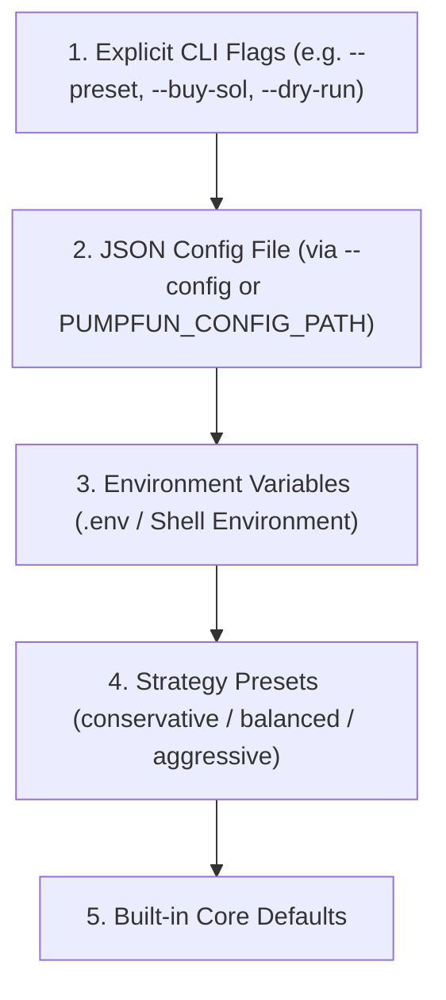

# Environment Variables Reference Manual

This document provides an exhaustive, authoritative reference for all environment variables supported across the `pumpfun-trading` automated runtime, execution SDK, telemetry logger, and quantitative analytics CLI toolkit.

---

## 1. Configuration Precedence & Architecture

The `pumpfun-trading` runtime resolves configuration using a strict deterministic priority cascade:



1. **Explicit Command-Line Flags**: Command-line arguments passed directly to entry points (`pumpbot`, `pumpfun-recorder`, `pumpfun-replay`, `pumpfun-audit`, `pumpfun-events`, `pumpfun`) take highest precedence.
2. **External JSON Configuration File**: Settings loaded via `--config <path>` or `PUMPFUN_CONFIG_PATH`.
3. **Environment Variables**: Variables defined in `.env` (loaded automatically via `python-dotenv`) or active shell session environment.
4. **Strategy Presets**: Base parameters defined by the selected strategy profile (`--preset` or `PUMPFUN_STRATEGY_PRESET`).
5. **System Defaults**: Hardcoded safe defaults defined in `TradingBotConfig` (`pumpfun_trading/strategies/base.py`).

---

## 2. Master Environment Variable Matrix

The table below summarizes every supported environment variable, its recognized fallback aliases, data type, requirement status, default value, and primary subsystem:

| Variable Name | Alias / Fallback | Type | Required | Default | Subsystem |
| :--- | :--- | :---: | :---: | :---: | :--- |
| [`PUMPFUN_PRIVATE_KEY`](#pumpfun_private_key) | `SOLANA_PRIVATE_KEY` | String (Base58) | **Yes** (Live) | `None` | Authentication |
| [`PUMPFUN_RPC_URL`](#pumpfun_rpc_url) | `HELIUS_RPC_URL` | String (URL) | **Yes** | `https://api.mainnet-beta.solana.com` | Networking |
| [`PUMPFUN_RPC_URLS`](#pumpfun_rpc_urls) | `SOLANA_RPC_URLS` | String (CSV) | Optional | `None` | Networking |
| [`PUMPFUN_STREAM_URL`](#pumpfun_stream_url) | `PUMPFUN_WS_URL` | String (URL) | **Required\*** | `wss://pumpportal.fun/api/data` | Streaming |
| [`PUMPFUN_GEYSER_ENDPOINT`](#pumpfun_geyser_endpoint) | — | String (URL) | **Required\*** | `None` | Streaming |
| [`PUMPFUN_GEYSER_X_TOKEN`](#pumpfun_geyser_x_token) | `PUMPFUN_GEYSER_TOKEN` | String | Optional | `None` | Streaming |
| [`PUMPFUN_STREAM_MAX_RETRIES`](#pumpfun_stream_max_retries) | `PUMPFUN_WS_MAX_RETRIES` | Integer | Optional | `5` | Streaming |
| [`PUMPFUN_USE_JITO`](#pumpfun_use_jito) | — | Boolean | Optional | `true` | Execution / Anti-MEV |
| [`PUMPFUN_JITO_BLOCK_ENGINE_URL`](#pumpfun_jito_block_engine_url) | — | String (URL) | Optional | `https://mainnet.block-engine.jito.wtf` | Execution / Anti-MEV |
| [`PUMPFUN_JITO_TIP_LAMPORTS`](#pumpfun_jito_tip_lamports) | — | Integer | Optional | `100000` (0.0001 SOL) | Execution / Anti-MEV |
| [`PUMPFUN_JITO_CONFIRMATION_TIMEOUT`](#pumpfun_jito_confirmation_timeout) | — | Float (Seconds) | Optional | `12.0` | Execution / Anti-MEV |
| [`PUMPFUN_JITO_FALLBACK_TO_RPC`](#pumpfun_jito_fallback_to_rpc) | — | Boolean | Optional | `true` | Execution / Anti-MEV |
| [`PUMPFUN_COMPUTE_UNIT_LIMIT`](#pumpfun_compute_unit_limit) | — | Integer | Optional | `200000` | Execution / Priority Fees |
| [`PUMPFUN_BASE_BUY_SOL`](#pumpfun_base_buy_sol) | `PUMPFUN_BUY_AMOUNT_SOL` | Float (SOL) | Optional | `0.1` | Strategy Sizing |
| [`PUMPFUN_SLIPPAGE_BPS`](#pumpfun_slippage_bps) | — | Integer (BPS) | Optional | `250` (2.5%) | Strategy / Execution |
| [`PUMPFUN_BASE_EXIT_SLIPPAGE_BPS`](#pumpfun_base_exit_slippage_bps) | — | Integer (BPS) | Optional | `500` (5.0%) | Risk / Exit |
| [`PUMPFUN_MAX_EXIT_SLIPPAGE_BPS`](#pumpfun_max_exit_slippage_bps) | — | Integer (BPS) | Optional | `5000` (50.0%) | Risk / Exit |
| [`PUMPFUN_MAX_EXIT_RETRIES`](#pumpfun_max_exit_retries) | — | Integer | Optional | `5` | Risk / Exit |
| [`PUMPFUN_STRATEGY_PRESET`](#pumpfun_strategy_preset) | `PUMPFUN_PRESET` | String | Optional | `balanced` | Strategy |
| [`PUMPFUN_DRY_RUN`](#pumpfun_dry_run) | — | Boolean | Optional | `false` | Execution Mode |
| [`PUMPFUN_CONFIG_PATH`](#pumpfun_config_path) | `PUMPFUN_CONFIG` | String (Path) | Optional | `None` | Configuration |
| [`PUMPFUN_DRAWDOWN_MODE`](#pumpfun_drawdown_mode) | — | String | Optional | `adaptive_ratchet` | Risk Management |
| [`PUMPFUN_PROFIT_RATCHET_RATIO`](#pumpfun_profit_ratchet_ratio) | — | Float | Optional | `0.50` (50%) | Risk Management |
| [`PUMPFUN_PROFIT_DRAWDOWN_TOLERANCE_PCT`](#pumpfun_profit_drawdown_tolerance_pct) | — | Float | Optional | `0.35` (35%) | Risk Management |
| [`PUMPFUN_ENABLE_DIAGNOSTIC_EVENTS`](#pumpfun_enable_diagnostic_events) | — | Boolean | Optional | `true` | Telemetry |
| [`PUMPFUN_EVENT_LOG_PATH`](#pumpfun_event_log_path) | — | String (Path) | Optional | `events.jsonl` | Telemetry |
| [`PUMPFUN_EVENT_SUBSYSTEMS`](#pumpfun_event_subsystems) | — | String (CSV) | Optional | `stream,screening,strategy,execution,risk,lifecycle` | Telemetry |
| [`PUMPFUN_STATUS_PATH`](#pumpfun_status_path) | `PUMPFUN_BOT_STATUS_PATH` | String (Path) | Optional | `runtime/bot_status.json` | Persistence |
| [`PUMPFUN_AUDIT_LOG_PATH`](#pumpfun_audit_log_path) | `PUMPFUN_AUDIT_LOG` | String (Path) | Optional | `runtime/audit_trail.jsonl` | Persistence / Forensic |
| [`PUMPFUN_RECORD_REPLAY`](#pumpfun_record_replay) | — | Boolean / Path | Optional | `false` | Replay Simulation |
| [`PUMPFUN_REPLAY_LOG_PATH`](#pumpfun_replay_log_path) | — | String (Path) | Optional | `None` | Replay Simulation |
| [`PUMPFUN_LOG_MAX_BYTES`](#pumpfun_log_max_bytes) | — | Integer (Bytes) | Optional | `10485760` (10 MB) | Log Retention |
| [`PUMPFUN_LOG_BACKUP_COUNT`](#pumpfun_log_backup_count) | — | Integer | Optional | `5` | Log Retention |
| [`PUMPFUN_LOG_ROTATION_TYPE`](#pumpfun_log_rotation_type) | — | String | Optional | `size` | Log Retention |
| [`PUMPFUN_LOG_COMPRESS`](#pumpfun_log_compress) | — | Boolean | Optional | `true` | Log Retention |
| [`PUMPFUN_AUDIT_MAX_BYTES`](#pumpfun_audit_max_bytes) | — | Integer (Bytes) | Optional | `10485760` (10 MB) | Audit Retention |
| [`PUMPFUN_AUDIT_BACKUP_COUNT`](#pumpfun_audit_backup_count) | — | Integer | Optional | `10` | Audit Retention |
| [`PUMPFUN_AUDIT_RETENTION_DAYS`](#pumpfun_audit_retention_days) | — | Integer (Days) | Optional | `30` | Audit Retention |
| [`PUMPFUN_AUDIT_COMPRESS`](#pumpfun_audit_compress) | — | Boolean | Optional | `true` | Audit Retention |
| [`PUMPFUN_REPLAY_MAX_BYTES`](#pumpfun_replay_max_bytes) | — | Integer (Bytes) | Optional | `52428800` (50 MB) | Replay Retention |
| [`PUMPFUN_REPLAY_BACKUP_COUNT`](#pumpfun_replay_backup_count) | — | Integer | Optional | `10` | Replay Retention |
| [`PUMPFUN_REPLAY_RETENTION_DAYS`](#pumpfun_replay_retention_days) | — | Integer (Days) | Optional | `30` | Replay Retention |
| [`PUMPFUN_REPLAY_COMPRESS`](#pumpfun_replay_compress) | — | Boolean | Optional | `true` | Replay Retention |
| [`PUMPFUN_RETENTION_CHECK_INTERVAL_SECONDS`](#pumpfun_retention_check_interval_seconds) | — | Float (Seconds) | Optional | `3600.0` (1 hour) | Retention Engine |
| [`PUMPFUN_ALERT_PROVIDER`](#pumpfun_alert_provider) | — | String | Optional | `none` | Alerting |
| [`PUMPFUN_ALERT_DISCORD_WEBHOOK_URL`](#pumpfun_alert_discord_webhook_url) | `PUMPFUN_ALERT_WEBHOOK_URL` | String (URL) | Optional | `None` | Alerting |
| [`PUMPFUN_ALERT_SLACK_WEBHOOK_URL`](#pumpfun_alert_slack_webhook_url) | — | String (URL) | Optional | `None` | Alerting |
| [`PUMPFUN_ALERT_TELEGRAM_BOT_TOKEN`](#pumpfun_alert_telegram_bot_token) | `PUMPFUN_TELEGRAM_BOT_TOKEN` | String | Optional | `None` | Alerting |
| [`PUMPFUN_ALERT_TELEGRAM_CHAT_ID`](#pumpfun_alert_telegram_chat_id) | `PUMPFUN_TELEGRAM_CHAT_ID` | String | Optional | `None` | Alerting |
| [`PUMPFUN_HEADLESS`](#pumpfun_headless) | — | Boolean | Optional | `false` | Display & Runtime |
| [`NO_COLOR`](#no_color) | — | String | Optional | `None` | Terminal Display |

*\*Note on Streaming Requirements:* Live market operations require **at least one** stream source (`PUMPFUN_GEYSER_ENDPOINT` or `PUMPFUN_STREAM_URL`).

---

## 3. Detailed Subsystem Specifications

### 3.1 Authentication & Wallet Management

#### `PUMPFUN_PRIVATE_KEY`
* **Fallback Alias:** `SOLANA_PRIVATE_KEY`
* **Type:** String (Base58 encoded)
* **Required:** Yes (for live on-chain trading)
* **Default:** `None`
* **Description:** Base58-encoded private key for the trading wallet. Supports standard 32-byte Ed25519 seed phrases as well as 64-byte secret key byte arrays.
* **Security & Sanitization:** Automatically masked in log dumps (`abcd...ef`) via `mask_secret()`. Never written to unencrypted disk storage during Web UI sessions.
* **Example:** `PUMPFUN_PRIVATE_KEY="5K3...x9Z"`

---

### 3.2 Solana Network, RPC Providers & Failover

#### `PUMPFUN_RPC_URL`
* **Fallback Alias:** `HELIUS_RPC_URL`
* **Type:** String (HTTP/HTTPS URL)
* **Required:** Yes (unless `PUMPFUN_RPC_URLS` is configured)
* **Default:** `https://api.mainnet-beta.solana.com`
* **Description:** Primary Solana JSON-RPC HTTP endpoint used for account balance inquiries, token account lookups, recent blockhash fetching, priority fee estimation, and direct transaction dispatch.
* **Example:** `PUMPFUN_RPC_URL="https://mainnet.helius-rpc.com/?api-key=YOUR_API_KEY"`

#### `PUMPFUN_RPC_URLS`
* **Fallback Alias:** `SOLANA_RPC_URLS`
* **Type:** String (Comma-separated URLs)
* **Required:** Optional
* **Default:** `None`
* **Description:** Comma-separated list of secondary/failover Solana RPC endpoints. Loaded into `RpcConnectionPool` to provide seamless round-robin load distribution and automatic error recovery during node rate-limiting.
* **Example:** `PUMPFUN_RPC_URLS="https://rpc1.triton.one/?api-key=KEY,https://rpc2.helius.xyz/?api-key=KEY"`

---

### 3.3 Market Data Streaming & Geyser gRPC (FEAT-01)

#### `PUMPFUN_GEYSER_ENDPOINT`
* **Fallback Alias:** None
* **Type:** String (gRPC URL)
* **Required:** Required if `PUMPFUN_STREAM_URL` is omitted
* **Default:** `None`
* **Description:** Yellowstone Geyser gRPC streaming endpoint for ultra-low latency, zero-copy binary market feed ingestion directly from validator nodes.
* **Example:** `PUMPFUN_GEYSER_ENDPOINT="https://grpc.mainnet.helius-rpc.com"`

#### `PUMPFUN_GEYSER_X_TOKEN`
* **Fallback Alias:** `PUMPFUN_GEYSER_TOKEN`
* **Type:** String
* **Required:** Optional (provider-dependent)
* **Default:** `None`
* **Description:** Authentication header / X-Token passed in Yellowstone Geyser gRPC connection metadata.
* **Example:** `PUMPFUN_GEYSER_X_TOKEN="helius-grpc-token-abc123xyz"`

#### `PUMPFUN_STREAM_URL`
* **Fallback Alias:** `PUMPFUN_WS_URL`
* **Type:** String (WebSocket/HTTP URL)
* **Required:** Required if `PUMPFUN_GEYSER_ENDPOINT` is omitted
* **Default:** `wss://pumpportal.fun/api/data`
* **Description:** WebSocket streaming endpoint (e.g. PumpPortal public trade feed) used for event-driven market tracking when Geyser gRPC is unavailable.
* **Example:** `PUMPFUN_STREAM_URL="wss://pumpportal.fun/api/data"`

#### `PUMPFUN_STREAM_MAX_RETRIES`
* **Fallback Alias:** `PUMPFUN_WS_MAX_RETRIES`
* **Type:** Integer
* **Required:** Optional
* **Default:** `5`
* **Description:** Maximum consecutive streaming connection failures permitted before triggering the streaming circuit breaker, halting trade entries, and firing critical alerts.
* **Example:** `PUMPFUN_STREAM_MAX_RETRIES=10`

---

### 3.4 Jito MEV Protection & Priority Execution (FEAT-02)

#### `PUMPFUN_USE_JITO`
* **Fallback Alias:** None
* **Type:** Boolean (`true`, `false`, `1`, `0`, `yes`, `no`)
* **Required:** Optional
* **Default:** `true`
* **Description:** Enables private mempool bundle routing via Jito Block Engines to eliminate front-running and sandwich attacks.
* **Example:** `PUMPFUN_USE_JITO=true`

#### `PUMPFUN_JITO_BLOCK_ENGINE_URL`
* **Fallback Alias:** None
* **Type:** String (HTTPS URL)
* **Required:** Optional
* **Default:** `https://mainnet.block-engine.jito.wtf`
* **Description:** Jito Block Engine endpoint URL for MEV bundle submission.
* **Example:** `PUMPFUN_JITO_BLOCK_ENGINE_URL="https://ny.mainnet.block-engine.jito.wtf"`

#### `PUMPFUN_JITO_TIP_LAMPORTS`
* **Fallback Alias:** None
* **Type:** Integer (Lamports)
* **Required:** Optional
* **Default:** `100000` (0.0001 SOL)
* **Description:** Validator tip in Lamports appended to Jito bundles to incentivize fast block inclusion.
* **Example:** `PUMPFUN_JITO_TIP_LAMPORTS=200000`

#### `PUMPFUN_JITO_CONFIRMATION_TIMEOUT`
* **Fallback Alias:** None
* **Type:** Float (Seconds)
* **Required:** Optional
* **Default:** `12.0`
* **Description:** Timeout in seconds waiting for on-chain Jito bundle confirmation before triggering fallback execution.
* **Example:** `PUMPFUN_JITO_CONFIRMATION_TIMEOUT=8.5`

#### `PUMPFUN_JITO_FALLBACK_TO_RPC`
* **Fallback Alias:** None
* **Type:** Boolean (`true`, `false`, `1`, `0`)
* **Required:** Optional
* **Default:** `true`
* **Description:** Automatically falls back to high-priority direct RPC transaction dispatch if a Jito bundle confirmation times out.
* **Example:** `PUMPFUN_JITO_FALLBACK_TO_RPC=true`

#### `PUMPFUN_COMPUTE_UNIT_LIMIT`
* **Fallback Alias:** None
* **Type:** Integer
* **Required:** Optional
* **Default:** `200000`
* **Description:** Compute unit budget limit requested in `SetComputeUnitLimit` instructions for Solana transactions.
* **Example:** `PUMPFUN_COMPUTE_UNIT_LIMIT=250000`

---

### 3.5 Strategy Sizing, Presets & Exit Escalation (FEAT-03, FEAT-04)

#### `PUMPFUN_BASE_BUY_SOL`
* **Fallback Alias:** `PUMPFUN_BUY_AMOUNT_SOL`
* **Type:** Float (SOL)
* **Required:** Optional
* **Default:** `0.1` (or strategy preset default)
* **Description:** Base capital allocation committed per initial token buy order.
* **Example:** `PUMPFUN_BASE_BUY_SOL=0.25`

#### `PUMPFUN_SLIPPAGE_BPS`
* **Fallback Alias:** None
* **Type:** Integer (Basis Points, 1 BPS = 0.01%)
* **Required:** Optional
* **Default:** `250` (2.5%)
* **Description:** Maximum allowable price slippage tolerance for token buy entry transactions.
* **Example:** `PUMPFUN_SLIPPAGE_BPS=300`

#### `PUMPFUN_BASE_EXIT_SLIPPAGE_BPS`
* **Fallback Alias:** None
* **Type:** Integer (Basis Points)
* **Required:** Optional
* **Default:** `500` (5.0%)
* **Description:** Initial price slippage tolerance applied during the first exit sell attempt.
* **Example:** `PUMPFUN_BASE_EXIT_SLIPPAGE_BPS=400`

#### `PUMPFUN_MAX_EXIT_SLIPPAGE_BPS`
* **Fallback Alias:** None
* **Type:** Integer (Basis Points)
* **Required:** Optional
* **Default:** `5000` (50.0%)
* **Description:** Maximum escalated slippage cap during dynamic exit retry cycles under extreme market volatility.
* **Example:** `PUMPFUN_MAX_EXIT_SLIPPAGE_BPS=6000`

#### `PUMPFUN_MAX_EXIT_RETRIES`
* **Fallback Alias:** None
* **Type:** Integer
* **Required:** Optional
* **Default:** `5`
* **Description:** Maximum number of retry attempts for failed exit orders before escalating to emergency liquidation.
* **Example:** `PUMPFUN_MAX_EXIT_RETRIES=8`

#### `PUMPFUN_STRATEGY_PRESET`
* **Fallback Alias:** `PUMPFUN_PRESET`
* **Type:** String (`conservative`, `balanced`, `aggressive`)
* **Required:** Optional
* **Default:** `balanced`
* **Description:** Selects a preconfigured parameter profile governing entry screening strictness, take-profit multipliers, and trailing stop floors.
* **Example:** `PUMPFUN_STRATEGY_PRESET="aggressive"`

#### `PUMPFUN_DRY_RUN`
* **Fallback Alias:** None
* **Type:** Boolean (`true`, `false`, `1`, `0`)
* **Required:** Optional
* **Default:** `false`
* **Description:** Enables paper-trading simulation mode. The bot processes real-time live market streams, screens tokens, and calculates fills without signing or broadcasting on-chain transactions.
* **Example:** `PUMPFUN_DRY_RUN=true`

#### `PUMPFUN_CONFIG_PATH`
* **Fallback Alias:** `PUMPFUN_CONFIG`
* **Type:** String (File Path)
* **Required:** Optional
* **Default:** `None`
* **Description:** File path to an external JSON configuration file (e.g. `configs/custom-strategy.json`).
* **Example:** `PUMPFUN_CONFIG_PATH="configs/bot-config.json"`

---

### 3.6 Risk Management & Realized-Ratchet Drawdown (FEAT-09, FEAT-29)

#### `PUMPFUN_DRAWDOWN_MODE`
* **Fallback Alias:** None
* **Type:** String (`adaptive_ratchet`, `baseline`, `trailing_hwm`)
* **Required:** Optional
* **Default:** `adaptive_ratchet`
* **Description:** Selects the portfolio circuit breaker drawdown reference policy:
  * `adaptive_ratchet`: Dual-zone risk engine ratcheting realized profits into a rising baseline floor while allowing transient paper runners room to breathe.
  * `baseline`: Simple capital preservation measuring drawdown strictly against initial session starting capital.
  * `trailing_hwm`: Legacy peak-to-trough trailing high-water mark tracking.
* **Example:** `PUMPFUN_DRAWDOWN_MODE="adaptive_ratchet"`

#### `PUMPFUN_PROFIT_RATCHET_RATIO`
* **Fallback Alias:** None
* **Type:** Float (`0.0` to `1.0`)
* **Required:** Optional
* **Default:** `0.50` (50%)
* **Description:** Proportion of cumulative net realized trading profits permanently banked into increasing the guaranteed portfolio baseline floor ($\text{Floor} = \text{Starting Capital} + \alpha \times \max(0, \text{Realized PnL})$).
* **Example:** `PUMPFUN_PROFIT_RATCHET_RATIO=0.60`

#### `PUMPFUN_PROFIT_DRAWDOWN_TOLERANCE_PCT`
* **Fallback Alias:** None
* **Type:** Float (`0.0` to `1.0`)
* **Required:** Optional
* **Default:** `0.35` (35%)
* **Description:** Allowable trailing drawdown tolerance when operating in the **Profit Run Zone** (`Current Equity >= Starting Capital`) before triggering Stage 1 circuit breaker (`HALT_NEW_BUYS`).
* **Example:** `PUMPFUN_PROFIT_DRAWDOWN_TOLERANCE_PCT=0.40`

---

### 3.7 Structured Diagnostic Telemetry & Event Logging (FEAT-30)

#### `PUMPFUN_ENABLE_DIAGNOSTIC_EVENTS`
* **Fallback Alias:** None
* **Type:** Boolean (`true`, `false`, `1`, `0`)
* **Required:** Optional
* **Default:** `true`
* **Description:** Enables high-throughput, asynchronous non-blocking JSONL telemetry logging across all internal bot subsystems.
* **Example:** `PUMPFUN_ENABLE_DIAGNOSTIC_EVENTS=true`

#### `PUMPFUN_EVENT_LOG_PATH`
* **Fallback Alias:** None
* **Type:** String (File Path)
* **Required:** Optional
* **Default:** `events.jsonl`
* **Description:** Destination file path for structured diagnostic event logs.
* **Example:** `PUMPFUN_EVENT_LOG_PATH="runtime/events.jsonl"`

#### `PUMPFUN_EVENT_SUBSYSTEMS`
* **Fallback Alias:** None
* **Type:** String (Comma-separated list)
* **Required:** Optional
* **Default:** `stream,screening,strategy,execution,risk,lifecycle`
* **Description:** Granular filter specifying which subsystem events are written to the telemetry sink.
* **Example:** `PUMPFUN_EVENT_SUBSYSTEMS="execution,risk,screening"`

---

### 3.8 Persistence, Snapshots & Market Replay (FEAT-21, FEAT-22)

#### `PUMPFUN_STATUS_PATH`
* **Fallback Alias:** `PUMPFUN_BOT_STATUS_PATH`
* **Type:** String (File Path)
* **Required:** Optional
* **Default:** `runtime/bot_status.json`
* **Description:** Path to the atomic JSON snapshot file recording live state machine status, active positions, wallet valuation, and performance metrics for external monitoring and crash recovery.
* **Example:** `PUMPFUN_STATUS_PATH="runtime/bot_status.json"`

#### `PUMPFUN_AUDIT_LOG_PATH`
* **Fallback Alias:** `PUMPFUN_AUDIT_LOG`
* **Type:** String (File Path)
* **Required:** Optional
* **Default:** `runtime/audit_trail.jsonl`
* **Description:** Append-only JSONL destination path for the forensic audit trail, logging completed trades, exit reasons, slippage data, and risk interventions.
* **Example:** `PUMPFUN_AUDIT_LOG_PATH="runtime/audit_trail.jsonl"`

#### `PUMPFUN_RECORD_REPLAY`
* **Fallback Alias:** None
* **Type:** Boolean / String (`true`, `false`, `1`, `0`, or custom path)
* **Required:** Optional
* **Default:** `false`
* **Description:** Enables live market quote and trade replay recording. If set to `true`, outputs to `market_replay.jsonl`.
* **Example:** `PUMPFUN_RECORD_REPLAY=true`

#### `PUMPFUN_REPLAY_LOG_PATH`
* **Fallback Alias:** None
* **Type:** String (File Path)
* **Required:** Optional
* **Default:** `None`
* **Description:** Explicit destination file path for market replay recordings.
* **Example:** `PUMPFUN_REPLAY_LOG_PATH="datasets/market_replay_20261014.jsonl"`

---

### 3.9 Automated Retention, Rollover & Multi-Sink Compression (FEAT-22)

#### `PUMPFUN_LOG_MAX_BYTES`
* **Fallback Alias:** None
* **Type:** Integer (Bytes)
* **Required:** Optional
* **Default:** `10485760` (10 MB)
* **Description:** Maximum file size in bytes before the primary application log (`bot.log`) rotates.
* **Example:** `PUMPFUN_LOG_MAX_BYTES=20971520` (20 MB)

#### `PUMPFUN_LOG_BACKUP_COUNT`
* **Fallback Alias:** None
* **Type:** Integer
* **Required:** Optional
* **Default:** `5`
* **Description:** Maximum number of rotated application log archives (`bot.log.1.gz`, etc.) retained on disk before pruning.
* **Example:** `PUMPFUN_LOG_BACKUP_COUNT=10`

#### `PUMPFUN_LOG_ROTATION_TYPE`
* **Fallback Alias:** None
* **Type:** String (`size`, `time`, `none`)
* **Required:** Optional
* **Default:** `size`
* **Description:** Application log rotation trigger strategy (`size` based on byte thresholds, `time` based on daily midnight rollover, or `none`).
* **Example:** `PUMPFUN_LOG_ROTATION_TYPE="size"`

#### `PUMPFUN_LOG_COMPRESS`
* **Fallback Alias:** None
* **Type:** Boolean (`true`, `false`, `1`, `0`)
* **Required:** Optional
* **Default:** `true`
* **Description:** Enables automated background gzip compression (`.gz`) for closed application log backup files.
* **Example:** `PUMPFUN_LOG_COMPRESS=true`

#### `PUMPFUN_AUDIT_MAX_BYTES`
* **Fallback Alias:** None
* **Type:** Integer (Bytes)
* **Required:** Optional
* **Default:** `10485760` (10 MB)
* **Description:** Maximum byte threshold per forensic audit log chunk before triggering atomic rollover.
* **Example:** `PUMPFUN_AUDIT_MAX_BYTES=10485760`

#### `PUMPFUN_AUDIT_BACKUP_COUNT`
* **Fallback Alias:** None
* **Type:** Integer
* **Required:** Optional
* **Default:** `10`
* **Description:** Maximum number of rotated audit trail archives retained.
* **Example:** `PUMPFUN_AUDIT_BACKUP_COUNT=20`

#### `PUMPFUN_AUDIT_RETENTION_DAYS`
* **Fallback Alias:** None
* **Type:** Integer (Days)
* **Required:** Optional
* **Default:** `30`
* **Description:** Maximum age in days before historical audit archives are automatically pruned by background retention workers.
* **Example:** `PUMPFUN_AUDIT_RETENTION_DAYS=60`

#### `PUMPFUN_AUDIT_COMPRESS`
* **Fallback Alias:** None
* **Type:** Boolean (`true`, `false`, `1`, `0`)
* **Required:** Optional
* **Default:** `true`
* **Description:** Automatically compresses rotated audit chunks to `.jsonl.gz`.
* **Example:** `PUMPFUN_AUDIT_COMPRESS=true`

#### `PUMPFUN_REPLAY_MAX_BYTES`
* **Fallback Alias:** None
* **Type:** Integer (Bytes)
* **Required:** Optional
* **Default:** `52428800` (50 MB)
* **Description:** Maximum byte threshold per market replay chunk before rollover.
* **Example:** `PUMPFUN_REPLAY_MAX_BYTES=104857600` (100 MB)

#### `PUMPFUN_REPLAY_BACKUP_COUNT`
* **Fallback Alias:** None
* **Type:** Integer
* **Required:** Optional
* **Default:** `10`
* **Description:** Maximum number of chunked replay files retained.
* **Example:** `PUMPFUN_REPLAY_BACKUP_COUNT=15`

#### `PUMPFUN_REPLAY_RETENTION_DAYS`
* **Fallback Alias:** None
* **Type:** Integer (Days)
* **Required:** Optional
* **Default:** `30`
* **Description:** Maximum age in days before historical market replay chunks are pruned.
* **Example:** `PUMPFUN_REPLAY_RETENTION_DAYS=14`

#### `PUMPFUN_REPLAY_COMPRESS`
* **Fallback Alias:** None
* **Type:** Boolean (`true`, `false`, `1`, `0`)
* **Required:** Optional
* **Default:** `true`
* **Description:** Automatically compresses rotated market replay chunks to `.jsonl.gz`.
* **Example:** `PUMPFUN_REPLAY_COMPRESS=true`

#### `PUMPFUN_RETENTION_CHECK_INTERVAL_SECONDS`
* **Fallback Alias:** None
* **Type:** Float (Seconds)
* **Required:** Optional
* **Default:** `3600.0` (1 hour)
* **Description:** Interval between background disk retention quota evaluations and archive pruning tasks.
* **Example:** `PUMPFUN_RETENTION_CHECK_INTERVAL_SECONDS=1800.0` (30 minutes)

---

### 3.10 Multi-Channel Alerting & Webhooks

#### `PUMPFUN_ALERT_PROVIDER`
* **Fallback Alias:** None
* **Type:** String (`none`, `discord`, `slack`, `telegram`)
* **Required:** Optional
* **Default:** `none`
* **Description:** Active notification provider for real-time trade fills, trailing stop executions, and risk circuit breaker trips.
* **Example:** `PUMPFUN_ALERT_PROVIDER="discord"`

#### `PUMPFUN_ALERT_DISCORD_WEBHOOK_URL`
* **Fallback Alias:** `PUMPFUN_ALERT_WEBHOOK_URL`
* **Type:** String (HTTPS URL)
* **Required:** Optional (required if provider is `discord`)
* **Default:** `None`
* **Description:** Discord incoming webhook URL.
* **Example:** `PUMPFUN_ALERT_DISCORD_WEBHOOK_URL="https://discord.com/api/webhooks/123/xyz"`

#### `PUMPFUN_ALERT_SLACK_WEBHOOK_URL`
* **Fallback Alias:** None
* **Type:** String (HTTPS URL)
* **Required:** Optional (required if provider is `slack`)
* **Default:** `None`
* **Description:** Slack incoming webhook URL.
* **Example:** `PUMPFUN_ALERT_SLACK_WEBHOOK_URL="https://hooks.slack.com/services/T00/B00/X00"`

#### `PUMPFUN_ALERT_TELEGRAM_BOT_TOKEN`
* **Fallback Alias:** `PUMPFUN_TELEGRAM_BOT_TOKEN`
* **Type:** String
* **Required:** Optional (required if provider is `telegram`)
* **Default:** `None`
* **Description:** Telegram Bot API authentication token.
* **Example:** `PUMPFUN_ALERT_TELEGRAM_BOT_TOKEN="123456789:ABCdefGHIjklMNOpqrSTUvwxYZ"`

#### `PUMPFUN_ALERT_TELEGRAM_CHAT_ID`
* **Fallback Alias:** `PUMPFUN_TELEGRAM_CHAT_ID`
* **Type:** String
* **Required:** Optional (required if provider is `telegram`)
* **Default:** `None`
* **Description:** Authorized Telegram Chat or Channel ID for alert delivery.
* **Example:** `PUMPFUN_ALERT_TELEGRAM_CHAT_ID="-1001234567890"`

---

### 3.11 Terminal UI, Headless Mode & Display Formatting

#### `PUMPFUN_HEADLESS`
* **Fallback Alias:** None
* **Type:** Boolean (`true`, `false`, `1`, `0`, `yes`, `no`)
* **Required:** Optional
* **Default:** `false`
* **Description:** Runs the bot in non-interactive headless mode without the Rich alternate-screen terminal dashboard. Ideal for daemonized background services, systemd units, Docker containers, and CI pipelines.
* **Example:** `PUMPFUN_HEADLESS=true`

#### `NO_COLOR`
* **Fallback Alias:** None
* **Type:** String (Any non-empty string)
* **Required:** Optional
* **Default:** `None`
* **Description:** Adheres to the standard `NO_COLOR` specification. When present in the environment, suppresses all ANSI color codes and styling across terminal logs and Rich tables.
* **Example:** `NO_COLOR=1`

---

### 3.12 Quantitative Alpha Engines (FEAT-23, FEAT-24, FEAT-25)

#### `PUMPFUN_DYNAMIC_SLIPPAGE_ENABLED`
* **Fallback Alias:** `PUMPFUN_ENABLE_DYNAMIC_SLIPPAGE`
* **Type:** Boolean (`true`, `false`, `1`, `0`)
* **Required:** Optional
* **Default:** `true`
* **Description:** Enables real-time bonding curve volatility and depth consumption slippage scaling (FEAT-23).
* **Example:** `PUMPFUN_DYNAMIC_SLIPPAGE_ENABLED=true`

#### `PUMPFUN_MIN_SLIPPAGE_BPS`
* **Fallback Alias:** None
* **Type:** Integer (BPS)
* **Required:** Optional
* **Default:** `100` (1.0%)
* **Description:** Minimum lower bound for dynamic slippage during calm market regimes.
* **Example:** `PUMPFUN_MIN_SLIPPAGE_BPS=100`

#### `PUMPFUN_MAX_SLIPPAGE_BPS`
* **Fallback Alias:** None
* **Type:** Integer (BPS)
* **Required:** Optional
* **Default:** `500` (5.0%)
* **Description:** Maximum upper bound for dynamic entry slippage during high-volatility surges.
* **Example:** `PUMPFUN_MAX_SLIPPAGE_BPS=500`

#### `PUMPFUN_MAX_EXIT_SLIPPAGE_BPS`
* **Fallback Alias:** None
* **Type:** Integer (BPS)
* **Required:** Optional
* **Default:** `5000` (50.0%)
* **Description:** Maximum slippage ceiling for emergency stop-loss and panic liquidations.
* **Example:** `PUMPFUN_MAX_EXIT_SLIPPAGE_BPS=5000`

#### `PUMPFUN_PRIORITY_FEE_MODE`
* **Fallback Alias:** None
* **Type:** String (`adaptive`, `fixed`)
* **Required:** Optional
* **Default:** `adaptive`
* **Description:** Mode governing compute budget priority fee and Jito tip scaling based on urgency tiers.
* **Example:** `PUMPFUN_PRIORITY_FEE_MODE="adaptive"`

#### `PUMPFUN_CAPITAL_ROTATION_ENABLED`
* **Fallback Alias:** `PUMPFUN_ENABLE_CAPITAL_ROTATION`
* **Type:** Boolean (`true`, `false`, `1`, `0`)
* **Required:** Optional
* **Default:** `true`
* **Description:** Enables autonomous capital displacement from stagnant holdings into 95th+ percentile breakout candidates (FEAT-24).
* **Example:** `PUMPFUN_CAPITAL_ROTATION_ENABLED=true`

#### `PUMPFUN_DISPLACEMENT_MIN_CONVICTION_PERCENTILE`
* **Fallback Alias:** None
* **Type:** Float (`0.0` to `1.0`)
* **Required:** Optional
* **Default:** `0.95` (95th percentile)
* **Description:** Minimum statistical conviction threshold required before evaluating candidate displacement.
* **Example:** `PUMPFUN_DISPLACEMENT_MIN_CONVICTION_PERCENTILE=0.95`

#### `PUMPFUN_DISPLACEMENT_HURDLE_RATE_PCT`
* **Fallback Alias:** None
* **Type:** Float
* **Required:** Optional
* **Default:** `0.03` (3.0%)
* **Description:** Additional hurdle margin above roundtrip transaction friction required for displacement approval.
* **Example:** `PUMPFUN_DISPLACEMENT_HURDLE_RATE_PCT=0.03`

#### `PUMPFUN_PRE_GRADUATION_ENABLED`
* **Fallback Alias:** `PUMPFUN_ENABLE_PRE_GRADUATION_HARVESTING`
* **Type:** Boolean (`true`, `false`, `1`, `0`)
* **Required:** Optional
* **Default:** `true`
* **Description:** Enables predictive graduation trajectory modeling and pre-migration multi-tranche take-profit scaling (FEAT-25).
* **Example:** `PUMPFUN_PRE_GRADUATION_ENABLED=true`

#### `PUMPFUN_PRE_GRADUATION_ENTRY_PROGRESS_PCT`
* **Fallback Alias:** None
* **Type:** Float
* **Required:** Optional
* **Default:** `0.70` (70%)
* **Description:** Curve progress completion threshold where pre-graduation acceleration harvesting activates.
* **Example:** `PUMPFUN_PRE_GRADUATION_ENTRY_PROGRESS_PCT=0.70`

---

### 3.13 On-Chain Funding Cluster Graph & Sybil Wash-Trading Detector (FEAT-26)

#### `PUMPFUN_CLUSTER_ANALYSIS_ENABLED`
* **Fallback Alias:** `PUMPFUN_ENABLE_CLUSTER_ANALYSIS`
* **Type:** Boolean (`true`, `false`, `1`, `0`)
* **Required:** Optional
* **Default:** `true`
* **Description:** Enables on-chain funding cluster graph mapping and sybil wash-trading pattern detection during anti-rug screening (FEAT-26).
* **Example:** `PUMPFUN_CLUSTER_ANALYSIS_ENABLED=true`

#### `PUMPFUN_MAX_CLUSTER_CONCENTRATION_PCT`
* **Fallback Alias:** None
* **Type:** Float (`0.0` to `1.0`)
* **Required:** Optional
* **Default:** `0.25` (25%)
* **Description:** Maximum allowable fraction of circulating supply held by multi-wallet insider clusters before triggering hard token rejection.
* **Example:** `PUMPFUN_MAX_CLUSTER_CONCENTRATION_PCT=0.20`

#### `PUMPFUN_MAX_SINGLE_CLUSTER_PCT`
* **Fallback Alias:** None
* **Type:** Float (`0.0` to `1.0`)
* **Required:** Optional
* **Default:** `0.20` (20%)
* **Description:** Maximum allowable fraction of circulating supply held by any single dominant funding cluster.
* **Example:** `PUMPFUN_MAX_SINGLE_CLUSTER_PCT=0.15`

#### `PUMPFUN_MAX_SYBIL_WASH_RATIO`
* **Fallback Alias:** None
* **Type:** Float (`0.0` to `1.0`)
* **Required:** Optional
* **Default:** `0.20` (20%)
* **Description:** Maximum allowable ratio of circular / sybil wash volume before rejecting a token.
* **Example:** `PUMPFUN_MAX_SYBIL_WASH_RATIO=0.15`

#### `PUMPFUN_CLUSTER_TRACE_DEPTH`
* **Fallback Alias:** None
* **Type:** Integer
* **Required:** Optional
* **Default:** `2`
* **Description:** Maximum upstream funding link traversal depth when resolving common wallet root ancestors.
* **Example:** `PUMPFUN_CLUSTER_TRACE_DEPTH=3`

---

## 4. Production Configuration Templates

### Template A: High-Performance Live Trading with Yellowstone Geyser & Jito MEV
Ideal for sub-millisecond live trading with maximum MEV protection, multi-RPC failover, and Discord alerting:

```bash
# ==========================================
# 1. Authentication & Network
# ==========================================
PUMPFUN_PRIVATE_KEY="5K3...yourBase58PrivateKey..."
PUMPFUN_RPC_URL="https://mainnet.helius-rpc.com/?api-key=YOUR_PRIMARY_KEY"
PUMPFUN_RPC_URLS="https://rpc1.helius.xyz/?api-key=KEY,https://triton.rpc.pool/?api-key=KEY"

# ==========================================
# 2. Yellowstone Geyser gRPC Streaming
# ==========================================
PUMPFUN_GEYSER_ENDPOINT="https://grpc.mainnet.helius-rpc.com"
PUMPFUN_GEYSER_X_TOKEN="helius-grpc-token-xyz"
PUMPFUN_STREAM_MAX_RETRIES=10

# ==========================================
# 3. Jito MEV Protection
# ==========================================
PUMPFUN_USE_JITO=true
PUMPFUN_JITO_BLOCK_ENGINE_URL="https://mainnet.block-engine.jito.wtf"
PUMPFUN_JITO_TIP_LAMPORTS=100000
PUMPFUN_JITO_FALLBACK_TO_RPC=true
PUMPFUN_COMPUTE_UNIT_LIMIT=200000

# ==========================================
# 4. Strategy & Realized Ratchet Risk
# ==========================================
PUMPFUN_STRATEGY_PRESET="balanced"
PUMPFUN_BASE_BUY_SOL=0.15
PUMPFUN_SLIPPAGE_BPS=250
PUMPFUN_DRAWDOWN_MODE="adaptive_ratchet"
PUMPFUN_PROFIT_RATCHET_RATIO=0.50
PUMPFUN_PROFIT_DRAWDOWN_TOLERANCE_PCT=0.35

# ==========================================
# 5. Diagnostic Telemetry & Retention
# ==========================================
PUMPFUN_ENABLE_DIAGNOSTIC_EVENTS=true
PUMPFUN_EVENT_LOG_PATH="runtime/events.jsonl"
PUMPFUN_STATUS_PATH="runtime/bot_status.json"
PUMPFUN_AUDIT_LOG_PATH="runtime/audit_trail.jsonl"
PUMPFUN_LOG_MAX_BYTES=10485760
PUMPFUN_LOG_BACKUP_COUNT=5
PUMPFUN_LOG_COMPRESS=true
PUMPFUN_AUDIT_RETENTION_DAYS=30

# ==========================================
# 6. Multi-Channel Alerting
# ==========================================
PUMPFUN_ALERT_PROVIDER="discord"
PUMPFUN_ALERT_DISCORD_WEBHOOK_URL="https://discord.com/api/webhooks/12345/abcdef"
```

---

### Template B: Dry-Run Paper Trading & Market Harvesting
Ideal for testing alpha screening strategies, logging telemetry, and recording historical replay datasets without risking capital:

```bash
# Paper trading execution
PUMPFUN_DRY_RUN=true
PUMPFUN_RPC_URL="https://api.mainnet-beta.solana.com"
PUMPFUN_STREAM_URL="wss://pumpportal.fun/api/data"

# Strategy & Diagnostics
PUMPFUN_STRATEGY_PRESET="aggressive"
PUMPFUN_BASE_BUY_SOL=0.20
PUMPFUN_ENABLE_DIAGNOSTIC_EVENTS=true
PUMPFUN_EVENT_LOG_PATH="runtime/paper_events.jsonl"

# Record Replay Dataset for Backtesting
PUMPFUN_RECORD_REPLAY=true
PUMPFUN_REPLAY_LOG_PATH="runtime/datasets/market_replay_pilot.jsonl"
PUMPFUN_REPLAY_MAX_BYTES=52428800
PUMPFUN_REPLAY_COMPRESS=true
```

---

### Template C: Daemonized Background Service (Headless Systemd)
Ideal for 24/7 Linux server deployments managed by `systemd` or Docker:

```bash
# Non-interactive headless execution
PUMPFUN_HEADLESS=true
PUMPFUN_PRIVATE_KEY="5K3...yourBase58PrivateKey..."
PUMPFUN_RPC_URL="https://mainnet.helius-rpc.com/?api-key=YOUR_KEY"
PUMPFUN_GEYSER_ENDPOINT="https://grpc.mainnet.helius-rpc.com"
PUMPFUN_GEYSER_X_TOKEN="your-token"

# Automated Log & Audit Lifecycle Retention
PUMPFUN_LOG_MAX_BYTES=10485760
PUMPFUN_LOG_BACKUP_COUNT=10
PUMPFUN_LOG_COMPRESS=true
PUMPFUN_AUDIT_MAX_BYTES=10485760
PUMPFUN_AUDIT_RETENTION_DAYS=45
PUMPFUN_AUDIT_COMPRESS=true
PUMPFUN_RETENTION_CHECK_INTERVAL_SECONDS=1800.0

# Alerting
PUMPFUN_ALERT_PROVIDER="telegram"
PUMPFUN_ALERT_TELEGRAM_BOT_TOKEN="123456789:ABCdefGHIjklMNOpqrSTUvwxYZ"
PUMPFUN_ALERT_TELEGRAM_CHAT_ID="-1001234567890"
```

---

## 5. Security & Key Hygiene Best Practices

1. **Hot Wallet Segregation**: Use an isolated Solana keypair dedicated exclusively to bot trading. Never configure the private key of your treasury, cold vault, or primary savings wallet in `PUMPFUN_PRIVATE_KEY`.
2. **File Permissions**: Set strict read-only permissions on your local `.env` file:
   ```bash
   chmod 600 .env
   ```
3. **Version Control Exclusion**: Ensure `.env`, `.envrc`, and all `.jsonl` / `.json` runtime state files remain in `.gitignore`. Never commit credentials to Git.
4. **Automated Secret Masking**: When querying bot state via `get_runtime_env()`, the system sanitizes all secrets containing `KEY`, `TOKEN`, `SECRET`, or `WEBHOOK` using `mask_secret()`.
