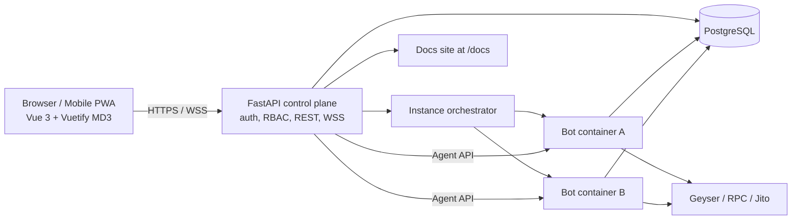
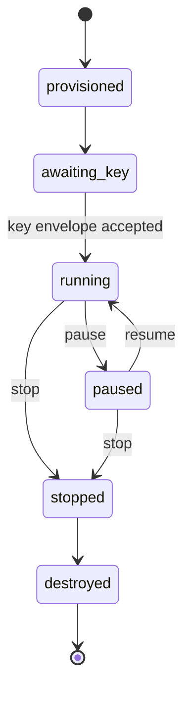
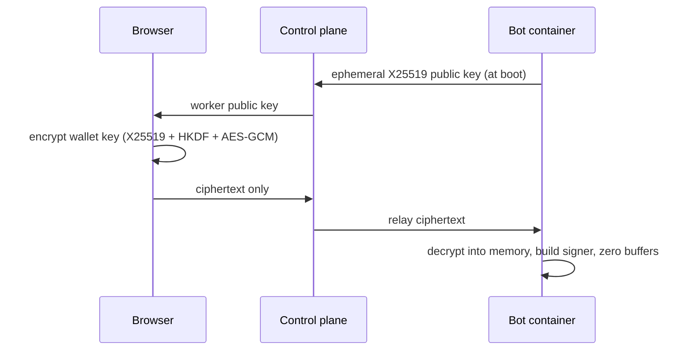

# Web Dashboard & Hosted User Instance Architecture

The Web Dashboard (FEAT-10) is the planned hosted, multi-tenant control portal for `pumpfun-trading`. It follows **Material Design 3**, works in desktop browsers, and installs on mobile as a Progressive Web App (PWA). Users get real-time control, portfolio analytics, hot configuration changes, and embedded documentation without terminal access or shell permissions.

> **Status: planned, gated on funding.** The terminal UI (`pumpbot`, see [`TERMINAL-UI.md`](TERMINAL-UI.md)) must first generate the income that pays for this work. Phase 6 starts only after the funding gate in [`dev/RELEASE-GATE.md` §3.7](dev/RELEASE-GATE.md#37-funding-gate-for-the-web-ui) passes, and the terminal UI stays the primary interface until the deprecation gate in Sprint 35. Architecture decisions are recorded in [`dev/ARCHITECTURE-DECISIONS.md`](../../dev/ARCHITECTURE-DECISIONS.md); the feature breakdown (FEAT-31…FEAT-37) is in [`dev/PROPOSED-FEATURES.md`](dev/PROPOSED-FEATURES.md); the schedule is Phase 6 in [`dev/TODO.md`](dev/TODO.md).

---

## 1. System Architecture & Hosted Topology

The browser talks only to the **FastAPI control plane**. The control plane owns authentication, tenancy, the database, and orchestration. Each tenant's bot runs in **its own container** and is driven through a small internal **Agent API**. The trading path (Geyser → strategy → Jito/RPC) never passes through the web tier.

| Component | Technology | Responsibility |
|---|---|---|
| Frontend | Vue 3 + TypeScript + Vite, Vuetify 3 (`md3` blueprint), Pinia, `vite-plugin-pwa`, `lightweight-charts` | Views, forms, charts; no trading logic |
| Control plane | FastAPI + Uvicorn, Pydantic v2, SQLAlchemy 2.0 async | Auth, tenancy, persistence, event fan-out, serves PWA and `/docs` |
| Orchestrator | Docker Engine API (Kubernetes later) | Creates/destroys one bot container per tenant instance with quotas |
| Agent API | `aiohttp.web` inside each bot container | Commands and typed event stream, private network only |
| Bot runtime | `pumpfun_trading` (`TradingBot` + `BotController`) | Trading, risk, execution — unchanged decision logic |
| Database | PostgreSQL (hosted), SQLite (local/dev) | Users, sessions, instances, ledger, audit, equity |

### Multi-Tenant Isolation
* **One container per tenant instance** with CPU/memory limits, a read-only root filesystem, a non-root user, and no host environment variables.
* Bot containers sit on a **private network** reachable only by the control plane; Agent API calls carry a per-instance token issued by the orchestrator.
* Every database row is scoped by `tenant_id`; the control plane enforces scoping on every query and the RBAC role on every mutation.
* Per-tenant quotas (instances, maximum position size, daily loss cap) are checked before a config change reaches the bot's own risk pipeline.

---

## 2. User Credential Security (Zero-Knowledge Key Ingestion)

The Web UI guarantees that a user's wallet private key is never readable by the server and never written to disk.

### A. No Host Environment Exposure
* Hosted users never touch `.env` files, host environment variables, shells, or terminal logs.

### B. Key Envelope Flow

* **Strict non-persistence:** keys are never written to the database, log files, or disk.
* **Session eviction:** stopping or destroying an instance discards the in-memory signer; a container restart requires key re-entry.
* **Future options:** HSM / MPC signing for institutional clusters.

---

## 3. Lifecycle Controls & Hot Configuration

### A. Lifecycle Operations
* **Start:** provisions the instance and begins candidate monitoring once a key is loaded.
* **Pause / Resume:** stops new buys while existing positions, trailing stops, and exits keep being managed (`PAUSED` lifecycle state).
* **Halt:** set automatically by the circuit breaker (`HALTED` state); requires an explicit operator reset.
* **Emergency Stop:** cancels pending buys and stops candidate ingestion.
* **Panic Liquidate All (`sell_all`):** submits high-priority exits for 100% of open positions, with a confirmation dialog.

### B. Hot Configuration
Changes are sent as a validated `ConfigPatch`. Each patch is checked against tenant quotas, passed through the bot's unified risk pipeline, written to the audit log, and versioned (FEAT-38) so it can be diffed and rolled back.
* Adjust base buy allocation, take-profit tiers, trailing-stop retracement, anti-rug thresholds.
* Switch between `conservative`, `balanced`, and `aggressive` presets without restarting.

---

## 4. Draft API Outline

All public endpoints are served by the control plane under `/api/v1`. The OpenAPI schema generates the TypeScript client used by the PWA.

### A. Authentication & Authorization
* OIDC / JWT sessions (short-lived access token, refresh token in an `HttpOnly` cookie) with WebAuthn passkeys as second factor.
* Roles: `owner` (full control, key load), `operator` (controls and config), `viewer` (read-only).
* All mutating endpoints are rate-limited and recorded in `audit_events`.

### B. REST Endpoints (draft)

| Method | Path | Role | Purpose |
|---|---|---|---|
| `POST` | `/auth/login`, `/auth/refresh`, `/auth/logout` | any | Session management |
| `GET` | `/instances` | viewer | List the tenant's bot instances |
| `POST` | `/instances` | owner | Provision a new instance |
| `DELETE` | `/instances/{id}` | owner | Destroy an instance |
| `GET` | `/instances/{id}/status` | viewer | `BotStatusView` snapshot |
| `GET` | `/instances/{id}/positions` | viewer | Open positions |
| `GET` | `/instances/{id}/trades?from=&to=` | viewer | Trade ledger (paged) |
| `GET` | `/instances/{id}/equity?range=` | viewer | Equity series |
| `POST` | `/instances/{id}/commands/{pause\|resume\|stop\|sell_all}` | operator | Lifecycle commands |
| `GET` / `PATCH` | `/instances/{id}/config` | viewer / operator | Read / apply `ConfigPatch` |
| `GET` | `/instances/{id}/config/versions` | viewer | Config history (FEAT-38) |
| `GET` | `/instances/{id}/key/public` | owner | Worker X25519 public key |
| `POST` | `/instances/{id}/key/envelope` | owner | Relay encrypted key |
| `GET` | `/instances/{id}/audit?query=` | viewer | Audit search |

### C. WebSocket Stream
* `WSS /api/v1/instances/{id}/events` streams typed events from the bot's event bus: `status`, `position_opened`, `position_updated`, `trade_filled`, `circuit_breaker`, `health`, `alert`.
* The control plane authenticates the socket, subscribes to the instance's Agent API `/events`, and fans out to every connected client of that tenant.

---

## 5. Dashboard Views (Material Design 3)

| View | Content |
|---|---|
| **Overview** | Equity curve, daily PnL vs. circuit-breaker gauge, health chips (Geyser, RPC, Jito), lifecycle state |
| **Positions** | MD3 cards with bonding-curve progress, unrealized ROI, trailing-stop distance, per-position sell |
| **Trades** | Paged ledger table with filters and CSV export (FEAT-43) |
| **Controls** | Pause / resume / stop / sell-all with confirmation dialogs |
| **Settings** | Validated config forms grouped by Strategy and Risk, each field linked to its docs anchor |
| **Audit** | Search over audit events and state transitions |

Design rules:
* Responsive navigation: bottom navigation bar on phones, navigation rail on tablets, navigation drawer on desktop.
* Usable down to 360 px width; touch targets ≥ 48 px.
* Light/dark theme follows the system; MD3 colour tokens are shared with the documentation site theme.
* Installable PWA with an offline shell; live data requires a connection.

---

## 6. Embedded Documentation

The documentation is built as a static Material-styled site (Zensical, with Material for MkDocs as fallback) and served by the control plane at `/docs`. See [`dev/DOCUMENTATION-PLAN.md`](dev/DOCUMENTATION-PLAN.md).
* **Context-aware help:** settings fields and tooltips deep-link to the matching sections of [`STRATEGY.md`](STRATEGY.md) and [`RISK.md`](RISK.md).
* **Full-text search** comes from the docs site itself.

---

## 7. Terminal UI Deprecation & Transition Roadmap

| Phase | Sprints | Terminal UI (`pumpbot`) | Web UI |
|---|---|---|---|
| **Now: Self-funding** | 24A–24D (Terminal Income Track) | Sole interface; must reach net profit | Not started |
| **Platform refactor** | 25–31 | Primary income path (runtime refactors released between canary windows) | Prerequisites built (typed state, `BotController`, event bus, database, docs site) |
| **Funding gate** | – | Net profit covers the Phase 6 budget ([`RELEASE-GATE.md` §3.7](dev/RELEASE-GATE.md#37-funding-gate-for-the-web-ui)) | Go / no-go for Phase 6 |
| **Control plane** | 32 | Primary | Agent API + FastAPI control plane, single tenant, dry-run |
| **PWA MVP / dual run** | 33 | Primary; Web UI used alongside | Vuetify MD3 dashboard: overview, positions, trades, controls, settings |
| **Hosted multi-tenant** | 34 | Operator diagnostics | Orchestrator, container per tenant, zero-knowledge keys |
| **Deprecation gate** | 35 | Maintenance only | Primary control portal once every operator workflow has parity |
