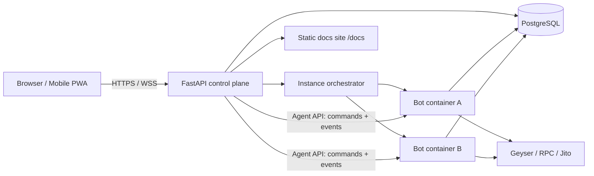

# Architecture Decision Records

This file records the architecture decisions for the hosted Web UI platform (FEAT-10, re-scoped to FEAT-31…37 in [`PROPOSED-FEATURES.md`](PROPOSED-FEATURES.md)), the persistence strategy, documentation tooling, and the test suite layout. Delivery is scheduled in [`TODO.md`](TODO.md) (Phase 5: Sprints 25–31, Phase 6: Sprints 32–35). The user-facing specification is [`docs/WEB-UI.md`](../WEB-UI.md).

Each record uses the format **Context → Decision → Alternatives considered → Consequences**. Status values: `Accepted`, `Proposed`, `Superseded`.

| ADR | Title | Status |
|---|---|---|
| [ADR-001](#adr-001-fastapi-for-the-web-backend) | FastAPI for the web backend | Accepted |
| [ADR-002](#adr-002-separate-control-plane-with-an-aiohttp-agent-api) | Separate control plane with an aiohttp Agent API | Accepted |
| [ADR-003](#adr-003-one-container-per-tenant) | One container per tenant | Accepted |
| [ADR-004](#adr-004-zero-knowledge-key-ingestion) | Zero-knowledge key ingestion | Accepted |
| [ADR-005](#adr-005-postgresql-hosted-and-sqlite-local-via-sqlalchemyalembic) | PostgreSQL (hosted) and SQLite (local) via SQLAlchemy/Alembic | Accepted |
| [ADR-006](#adr-006-vue-3--vuetify-md3-pwa-frontend) | Vue 3 + Vuetify MD3 PWA frontend | Accepted |
| [ADR-007](#adr-007-zensical-docs-site-with-material-for-mkdocs-fallback) | Zensical docs site with Material for MkDocs fallback | Accepted |
| [ADR-008](#adr-008-test-suite-mirrors-the-source-tree) | Test suite mirrors the source tree | Accepted |

---

## Context: Codebase Findings

These findings (from the Phase 5 review) motivate the decisions below.

| # | Finding | Evidence | Class |
|---|---|---|---|
| R1 | Runtime monolith regrew; TODO item 25 "lightweight facade" claim is no longer true | `bot/run.py` ~3,770 lines (`__init__` ~500 lines, `_sell_token_locked`, stream handlers, WebSocket loop) | Required |
| R2 | No typed read-model; UI and persistence read private attributes | `storage/status.py::build_status_snapshot` uses `getattr(bot, "_…")`; ~90 `getattr` calls outside tests | Required |
| R3 | No pause/halt lifecycle state | `bot/lifecycle.py` has only `IDLE`, `MONITORING`, `BUYING`, `HOLDING`, `SELLING`, `SHUTDOWN` | Required |
| R4 | No command/control interface or event bus | `ui/dashboard.py` renders snapshot dicts; `_render_loop` lives in `run.py` | Required |
| R5 | Hot config has no validated patch path through the risk pipeline | `TradingBot.config` setter in `run.py` | Required |
| R6 | WebSocket ingestion lives in `bot/`, breaking the `streams/` boundary | `_run_websocket_stream` in `run.py` | Suggested |
| R7 | `sdk/execution.py` mixes Pump.fun, Raydium and confirmation logic | ~1,650 lines | Suggested |
| R8 | Packaging hygiene | unused `requests`; `Framework :: Django` classifier; no extras; nox only on 3.14 | Required (small) |
| R9 | Repo hygiene | root `bot.log`, `events.jsonl`, `cov.json`, `coverage.xml`; stale `__pycache__` | Suggested |
| R10 | Unstructured test suite (detail: T1–T9 in [`TESTING.md`](TESTING.md)) | 65 flat files, ~25k lines, 581 tests | Required |
| R11 | No real Yellowstone gRPC transport | `streams/geyser.py:600` fails fast without `custom_transport` | Suggested (FEAT-39) |
| R12 | JSON/JSONL-only persistence; ledger inlined in snapshot | `storage/status.py` | Required for hosted |

---

## Target Topology

The browser talks only to the control plane. The control plane owns auth, the database and orchestration, and drives each tenant bot through its Agent API. Bots write ledger, audit and equity data to the database and talk to Solana infrastructure directly; the trading path never passes through the web tier.

---

## ADR-001: FastAPI for the Web Backend

* **Status:** Accepted
* **Context:** The original FEAT-10 proposal assumed FastAPI. We re-checked it against the hosted multi-tenant requirement, the async runtime, and the need for a typed client for the Vue frontend.
* **Decision:** Use **FastAPI** served by **Uvicorn** for the control plane.
  - Native `asyncio`, matching the bot runtime.
  - Pydantic v2 models shared with the bot's typed read-model (`bot/state_model.py`, Sprint 29).
  - Automatic OpenAPI schema → generated TypeScript client for the PWA.
  - First-class WebSockets for live event fan-out.
  - Mature ecosystem for OIDC/JWT, rate limiting and observability.
* **Alternatives considered:**
  - **Litestar** — technically strong (msgspec, DI, built-in channels) but smaller ecosystem and fewer operators familiar with it. Viable fallback.
  - **Django + Channels** — heavy, sync-first ORM, poor fit for the asyncio runtime.
  - **aiohttp for everything** — already a dependency, but no schema/OpenAPI generation or validation story; kept for the internal Agent API only (ADR-002).
* **Consequences:** FastAPI, Uvicorn and Pydantic are added only via the `[web]` extra so the trading image stays lean (Sprint 25).

## ADR-002: Separate Control Plane with an aiohttp Agent API

* **Status:** Accepted
* **Context:** The bot's event loop is latency-critical (slot-level entries/exits, Jito bundle polling). Web traffic, auth, and DB queries must never stall it.
* **Decision:**
  - The bot **never hosts public web traffic**.
  - Each bot exposes a small internal **Agent API** on `aiohttp.web` (already a runtime dependency): `GET /health`, `GET /status`, `POST /commands/{pause,resume,stop,sell_all}`, `POST /config`, `POST /keys/envelope`, `GET /events` (WebSocket).
  - Commands call `bot/control.py::BotController`; events come from `ops/bus.py`. No decision logic in the agent layer.
  - The FastAPI control plane holds auth, tenancy, the database, and browser fan-out.
* **Alternatives considered:** Embedding Uvicorn inside the bot process (simplest, but web load shares the trading loop and a web bug can crash trading).
* **Consequences:** One extra network hop on the **control path only**; the trading path is untouched. Requires Sprint 29 prerequisites (typed state, `PAUSED`/`HALTED`, `BotController`, event bus).

## ADR-003: One Container per Tenant

* **Status:** Accepted
* **Context:** Hosted users each run their own wallet and strategy. Key material, memory, and resource usage must be isolated.
* **Decision:**
  - An orchestrator service creates and destroys one bot container per tenant instance, behind an `InstanceBackend` protocol (Docker Engine API first, Kubernetes later).
  - Containers get CPU/memory limits, a read-only root filesystem, no host environment, a non-root user, and a private network reachable only by the control plane.
  - Agent API calls are authenticated with a per-instance token issued at provisioning.
* **Alternatives considered:** Process per tenant under a supervisor — simpler operations but weaker memory/key isolation and no hard resource limits.
* **Consequences:** Requires a container image (FEAT-46) and an orchestrator (FEAT-34, Sprint 34). Operator mode can still run a single bot without Docker.

## ADR-004: Zero-Knowledge Key Ingestion

* **Status:** Accepted
* **Context:** AGENTS.md requires that hosted users' private keys live only in volatile memory and are never written to disk (Volatile Key Erasure norm).
* **Decision:**
  1. On boot, each worker generates an ephemeral **X25519** key pair and publishes its public key through the Agent API.
  2. The browser encrypts the wallet key to that public key (X25519 + HKDF + AES-GCM, or a libsodium sealed box).
  3. The control plane relays **ciphertext only**; it cannot decrypt.
  4. The worker decrypts into a `bytearray`, builds the signer, then zeroes all buffers.
  5. Keys never touch the database, logs, or disk; container restart means key re-entry.
* **Alternatives considered:** Server-side envelope encryption with a KMS (control plane could decrypt — rejected); HSM / MPC (kept as a future institutional option).
* **Consequences:** Log redaction tests are mandatory; tenant isolation tests in Sprint 34 assert no key material in logs, DB, or disk.

## ADR-005: PostgreSQL (Hosted) and SQLite (Local) via SQLAlchemy/Alembic

* **Status:** Accepted
* **Context:** Today all state is JSON/JSONL files (`storage/status.py`, `audit.jsonl`, `events.jsonl`, replay datasets). The trade ledger is inlined in the status snapshot.
* **Decision — do we need a database?**

| Question | Answer |
|---|---|
| Needed **now**? | **No.** The single-operator terminal mode works with files and must keep working without a DB. |
| When does it become **required**? | **With the hosted Web UI** (Sprint 30, before Phase 6): multi-tenant auth, sessions, instance state, and cross-instance queries are not viable on files. |
| Engine | **PostgreSQL** when hosted (TimescaleDB optional for time series); **SQLite (WAL)** for operator/dev mode. |
| Access layer | **SQLAlchemy 2.0 async** + **Alembic** migrations, one code path for both engines, selected by database URL. Installed via the `[db]` extra. |

* **What is stored where:**

| Data | Store |
|---|---|
| `tenants`, `users`, `sessions`, `instances` | Database (control plane) |
| `config_versions` (FEAT-38) | Database |
| `positions`, `trades` (ledger) | Database (bot writes), JSONL dual-write during migration |
| `audit_events`, `alerts` | Database (+ existing rotated JSONL sinks during migration) |
| `equity_snapshots`, latency series | Database; TimescaleDB hypertables optional |
| Replay datasets (`.jsonl`, `.jsonl.gz`) | Files (unchanged); Parquet + DuckDB proposed (FEAT-47) |
| Private keys | **Never stored** (ADR-004) |

* **Alternatives considered:** Postgres only (heavier for local runs); keep JSONL (not viable for multi-tenant).
* **Consequences:** DB tests run on SQLite in-memory by default with an opt-in `postgres` marker.

## ADR-006: Vue 3 + Vuetify MD3 PWA Frontend

* **Status:** Accepted
* **Context:** The Web UI must follow **Material Design 3**, look attractive, and work in desktop browsers and on mobile. The previous spec named React/Tailwind, which has no first-class MD3 component set.
* **Decision:**
  - **Vue 3 + TypeScript + Vite**, **Vuetify 3** with the `md3` blueprint, **Pinia** for state.
  - OpenAPI-generated API client (ADR-001).
  - `vite-plugin-pwa` for installability and an offline shell.
  - TradingView `lightweight-charts` for equity and price charts.
  - Responsive layout down to 360 px; light/dark follows the system; MD3 colour tokens shared with the docs theme (ADR-007).
  - Tests: Vitest (components) and Playwright (desktop + mobile smoke), mirrored under `web/`.
* **Alternatives considered:** Angular Material (most faithful MD3, heavier framework); NiceGUI (Python-only, Quasar is not true MD3, weaker mobile); Flutter Web (native MD3, large bundles, poor docs embedding).
* **Consequences:** Adds a Node toolchain under `web/`; the Python package stays pure Python.

## ADR-007: Zensical Docs Site with Material for MkDocs Fallback

* **Status:** Accepted
* **Context:** Docs must be published as a Material-styled site and embedded in the Web UI. Material for MkDocs is in maintenance mode (security fixes until its announced end-of-life); **Zensical**, from the same team, is its successor and reads `mkdocs.yml` natively.
* **Decision:** Author against a Material-compatible `mkdocs.yml`, build with **Zensical**, and keep Material for MkDocs as a fallback until EOL. The static output is served by the control plane at `/docs`, with deep links from config tooltips. This replaces the earlier "in-app Markdown renderer" idea. Details: [`DOCUMENTATION-PLAN.md`](DOCUMENTATION-PLAN.md).
* **Alternatives considered:** Sphinx (strong API docs, weaker Material look); in-app Markdown rendering (duplicates search/nav, no static build).
* **Consequences:** Avoid exotic plugins Zensical does not yet support; the API reference uses mkdocstrings.

## ADR-008: Test Suite Mirrors the Source Tree

* **Status:** Accepted
* **Context:** The suite is 65 flat files with coverage-padding files, duplicated setup, and 24 files coupled to `bot.run.TradingBot` privates (findings T1–T9 in [`TESTING.md`](TESTING.md)). It must act as the safety net for the Sprint 28 `run.py` decomposition.
* **Decision:**
  - Tests stay inside the package at `pumpfun_trading/tests/` (as AGENTS.md requires) but are excluded from the wheel.
  - Layout: `unit/` mirrors the source 1:1, `integration/` holds cross-component flows, `property/` holds Hypothesis tests, `support/` holds shared factories, fakes and payload builders.
  - Regression tests live beside the module they guard and carry `@pytest.mark.regression("BUG-xx")`.
  - Coverage-padding files are dissolved into module tests.
  - The restructure (Sprints 26–27) lands **before** the run.py split (Sprint 28).
* **Alternatives considered:** A top-level `tests/` directory (more churn in AGENTS.md, nox and coverage config — rejected).
* **Consequences:** Collected test count and per-module coverage are compared before and after every migration batch; `fail_under` is never lowered.
