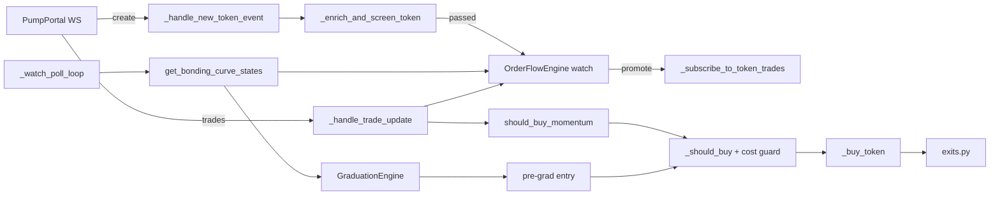

# Strategy pivot of pumpfun-trading v0.3.0 (history)

> [!NOTE]
> **2026-10-31: this page is history.** §1–§5 are pumpfun-trading's plan for
> v0.3.0 (confirmed momentum and pre-graduation on the bonding curve), kept as
> written; every lane in it was measured NO-GO and none was ported. The
> results log that was §6 is now [`RESULTS.md`](RESULTS.md), and the lanes
> that trade today are in [`docs/STRATEGY.md`](../STRATEGY.md). "Stage 0"
> here means the paper stage, now Stage 1
> ([`RELEASE-GATE.md` §3](RELEASE-GATE.md#3-live-capital-gate)).

Branch: `strategy-pivot-momentum`. Sprints: **Phase 4c, 24E–24I** in [`TODO.md`](../archive/pumpfun-trading/dev/TODO.md#phase-4c-strategy-pivot-income-track-ahead-of-phase-5). Features: FEAT-51, FEAT-52, FEAT-53 (implemented, [`FEATURES.md` §33–35](../archive/pumpfun-trading/FEATURES.md)) and FEAT-54 ([`PROPOSED-FEATURES.md`](../archive/pumpfun-trading/dev/PROPOSED-FEATURES.md#2-terminal-income-track-income)).

> **Since 2026-10-28** this log continues in trading-pump, the trading-core module that replaced pumpbot. §1–§6.13 are pumpbot's record, kept as written: their sprint, feature and runbook links go to the [archived documents](../archive/pumpfun-trading/INDEX.md). New results start at [§6.14](RESULTS.md#614-feat-76-on-the-new-stack-the-rc8-graduations-replayed-through-trading-core-2026-10-28); the current strategy is in [`docs/STRATEGY.md`](../STRATEGY.md).

This document records why the bot stops buying at the create event, what it does instead, what that costs, and the numbers each sprint must hit before live capital is risked. It is not a promise of profit: the strategy is a bet that is tested cheaply first (replay, then paper), and the go/no-go rules below decide whether it ships.

---

## 1. Evidence: why launch sniping loses

| Run | Build | Result | Source |
|---|---|---|---|
| Stage 0 paper pilot | v0.2.1 | **FAIL** at T + 1 h 33 min: daily breaker locked buying after 34 positions, net −0.022975 SOL, 2 of 34 profitable | [`releases/v0.2.1-stage0.md`](runs/v0.2.1-stage0.md) |
| 24 h capture run (paper) | v0.2.3 | **−0.579 SOL net over 1,675 positions, 10.3% profitable** | [`DONE.md` Sprint 24A](DONE.md#sprint-24a-paper-pilot--live-canary--see-release-gatemd-3-and-runbookmd) |
| Replay of that capture | v0.2.3+ | Exit timing barely changes the result; `min_holder_count: 6` was the only filter net positive in both halves of the day (+0.026 SOL over ~229 positions) | same |
| Cost split at 0.01 SOL | v0.2.3 | Jito tips are **83%** of the separately listed costs (fee, priority fee, tip, rent) | same |

**Diagnosis.** The losses come from *buying tokens no one else buys*. At the create event the bot has no information about follow-on demand, so most positions are dead on arrival; no exit rule can save a position that has no buyers after it. The fix has to be on the entry side.

---

## 2. The new strategy

`entry_mode` (new config key) selects the entry pipeline:

| `entry_mode` | Pipeline | Use |
|---|---|---|
| `"launch"` (default) | create → screen → **buy** | Unchanged legacy behaviour; golden replay pinned to it |
| `"confirmed"` | create → screen → **watch** → RPC curve poll → trade subscription → **confirm** → buy | `momentum` preset, canary and capture configs |

### 2.1 Lane 1 — confirmed momentum (FEAT-51, FEAT-52; P0)
1. **Watch, don't buy.** A create event that passes the Pump.fun (BUG-108), mayhem and screening checks goes onto a bounded watch list (`watch_ttl_seconds`, `watch_max_mints`; oldest evicted). Mints already traded are never watched again (BUG-109).
2. **Observe cheaply.** One task batch-reads all watched curves with `getMultipleAccounts` (≤ 100 per call) every `watch_poll_interval_seconds`. Curves that fail the BUG-104 sanity or BUG-108 owner checks are dropped with a counted reason.
3. **Promote on growth.** Only mints whose real SOL reserves grew by at least `watch_promote_min_sol_growth` since they were watched get a (billed) PumpPortal trade subscription, at most `watch_max_trade_subscriptions` at once. Expired or rejected mints are unsubscribed (BUG-120 rule).
4. **Confirm.** Buy only when all hold:
   - token age within [`momentum_min_token_age_seconds`, `momentum_max_token_age_seconds`]
   - market cap within [`min_market_cap_sol`, `momentum_max_market_cap_sol`]
   - `OrderFlowEngine` shows enough distinct non-creator buyers, net inflow, buy ratio and z-score (`momentum_min_*` keys)
   - the unified risk pipeline (`_should_buy`) and the cost guard pass
5. **Exit for momentum entries.** Full exit if no buy of at least `stagnant_min_buy_sol` arrives within `stagnant_timeout_seconds`; once the gain reaches `breakeven_ratchet_activation_pct`, the floor moves to entry + `breakeven_buffer_pct`; tiers, trailing stop and the pre-graduation exit stay.

### 2.2 Lane 2 — pre-graduation (FEAT-53; P1)
The same poller feeds `GraduationEngine`, so the existing `evaluate_pre_graduation_harvesting_entry` works on the WebSocket deployment without Geyser (FEAT-39). Curves at 75–88% progress with rising acceleration may be bought; tranche exits sell before `complete`. The lane stays **off** in the canary until a ≥ 72 h paper pilot shows it positive ([`RELEASE-GATE.md` §3.5](../archive/pumpfun-trading/dev/RELEASE-GATE.md#35-features-that-must-stay-off-until-proven)).

### 2.3 What stays out
FEAT-39 Yellowstone gRPC, arbitrage, back-running, Raydium sniping and copy trading as its own entry lane stay off as in `RELEASE-GATE.md` §3.5. Launch sniping is not removed; it stays available as `entry_mode: "launch"`.

### 2.4 Lane 3 — reviewed smart wallets (FEAT-54; P2)
Sprint 24I, after 24H. Wallets with a strong record (for example ≥ 100 buys at a 75% win rate) are **candidates, not signals**. They are never added to live copy trading automatically, because:
- win rate is not net profit: a few large losses can outweigh many small wins;
- scanning thousands of wallets always finds some that were lucky;
- many high scorers are launch-slot snipers, bundle, dev or insider wallets, or wash bots;
- our copy fills one or more slots later at a higher curve price, so the wallet's result is not ours;
- a wallet that is known to be copied can sell into its copiers.

The lane works in five steps:
1. **Discover offline.** Score wallets from captures on net SOL after modelled costs, distinct tokens, average and worst return, and hold time. Reject launch-slot buyers, the creator's funding cluster and wash patterns.
2. **Simulate our copy.** Replay their buys with our delay (`copy_entry_delay_slots`) and `engines/costs.py`. Keep a wallet only if **our** copied PnL is net positive on a later capture that was not used to find it.
3. **Review.** Survivors go to a candidate file; an operator moves them to the tracked list.
4. **Use as evidence.** A tracked wallet's buy on a watched mint counts toward the momentum check (`momentum_tracked_wallet_bonus`, default 0 = off). It never bypasses the band, `_should_buy` or the cost guard.
5. **Drop automatically.** A wallet is disabled when its rolling net PnL over its last influenced positions goes below zero, and its SOL at risk is capped.

A stand-alone `strategy=copy` lane (needs the billed `subscribeAccountTrade` feed) is optional and comes only after steps 1–5 are shown positive.

---

## 3. Cost model at 0.02 SOL

Modelled by `engines/costs.py::ReplayCostModel` (same model as paper mode). Round trip = one buy + one closing full exit (rent refunded, BUG-96).

| Item | Per leg | Round trip | Share at 0.01 SOL | Share at 0.02 SOL |
|---|---|---|---|---|
| Pump.fun fee (125 bps) | 1.25% of size | 2.5% of size | 2.5% | 2.5% |
| Base network fee | 5,000 lamports | 0.00001 SOL | 0.1% | 0.05% |
| Jito tip, 100k lamports (current) | 0.0001 SOL | 0.0002 SOL | 2.0% | 1.0% |
| Jito tip, 25k lamports | 0.000025 SOL | 0.00005 SOL | 0.5% | 0.25% |
| Jito tip, 0 (direct RPC) | 0 | 0 | 0% | 0% |
| ATA rent (1,513,840 lamports) | paid / refunded | 0 if closed | 0% | 0% |

Price impact and entry latency come on top and are modelled by `paper_entry_delay_seconds` / `paper_entry_slippage_bps`. Decisions:

- **Stage 1 size 0.02 SOL**: one 2× step from the 0.01 canary, within the `RELEASE-GATE.md` §3.1 scaling rule.
- **Tip experiment** on paper/landing: 0 / 25k / 50k lamports; the canary uses the lowest tip that keeps landing rates acceptable.
- **Cost guard** (`max_entry_cost_share_pct`, default 0.10): refuse a buy whose modelled fixed round-trip costs (fees, tip, rent not refunded) exceed that share of the position, so paper and live share one rule.

---

## 4. Sprints and priorities (Phase 4c)

| Sprint | Priority | Goal | Money path? | Exit gate |
|---|---|---|---|---|
| **24E** | P0 – first, no code risk | Branch, this document, TODO / FEAT / gate docs, tip experiment plan | No (docs/config) | Docs reviewed |
| **24F** | P0 – unlocks everything | Watch list, batch curve poller, promotion and subscription budget (FEAT-51) | Entry gate (no buys in confirmed mode yet) | Paper run: watch list bounded, message count ≤ budget, no loop stalls |
| **24G** | P0 – the income change | Momentum confirmation entry, exit tuning, cost guard, replay support, tuning on the 24 h capture (FEAT-52) | Yes | Replay net > 0 on a second, unseen capture, then 72 h Stage 0 net > 0 |
| **24H** | P1 – second lane | Pre-graduation lane via the poller (FEAT-53), then Stage 1 canary at 0.02 SOL with the lower tip | Yes | Lane positive in 72 h paper; Stage 1: ≥ 100 trades, net > 0, reconciled |
| **24I** | P2 – after 24H | Smart-wallet discovery, copy simulation, reviewed list used as momentum evidence (FEAT-54) | Entry evidence only (no copy lane) | Our simulated copy PnL net > 0 on an unseen capture; momentum + wallet evidence beats momentum alone in replay and 72 h paper |

**Why this order**
1. **24E** writes down the evidence and the rules before code changes, at no risk.
2. **24F** comes before 24G because no confirmation is possible without cheap data on candidates; it also keeps PumpPortal message costs bounded (BUG-120).
3. **24G** is the change expected to flip net PnL: it removes the main cause of the losses (no follow-on buyers).
4. **24H** adds trade count only after the main lane is shown positive, and stays gated by `RELEASE-GATE.md` §3.5.
5. **24I** comes last because it needs two captures with trade flow for watched mints (one to find wallets, one to test them) and a working momentum check to plug the evidence into. It is not part of the v0.3.0 go/no-go.

---

## 5. Go / no-go

- Thresholds are **starting points**. Final values go into `canary.json` only after they come out net positive on a capture that was **not** used to pick them (train/test split, as for `min_holder_count`).
- If confirmed momentum is not net positive in replay on the unseen capture, **do not run Stage 0**: re-tune or narrow the band, and record the result in §6.
- Every money-path sprint goes back through Stage 0 ([`RELEASE-GATE.md` §3.1](../archive/pumpfun-trading/dev/RELEASE-GATE.md#31-stages)).
- v0.3.0 is a MINOR release (new config keys) and is tagged only after 24G passes Stage 0.
- Judge each lane on its own with `pumpfun-audit pnl --group-by strategy` (`momentum`, `pre_graduation`, `launch`, later `copy`).
- From rc.4 a paper run's go / no-go is the pre-registered rule in `configs/verdict_rules.json`, applied per lane with `pumpfun-audit verdict --strategy <lane>` (FEAT-67): adjusted for a 50 bps exit haircut and a 25,000-lamport tip, at least 100 positions, positive overall, in both halves and on at least half the UTC days, positive without the 3 best positions, and the 90% bootstrap interval of the mean per position above zero. Record the rule hash when the run starts; do not change the rule after that.
- Wallet evidence (24I) stays off (`momentum_tracked_wallet_bonus: 0`) unless momentum with it beats momentum without it on an unseen capture and in a 72 h paper run.

### Known risks
- **Paying for exit liquidity:** later entries cost more per token and late buyers often become exit liquidity. Mitigated by the market-cap band, the age window and the buy-flow stagnation exit.
- **Biased capture:** the v0.2.3 capture has trade flow only for mints the bot bought at launch, so tuning on it is partial evidence; the next capture records watched mints too.
- **RPC load:** 300 mints / 100 per call / 2 s ≈ 1.5 req/s through `rpc_pool`, with backoff and a degradation event.
- **Overfitting:** tune on one capture, confirm on a second.

---

## 6. Results log

Moved on 2026-10-31, whole and unedited with its §6.N numbering, to
[`RESULTS.md`](RESULTS.md#6-results-log), where new results are added.
