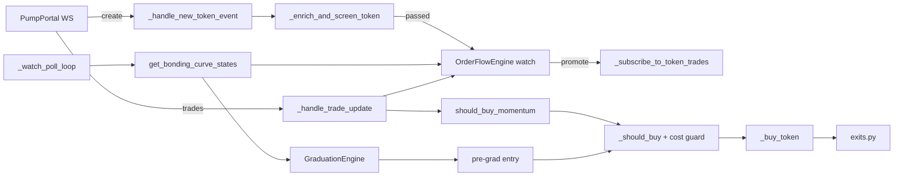

# Strategy Pivot: Confirmed Momentum & Pre-Graduation (v0.3.0)

Branch: `strategy-pivot-momentum`. Sprints: **Phase 4c, 24E–24I** in [`TODO.md`](TODO.md#phase-4c-strategy-pivot-income-track-ahead-of-phase-5). Features: FEAT-51, FEAT-52, FEAT-53, FEAT-54 in [`PROPOSED-FEATURES.md`](PROPOSED-FEATURES.md#2-terminal-income-track-income).

This document records why the bot stops buying at the create event, what it does instead, what that costs, and the numbers each sprint must hit before live capital is risked. It is not a promise of profit: the strategy is a bet that is tested cheaply first (replay, then paper), and the go/no-go rules below decide whether it ships.

---

## 1. Evidence: why launch sniping loses

| Run | Build | Result | Source |
|---|---|---|---|
| Stage 0 paper pilot | v0.2.1 | **FAIL** at T + 1 h 33 min: daily breaker locked buying after 34 positions, net −0.022975 SOL, 2 of 34 profitable | [`releases/v0.2.1-stage0.md`](releases/v0.2.1-stage0.md) |
| 24 h capture run (paper) | v0.2.3 | **−0.579 SOL net over 1,675 positions, 10.3% profitable** | [`TODO.md` Sprint 24A](TODO.md#sprint-24a-paper-pilot--live-canary--see-release-gatemd-3-and-runbookmd) |
| Replay of that capture | v0.2.3+ | Exit timing barely changes the result; `min_holder_count: 6` was the only filter net positive in both halves of the day (+0.026 SOL over ~229 positions) | same |
| Cost split at 0.01 SOL | v0.2.3 | Jito tips are **83%** of the separately listed costs (fee, priority fee, tip, rent) | same |

**Diagnosis.** The losses come from *buying tokens no one else buys*. At the create event the bot has no information about follow-on demand, so most positions are dead on arrival; no exit rule can save a position that has no buyers after it. The fix has to be on the entry side.

---

## 2. The new strategy

`entry_mode` (new config key) selects the entry pipeline:

| `entry_mode` | Pipeline | Use |
|---|---|---|
| `"launch"` (default) | create → screen → **buy** | Unchanged legacy behaviour; golden replay pinned to it |
| `"confirmed"` | create → screen → **watch** → RPC curve poll → trade subscription → **confirm** → buy | `momentum` preset, canary and capture configs |

### 2.1 Lane 1 — confirmed momentum (FEAT-51, FEAT-52; P0)
1. **Watch, don't buy.** A create event that passes the Pump.fun (BUG-108), mayhem and screening checks goes onto a bounded watch list (`watch_ttl_seconds`, `watch_max_mints`; oldest evicted). Mints already traded are never watched again (BUG-109).
2. **Observe cheaply.** One task batch-reads all watched curves with `getMultipleAccounts` (≤ 100 per call) every `watch_poll_interval_seconds`. Curves that fail the BUG-104 sanity or BUG-108 owner checks are dropped with a counted reason.
3. **Promote on growth.** Only mints whose real SOL reserves grew by at least `watch_promote_min_sol_growth` since they were watched get a (billed) PumpPortal trade subscription, at most `watch_max_trade_subscriptions` at once. Expired or rejected mints are unsubscribed (BUG-120 rule).
4. **Confirm.** Buy only when all hold:
   - token age within [`momentum_min_token_age_seconds`, `momentum_max_token_age_seconds`]
   - market cap within [`min_market_cap_sol`, `momentum_max_market_cap_sol`]
   - `OrderFlowEngine` shows enough distinct non-creator buyers, net inflow, buy ratio and z-score (`momentum_min_*` keys)
   - the unified risk pipeline (`_should_buy`) and the cost guard pass
5. **Exit for momentum entries.** Full exit if no buy of at least `stagnant_min_buy_sol` arrives within `stagnant_timeout_seconds`; once the gain reaches `breakeven_ratchet_activation_pct`, the floor moves to entry + `breakeven_buffer_pct`; tiers, trailing stop and the pre-graduation exit stay.

### 2.2 Lane 2 — pre-graduation (FEAT-53; P1)
The same poller feeds `GraduationEngine`, so the existing `evaluate_pre_graduation_harvesting_entry` works on the WebSocket deployment without Geyser (FEAT-39). Curves at 75–88% progress with rising acceleration may be bought; tranche exits sell before `complete`. The lane stays **off** in the canary until a ≥ 72 h paper pilot shows it positive ([`RELEASE-GATE.md` §3.5](RELEASE-GATE.md#35-features-that-must-stay-off-until-proven)).

### 2.3 What stays out
FEAT-39 Yellowstone gRPC, arbitrage, back-running, Raydium sniping and copy trading as its own entry lane stay off as in `RELEASE-GATE.md` §3.5. Launch sniping is not removed; it stays available as `entry_mode: "launch"`.

### 2.4 Lane 3 — reviewed smart wallets (FEAT-54; P2)
Sprint 24I, after 24H. Wallets with a strong record (for example ≥ 100 buys at a 75% win rate) are **candidates, not signals**. They are never added to live copy trading automatically, because:
- win rate is not net profit: a few large losses can outweigh many small wins;
- scanning thousands of wallets always finds some that were lucky;
- many high scorers are launch-slot snipers, bundle, dev or insider wallets, or wash bots;
- our copy fills one or more slots later at a higher curve price, so the wallet's result is not ours;
- a wallet that is known to be copied can sell into its copiers.

The lane works in five steps:
1. **Discover offline.** Score wallets from captures on net SOL after modelled costs, distinct tokens, average and worst return, and hold time. Reject launch-slot buyers, the creator's funding cluster and wash patterns.
2. **Simulate our copy.** Replay their buys with our delay (`copy_entry_delay_slots`) and `engines/costs.py`. Keep a wallet only if **our** copied PnL is net positive on a later capture that was not used to find it.
3. **Review.** Survivors go to a candidate file; an operator moves them to the tracked list.
4. **Use as evidence.** A tracked wallet's buy on a watched mint counts toward the momentum check (`momentum_tracked_wallet_bonus`, default 0 = off). It never bypasses the band, `_should_buy` or the cost guard.
5. **Drop automatically.** A wallet is disabled when its rolling net PnL over its last influenced positions goes below zero, and its SOL at risk is capped.

A stand-alone `strategy=copy` lane (needs the billed `subscribeAccountTrade` feed) is optional and comes only after steps 1–5 are shown positive.

---

## 3. Cost model at 0.02 SOL

Modelled by `engines/costs.py::ReplayCostModel` (same model as paper mode). Round trip = one buy + one closing full exit (rent refunded, BUG-96).

| Item | Per leg | Round trip | Share at 0.01 SOL | Share at 0.02 SOL |
|---|---|---|---|---|
| Pump.fun fee (125 bps) | 1.25% of size | 2.5% of size | 2.5% | 2.5% |
| Base network fee | 5,000 lamports | 0.00001 SOL | 0.1% | 0.05% |
| Jito tip, 100k lamports (current) | 0.0001 SOL | 0.0002 SOL | 2.0% | 1.0% |
| Jito tip, 25k lamports | 0.000025 SOL | 0.00005 SOL | 0.5% | 0.25% |
| Jito tip, 0 (direct RPC) | 0 | 0 | 0% | 0% |
| ATA rent (1,513,840 lamports) | paid / refunded | 0 if closed | 0% | 0% |

Price impact and entry latency come on top and are modelled by `paper_entry_delay_seconds` / `paper_entry_slippage_bps`. Decisions:

- **Stage 1 size 0.02 SOL**: one 2× step from the 0.01 canary, within the `RELEASE-GATE.md` §3.1 scaling rule.
- **Tip experiment** on paper/landing: 0 / 25k / 50k lamports; the canary uses the lowest tip that keeps landing rates acceptable.
- **Cost guard** (`max_entry_cost_share_pct`, default 0.10): refuse a buy whose modelled fixed round-trip costs (fees, tip, rent not refunded) exceed that share of the position, so paper and live share one rule.

---

## 4. Sprints and priorities (Phase 4c)

| Sprint | Priority | Goal | Money path? | Exit gate |
|---|---|---|---|---|
| **24E** | P0 – first, no code risk | Branch, this document, TODO / FEAT / gate docs, tip experiment plan | No (docs/config) | Docs reviewed |
| **24F** | P0 – unlocks everything | Watch list, batch curve poller, promotion and subscription budget (FEAT-51) | Entry gate (no buys in confirmed mode yet) | Paper run: watch list bounded, message count ≤ budget, no loop stalls |
| **24G** | P0 – the income change | Momentum confirmation entry, exit tuning, cost guard, replay support, tuning on the 24 h capture (FEAT-52) | Yes | Replay net > 0 on a second, unseen capture, then 72 h Stage 0 net > 0 |
| **24H** | P1 – second lane | Pre-graduation lane via the poller (FEAT-53), then Stage 1 canary at 0.02 SOL with the lower tip | Yes | Lane positive in 72 h paper; Stage 1: ≥ 100 trades, net > 0, reconciled |
| **24I** | P2 – after 24H | Smart-wallet discovery, copy simulation, reviewed list used as momentum evidence (FEAT-54) | Entry evidence only (no copy lane) | Our simulated copy PnL net > 0 on an unseen capture; momentum + wallet evidence beats momentum alone in replay and 72 h paper |

**Why this order**
1. **24E** writes down the evidence and the rules before code changes, at no risk.
2. **24F** comes before 24G because no confirmation is possible without cheap data on candidates; it also keeps PumpPortal message costs bounded (BUG-120).
3. **24G** is the change expected to flip net PnL: it removes the main cause of the losses (no follow-on buyers).
4. **24H** adds trade count only after the main lane is shown positive, and stays gated by `RELEASE-GATE.md` §3.5.
5. **24I** comes last because it needs two captures with trade flow for watched mints (one to find wallets, one to test them) and a working momentum check to plug the evidence into. It is not part of the v0.3.0 go/no-go.

---

## 5. Go / no-go

- Thresholds are **starting points**. Final values go into `canary.json` only after they come out net positive on a capture that was **not** used to pick them (train/test split, as for `min_holder_count`).
- If confirmed momentum is not net positive in replay on the unseen capture, **do not run Stage 0**: re-tune or narrow the band, and record the result in §6.
- Every money-path sprint goes back through Stage 0 ([`RELEASE-GATE.md` §3.1](RELEASE-GATE.md#31-stages)).
- v0.3.0 is a MINOR release (new config keys) and is tagged only after 24G passes Stage 0.
- Judge each lane on its own with `pumpfun-audit pnl --group-by strategy` (`momentum`, `pre_graduation`, `launch`, later `copy`).
- Wallet evidence (24I) stays off (`momentum_tracked_wallet_bonus: 0`) unless momentum with it beats momentum without it on an unseen capture and in a 72 h paper run.

### Known risks
- **Paying for exit liquidity:** later entries cost more per token and late buyers often become exit liquidity. Mitigated by the market-cap band, the age window and the buy-flow stagnation exit.
- **Biased capture:** the v0.2.3 capture has trade flow only for mints the bot bought at launch, so tuning on it is partial evidence; the next capture records watched mints too.
- **RPC load:** 300 mints / 100 per call / 2 s ≈ 1.5 req/s through `rpc_pool`, with backoff and a degradation event.
- **Overfitting:** tune on one capture, confirm on a second.

---

## 6. Results log

| Date | Data | Lane | Config | Positions | Net SOL | Win rate | Verdict |
|---|---|---|---|---|---|---|---|
| 2026-10-18 | v0.2.3 24 h capture | launch | v0.2.3 canary | 1,675 | −0.579 | 10.3% | baseline (FAIL) |
| 2026-10-18 | same, 1st half (tuning) | momentum | `momentum` preset defaults | 21 | +0.008 | 66.7% | — |
| 2026-10-18 | same, 2nd half (held out) | momentum | `momentum` preset defaults | 19 | −0.022 | 36.8% | defaults not positive out of sample |
| 2026-10-18 | same, 1st half (tuning) | momentum | `configs/canary.json` | 62 | +0.086 | 54.8% | best of 162-point grid |
| 2026-10-18 | same, 2nd half (held out) | momentum | `configs/canary.json` | 70 | +0.023 | 41.4% | positive out of sample |
| 2026-10-18 | full 24 h | momentum | `configs/canary.json`, tip 25k | 132 | +0.132 | 49.2% | replay PASS (provisional) |
| 2026-10-19 | v0.3.0-rc.1 capture, 12.7 h (paper) | momentum | `configs/capture.json` | 65 | −0.100 | 21.5% | **paper FAIL** |
| 2026-10-19 | same, replay (rc.1 engine) | momentum | `configs/canary.json`, tip 0 | 62 | −0.084 | — | **replay NO-GO**; parity GAP +0.016 (allowed ±0.010) |
| 2026-10-19 | same, 13.1 h, replay (BUG-121 fix) | momentum | `configs/canary.json`, tip 0 | 63 | −0.090 | — | NO-GO; parity gap +0.023 → +0.014 (still GAP) |
| 2026-10-19 | v0.2.3 24 h, replay (BUG-121 fix) | momentum | `configs/canary.json`, tip 0 | 132 | +0.062 | — | was +0.139: half of the old edge was replay optimism |

### 6.1 How the thresholds were picked (Sprint 24G)
- Data: `runtime/capture/replay_capture.jsonl` (v0.2.3, 24.4 h, 25,610 create events, 10,718 screening records, 22,487 market trades on 1,229 mints). Replay: `pumpfun-replay --config configs/canary.json` (live exit stack, `ReplayCostModel`, 0.02 SOL, 2 positions, 0.05 SOL exposure), `entries_from: confirmed`.
- Split by time: the first 12.2 h picked the values, the second 12.2 h was never used to pick them. Grid: `watch_promote_min_sol_growth` {0.5, 1.5, 3}, `momentum_min_unique_buyers` {3, 5, 8}, `momentum_min_net_inflow_sol` {0.5, 1, 2}, `min_market_cap_sol` {30, 35, 45}, `momentum_min_token_age_seconds` {20, 60}, with `momentum_min_z_score` 0 and `momentum_min_buy_ratio` 1.5. 100 of 162 points were positive on the first half; the top 8 were then run on the second half, and 5 stayed positive.
- Chosen: promotion at +3 SOL real reserve growth, ≥ 3 distinct non-creator buyers and ≥ 0.5 SOL net inflow in 30 s, age ≥ 20 s, market cap 35–75 SOL. The z-score is off: a 300 s baseline does not exist for tokens this young.
- Tip experiment in replay (full 24 h, same config): 0 lamports +0.139 SOL, 25k +0.132, 50k +0.124, 100k +0.109. The tip is not what decides the result on this lane; the canary starts at 25k lamports (`PUMPFUN_JITO_TIP_LAMPORTS=25000`) and the landing rate decides the final value.
- The `momentum` preset needs `max_token_concentration_pct` 0.5: one 0.02 SOL position is 40% of the 0.05 SOL exposure cap, so the conservative 25% refused every buy.

### 6.2 Why this is not yet a go
- **Biased data.** The capture only has trade flow for the 1,229 mints the v0.2.3 bot bought at launch; the confirmed lane can only buy among them. Tokens the old bot never bought, which a live confirmed bot would see, are missing. A capture recorded with `configs/capture.json` (confirmed mode, so it records the watched and promoted mints) is the real test.
- **Same day.** The held-out half is the same day and market as the tuning half. The go/no-go rule (§5) asks for a second capture.
- **Small numbers.** +0.023 SOL over 70 positions in the held-out half is within a few lucky trades.
- **Replay simplifications.** Promotion uses the curve derived from recorded prices and is up to one poll interval optimistic. Until BUG-121 the 1.5 s paper entry delay and the 100 bps paper penalty were not modelled at all (see §6.3).

**Next:** run `configs/capture.json` for 24 h, replay it with `configs/canary.json` unchanged, and only if it is net positive start the 72 h Stage 0 with `configs/canary.json` in paper mode.

### 6.3 v0.3.0-rc.1 capture: NO-GO (2026-10-19)
- **Data:** `runtime/capture/` on tag `v0.3.0-rc.1`, `configs/capture.json` (paper, confirmed, 0.02 SOL, 5 positions), 2026-10-18 20:36 → 2026-10-19 09:20 (12.7 h). The run kept recording afterwards.
- **Paper result:** −0.100 SOL net over 65 momentum positions, 21.5% profitable, expectancy −0.0015 SOL. Costs were 0.0014 SOL with no tips and every rent refunded, so the loss is trade selection, not friction.

| First exit | Positions | Net SOL | Average return |
|---|---|---|---|
| Stop loss | 33 | −0.143 | −21.6% (worst −52%) |
| Buy flow dried up | 22 | −0.016 | −3.5% |
| Take profit, tier 1 | 5 | +0.044 | +43.8% |
| Trailing stop | 5 | +0.015 | +15.2% |

- **Fill drift:** the median stop-loss came 15 s after the buy and sold at −17% to −26% against a −15% stop. 9 stops came within 1 s of the buy; in 3 of them the paper fill (curve read 1.5 s after the signal) was 1.3–1.7× the signal price.
- **Winners vs losers at entry (medians):** distinct buyers 6.5 vs 3, token age 52 s vs 109 s, buy/sell ratio 5.5 vs 10.4 (a very one-sided ratio is usually one wallet or a bundle).
- **Runtime (24F exit gate): PASS.** 869 watched, 148 promoted, 65 bought, 83 expired; subscriptions never above 20 and all closed; 4,661 billed trade messages, no refusals or breaker trips; RPC ≈ 0.8 req/s, p95 139 ms, no errors.
- **Replay go/no-go (frozen `canary.json`, no re-tuning): NO-GO**, −0.084 SOL over 62 positions (profit factor 0.48). The tip changes the result by ≈ 0.003 SOL.
- **Replay was optimistic (BUG-121).** `engines/replay.py` filled confirmed entries at the signal price and ignored `paper_entry_delay_seconds` and `paper_entry_slippage_bps`. With the fix (rc.2) the fill is priced at the last curve price at signal + delay, cut by the penalty, and no exit runs before the fill. On the 13.1 h data the parity gap fell from +0.023 to +0.014 SOL (allowed ±0.010; it was +0.016 on the first 12.7 h). The rest comes from curve reads that see trades the capture's trade stream does not (a few fills 1.3–1.5× above any recorded price) and from 7 unmatched positions.
- **Exploratory sweep, re-run on the fixed replay** (net SOL / positions, tip 0; picked after seeing this capture, so not evidence):

| `momentum_min_unique_buyers` | v0.2.3 24 h | rc.1 capture 13.1 h | 1st half | 2nd half |
|---|---|---|---|---|
| 3 (canary) | +0.062 / 132 | −0.090 / 63 | −0.043 | −0.050 |
| 6 | +0.079 / 108 | −0.019 / 39 | −0.010 | −0.012 |
| 8 | +0.089 / 96 | −0.003 / 32 | +0.005 | −0.010 |
| 10 | +0.068 / 85 | −0.004 / 25 | +0.007 | −0.013 |

  With the rc.1 engine, 8 buyers looked positive in every period (+0.021 SOL on the new capture). With entry latency modelled, **no buyer threshold is net positive on the new capture**. Stop-loss 0.75/0.65, a 20 s stagnation timeout, a shorter age window and a higher inflow threshold did not help either (rc.1 engine).
- **Verdict:** no Stage 0 with the current lane. Changing `momentum_min_unique_buyers` alone is not enough. Next candidates, each to be judged on hours the sweep has not seen: a cap on the buy/sell ratio, skipping the buy when the curve moved more than X% between signal and fill, and a shorter signal-to-fill latency. If none is positive on unseen data, the momentum lane has no edge at this latency and the pre-graduation paper pilot or a faster data source comes next (§4).
