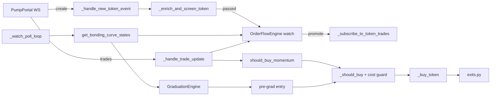

# Strategy Pivot: Confirmed Momentum & Pre-Graduation (v0.3.0)

Branch: `strategy-pivot-momentum`. Sprints: **Phase 4c, 24E–24I** in [`TODO.md`](../archive/pumpfun-trading/dev/TODO.md#phase-4c-strategy-pivot-income-track-ahead-of-phase-5). Features: FEAT-51, FEAT-52, FEAT-53 (implemented, [`FEATURES.md` §33–35](../archive/pumpfun-trading/FEATURES.md)) and FEAT-54 ([`PROPOSED-FEATURES.md`](../archive/pumpfun-trading/dev/PROPOSED-FEATURES.md#2-terminal-income-track-income)).

This document records why the bot stops buying at the create event, what it does instead, what that costs, and the numbers each sprint must hit before live capital is risked. It is not a promise of profit: the strategy is a bet that is tested cheaply first (replay, then paper), and the go/no-go rules below decide whether it ships.

---

## 1. Evidence: why launch sniping loses

| Run | Build | Result | Source |
|---|---|---|---|
| Stage 0 paper pilot | v0.2.1 | **FAIL** at T + 1 h 33 min: daily breaker locked buying after 34 positions, net −0.022975 SOL, 2 of 34 profitable | [`releases/v0.2.1-stage0.md`](releases/v0.2.1-stage0.md) |
| 24 h capture run (paper) | v0.2.3 | **−0.579 SOL net over 1,675 positions, 10.3% profitable** | [`DONE.md` Sprint 24A](DONE.md#sprint-24a-paper-pilot--live-canary--see-release-gatemd-3-and-runbookmd) |
| Replay of that capture | v0.2.3+ | Exit timing barely changes the result; `min_holder_count: 6` was the only filter net positive in both halves of the day (+0.026 SOL over ~229 positions) | same |
| Cost split at 0.01 SOL | v0.2.3 | Jito tips are **83%** of the separately listed costs (fee, priority fee, tip, rent) | same |

**Diagnosis.** The losses come from *buying tokens no one else buys*. At the create event the bot has no information about follow-on demand, so most positions are dead on arrival; no exit rule can save a position that has no buyers after it. The fix has to be on the entry side.

---

## 2. The new strategy

`entry_mode` (new config key) selects the entry pipeline:

| `entry_mode` | Pipeline | Use |
|---|---|---|
| `"launch"` (default) | create → screen → **buy** | Unchanged legacy behaviour; golden replay pinned to it |
| `"confirmed"` | create → screen → **watch** → RPC curve poll → trade subscription → **confirm** → buy | `momentum` preset, canary and capture configs |

### 2.1 Lane 1 — confirmed momentum (FEAT-51, FEAT-52; P0)
1. **Watch, don't buy.** A create event that passes the Pump.fun (BUG-108), mayhem and screening checks goes onto a bounded watch list (`watch_ttl_seconds`, `watch_max_mints`; oldest evicted). Mints already traded are never watched again (BUG-109).
2. **Observe cheaply.** One task batch-reads all watched curves with `getMultipleAccounts` (≤ 100 per call) every `watch_poll_interval_seconds`. Curves that fail the BUG-104 sanity or BUG-108 owner checks are dropped with a counted reason.
3. **Promote on growth.** Only mints whose real SOL reserves grew by at least `watch_promote_min_sol_growth` since they were watched get a (billed) PumpPortal trade subscription, at most `watch_max_trade_subscriptions` at once. Expired or rejected mints are unsubscribed (BUG-120 rule).
4. **Confirm.** Buy only when all hold:
   - token age within [`momentum_min_token_age_seconds`, `momentum_max_token_age_seconds`]
   - market cap within [`min_market_cap_sol`, `momentum_max_market_cap_sol`]
   - `OrderFlowEngine` shows enough distinct non-creator buyers, net inflow, buy ratio and z-score (`momentum_min_*` keys)
   - the unified risk pipeline (`_should_buy`) and the cost guard pass
5. **Exit for momentum entries.** Full exit if no buy of at least `stagnant_min_buy_sol` arrives within `stagnant_timeout_seconds`; once the gain reaches `breakeven_ratchet_activation_pct`, the floor moves to entry + `breakeven_buffer_pct`; tiers, trailing stop and the pre-graduation exit stay.

### 2.2 Lane 2 — pre-graduation (FEAT-53; P1)
The same poller feeds `GraduationEngine`, so the existing `evaluate_pre_graduation_harvesting_entry` works on the WebSocket deployment without Geyser (FEAT-39). Curves at 75–88% progress with rising acceleration may be bought; tranche exits sell before `complete`. The lane stays **off** in the canary until a ≥ 72 h paper pilot shows it positive ([`RELEASE-GATE.md` §3.5](../archive/pumpfun-trading/dev/RELEASE-GATE.md#35-features-that-must-stay-off-until-proven)).

### 2.3 What stays out
FEAT-39 Yellowstone gRPC, arbitrage, back-running, Raydium sniping and copy trading as its own entry lane stay off as in `RELEASE-GATE.md` §3.5. Launch sniping is not removed; it stays available as `entry_mode: "launch"`.

### 2.4 Lane 3 — reviewed smart wallets (FEAT-54; P2)
Sprint 24I, after 24H. Wallets with a strong record (for example ≥ 100 buys at a 75% win rate) are **candidates, not signals**. They are never added to live copy trading automatically, because:
- win rate is not net profit: a few large losses can outweigh many small wins;
- scanning thousands of wallets always finds some that were lucky;
- many high scorers are launch-slot snipers, bundle, dev or insider wallets, or wash bots;
- our copy fills one or more slots later at a higher curve price, so the wallet's result is not ours;
- a wallet that is known to be copied can sell into its copiers.

The lane works in five steps:
1. **Discover offline.** Score wallets from captures on net SOL after modelled costs, distinct tokens, average and worst return, and hold time. Reject launch-slot buyers, the creator's funding cluster and wash patterns.
2. **Simulate our copy.** Replay their buys with our delay (`copy_entry_delay_slots`) and `engines/costs.py`. Keep a wallet only if **our** copied PnL is net positive on a later capture that was not used to find it.
3. **Review.** Survivors go to a candidate file; an operator moves them to the tracked list.
4. **Use as evidence.** A tracked wallet's buy on a watched mint counts toward the momentum check (`momentum_tracked_wallet_bonus`, default 0 = off). It never bypasses the band, `_should_buy` or the cost guard.
5. **Drop automatically.** A wallet is disabled when its rolling net PnL over its last influenced positions goes below zero, and its SOL at risk is capped.

A stand-alone `strategy=copy` lane (needs the billed `subscribeAccountTrade` feed) is optional and comes only after steps 1–5 are shown positive.

---

## 3. Cost model at 0.02 SOL

Modelled by `engines/costs.py::ReplayCostModel` (same model as paper mode). Round trip = one buy + one closing full exit (rent refunded, BUG-96).

| Item | Per leg | Round trip | Share at 0.01 SOL | Share at 0.02 SOL |
|---|---|---|---|---|
| Pump.fun fee (125 bps) | 1.25% of size | 2.5% of size | 2.5% | 2.5% |
| Base network fee | 5,000 lamports | 0.00001 SOL | 0.1% | 0.05% |
| Jito tip, 100k lamports (current) | 0.0001 SOL | 0.0002 SOL | 2.0% | 1.0% |
| Jito tip, 25k lamports | 0.000025 SOL | 0.00005 SOL | 0.5% | 0.25% |
| Jito tip, 0 (direct RPC) | 0 | 0 | 0% | 0% |
| ATA rent (1,513,840 lamports) | paid / refunded | 0 if closed | 0% | 0% |

Price impact and entry latency come on top and are modelled by `paper_entry_delay_seconds` / `paper_entry_slippage_bps`. Decisions:

- **Stage 1 size 0.02 SOL**: one 2× step from the 0.01 canary, within the `RELEASE-GATE.md` §3.1 scaling rule.
- **Tip experiment** on paper/landing: 0 / 25k / 50k lamports; the canary uses the lowest tip that keeps landing rates acceptable.
- **Cost guard** (`max_entry_cost_share_pct`, default 0.10): refuse a buy whose modelled fixed round-trip costs (fees, tip, rent not refunded) exceed that share of the position, so paper and live share one rule.

---

## 4. Sprints and priorities (Phase 4c)

| Sprint | Priority | Goal | Money path? | Exit gate |
|---|---|---|---|---|
| **24E** | P0 – first, no code risk | Branch, this document, TODO / FEAT / gate docs, tip experiment plan | No (docs/config) | Docs reviewed |
| **24F** | P0 – unlocks everything | Watch list, batch curve poller, promotion and subscription budget (FEAT-51) | Entry gate (no buys in confirmed mode yet) | Paper run: watch list bounded, message count ≤ budget, no loop stalls |
| **24G** | P0 – the income change | Momentum confirmation entry, exit tuning, cost guard, replay support, tuning on the 24 h capture (FEAT-52) | Yes | Replay net > 0 on a second, unseen capture, then 72 h Stage 0 net > 0 |
| **24H** | P1 – second lane | Pre-graduation lane via the poller (FEAT-53), then Stage 1 canary at 0.02 SOL with the lower tip | Yes | Lane positive in 72 h paper; Stage 1: ≥ 100 trades, net > 0, reconciled |
| **24I** | P2 – after 24H | Smart-wallet discovery, copy simulation, reviewed list used as momentum evidence (FEAT-54) | Entry evidence only (no copy lane) | Our simulated copy PnL net > 0 on an unseen capture; momentum + wallet evidence beats momentum alone in replay and 72 h paper |

**Why this order**
1. **24E** writes down the evidence and the rules before code changes, at no risk.
2. **24F** comes before 24G because no confirmation is possible without cheap data on candidates; it also keeps PumpPortal message costs bounded (BUG-120).
3. **24G** is the change expected to flip net PnL: it removes the main cause of the losses (no follow-on buyers).
4. **24H** adds trade count only after the main lane is shown positive, and stays gated by `RELEASE-GATE.md` §3.5.
5. **24I** comes last because it needs two captures with trade flow for watched mints (one to find wallets, one to test them) and a working momentum check to plug the evidence into. It is not part of the v0.3.0 go/no-go.

---

## 5. Go / no-go

- Thresholds are **starting points**. Final values go into `canary.json` only after they come out net positive on a capture that was **not** used to pick them (train/test split, as for `min_holder_count`).
- If confirmed momentum is not net positive in replay on the unseen capture, **do not run Stage 0**: re-tune or narrow the band, and record the result in §6.
- Every money-path sprint goes back through Stage 0 ([`RELEASE-GATE.md` §3.1](../archive/pumpfun-trading/dev/RELEASE-GATE.md#31-stages)).
- v0.3.0 is a MINOR release (new config keys) and is tagged only after 24G passes Stage 0.
- Judge each lane on its own with `pumpfun-audit pnl --group-by strategy` (`momentum`, `pre_graduation`, `launch`, later `copy`).
- From rc.4 a paper run's go / no-go is the pre-registered rule in `configs/verdict_rules.json`, applied per lane with `pumpfun-audit verdict --strategy <lane>` (FEAT-67): adjusted for a 50 bps exit haircut and a 25,000-lamport tip, at least 100 positions, positive overall, in both halves and on at least half the UTC days, positive without the 3 best positions, and the 90% bootstrap interval of the mean per position above zero. Record the rule hash when the run starts; do not change the rule after that.
- Wallet evidence (24I) stays off (`momentum_tracked_wallet_bonus: 0`) unless momentum with it beats momentum without it on an unseen capture and in a 72 h paper run.

### Known risks
- **Paying for exit liquidity:** later entries cost more per token and late buyers often become exit liquidity. Mitigated by the market-cap band, the age window and the buy-flow stagnation exit.
- **Biased capture:** the v0.2.3 capture has trade flow only for mints the bot bought at launch, so tuning on it is partial evidence; the next capture records watched mints too.
- **RPC load:** 300 mints / 100 per call / 2 s ≈ 1.5 req/s through `rpc_pool`, with backoff and a degradation event.
- **Overfitting:** tune on one capture, confirm on a second.

---

## 6. Results log

| Date | Data | Lane | Config | Positions | Net SOL | Win rate | Verdict |
|---|---|---|---|---|---|---|---|
| 2026-10-18 | v0.2.3 24 h capture | launch | v0.2.3 canary | 1,675 | −0.579 | 10.3% | baseline (FAIL) |
| 2026-10-18 | same, 1st half (tuning) | momentum | `momentum` preset defaults | 21 | +0.008 | 66.7% | — |
| 2026-10-18 | same, 2nd half (held out) | momentum | `momentum` preset defaults | 19 | −0.022 | 36.8% | defaults not positive out of sample |
| 2026-10-18 | same, 1st half (tuning) | momentum | `configs/canary.json` | 62 | +0.086 | 54.8% | best of 162-point grid |
| 2026-10-18 | same, 2nd half (held out) | momentum | `configs/canary.json` | 70 | +0.023 | 41.4% | positive out of sample |
| 2026-10-18 | full 24 h | momentum | `configs/canary.json`, tip 25k | 132 | +0.132 | 49.2% | replay PASS (provisional) |
| 2026-10-19 | v0.3.0-rc.1 capture, 12.7 h (paper) | momentum | `configs/capture.json` | 65 | −0.100 | 21.5% | **paper FAIL** |
| 2026-10-19 | same, replay (rc.1 engine) | momentum | `configs/canary.json`, tip 0 | 62 | −0.084 | — | **replay NO-GO**; parity GAP +0.016 (allowed ±0.010) |
| 2026-10-19 | same, 13.1 h, replay (BUG-121 fix) | momentum | `configs/canary.json`, tip 0 | 63 | −0.090 | — | NO-GO; parity gap +0.023 → +0.014 (still GAP) |
| 2026-10-19 | v0.2.3 24 h, replay (BUG-121 fix) | momentum | `configs/canary.json`, tip 0 | 132 | +0.062 | — | was +0.139: half of the old edge was replay optimism |
| 2026-10-20 | v0.3.0-rc.1 capture, full 24.2 h (paper) | momentum | `configs/capture.json` | 118 | −0.099 | 29.7% | **paper FAIL** |
| 2026-10-20 | same, last 11.5 h only (unseen by the sweeps) | momentum | `configs/capture.json` | 53 | +0.001 | 39.6% | break-even |
| 2026-10-20 | same, 24.2 h, replay | momentum | `configs/canary.json`, tip 0 | 112 | −0.077 | — | NO-GO; parity gap +0.022 (allowed ±0.010) |
| 2026-10-20 | same, audit trail, drift guard applied after the fact | momentum | + `momentum_max_entry_drift_pct` 0.08 | 101 | −0.046 | — | helps in both halves (A −0.075, B +0.029), still negative |
| 2026-10-20 | rc.1 replay, FEAT-56 filters (top buyer < 50%, diversity ≥ 0.3, early inflow < 5 SOL) | momentum | `configs/canary.json`, tip 0 | 47 | −0.004 | — | beats a random cut on 3 sets; recorded in rc.2, not gated (§6.5) |
| 2026-10-20 | v0.2.3 / rc.1 replay + rc.1 paper, FEAT-57 wash inputs (skip `round_trip_share` > 0.2) | momentum | `configs/canary.json`, tip 0 | 85 / 77 / 85 | +0.094 / −0.059 / −0.091 | — | beats a random cut on v0.2.3 only; recorded in rc.2, not gated (§6.6) |
| 2026-10-20 | v0.2.3 / rc.1 replay, stop-loss sweep: `stop_loss` 0.92 (base 0.85) | momentum | `configs/canary.json`, tip 0 | 117 / 105 | +0.075 / −0.049 | — | better than the base in all four halves, by noise-sized amounts; not adopted (§6.8) |
| 2026-10-20 | same, stop armed after 5–30 s or held while buys continue | momentum | `configs/canary.json`, tip 0 | 117 / 105 | worse in every half (arming after 5 s: flat on rc.1 B, +0.0003) | — | rejected (§6.8) |
| 2026-10-20 | v0.2.3 / rc.1 replay, FEAT-56 + FEAT-57 + creator book together (rebuilt from the capture) | momentum | `configs/canary.json`, tip 0 | 64 / 39 | +0.097 / +0.004 | — | beats a random cut in all four halves; rc.1 only breaks even (§6.8) |
| 2026-10-20 | FEAT-54 copy simulation, top v0.2.3 wallets copied on rc.1 | copy (sim) | 0.02 SOL, 1.5 s, 100 bps, tip 0 | 92 copies | −0.125 | — | **no edge**: every wallet set loses at our delay and costs (§6.8) |
| 2026-10-20 | v0.2.3 / rc.1, pullback rule on the trade feed (FEAT-59), `--shadow-scan` | pullback (shadow) | `configs/capture.json`, tip 0 | 7 / 7 | −0.006 / −0.007 | — | too few signals (10–11 a day); below a random cut of the baseline in 3 of 4 halves (§6.9) |
| 2026-10-20 | v0.2.3 / rc.1, FEAT-60 buy-timing filters (gap CV ≥ 0.5, burst ≤ 50%, size CV ≥ 0.5), `--shadow-scan` | momentum (shadow) | `configs/capture.json`, tip 0 | 74–104 / 49–97 | — | — | **no edge**: none beats a random cut in both halves on either capture (§6.9) |
| 2026-10-21 | v0.3.0-rc.2 capture, 24.1 h (paper, no exit slippage) | momentum | rc.2 `configs/capture.json` | 105 | +0.014 | 32.4% | break-even; with the BUG-126 exit haircut about −0.007 (§6.10) |
| 2026-10-21 | same, replay | momentum | rc.2 `configs/canary.json` (stop 0.85), tip 0 | 107 | −0.015 | — | parity gap −0.028 → −0.007 after BUG-126 (allowed ±0.002) |
| 2026-10-21 | same, replay | momentum | rc.3 `configs/canary.json` (stop 0.92, exit 100 bps), tip 0 / modelled tip | 107 | +0.000 / −0.023 | — | **NO-GO**: stop 0.92 beats 0.85 in both halves (+0.004 / +0.011) but the lane only breaks even |
| 2026-10-21 | v0.2.3 / rc.1 / rc.2 replay, tier 1 at 1.2–1.3× (take +20–30% early) | momentum | rc.3 `configs/canary.json`, tip 0 | 117 / 105 / 106 | worse in at least one half on every capture | — | rejected (§6.10) |
| 2026-10-21 | v0.3.0-rc.2 pre-graduation pilot, 24.1 h (paper) | pre_graduation | rc.2 `configs/pregrad_pilot.json` | 2 | −0.008 | 0% | too few entries: the screen and the 10 min TTL starve the lane (§6.10) |
| 2026-10-23 | v0.3.0-rc.3 capture, first 45.5 h (paper) | momentum | rc.3 `configs/capture.json` (stop 0.92, exit 100 bps) | 127 | **−0.179** | 14.2% | **NO-GO**: verdict FAIL on every profit check; both halves and all 3 UTC days negative (§6.11) |
| 2026-10-23 | same, replay with `--no-circuit-breaker` | momentum | rc.3 `configs/capture.json` | 123 | −0.197 | — | parity holds: 119 of 127 matched, gap −0.018 (allowed ±0.018) |
| 2026-10-23 | same, stop-loss sweep 0.80 / 0.85 / 0.92 | momentum | rc.3 `configs/capture.json` | 123 | −0.205 / −0.203 / −0.197 | — | the stop is not the problem; no level is better in both halves |
| 2026-10-23 | same, FEAT-56/57 filters (top buyer < 50%, diversity ≥ 0.3, early inflow < 5 SOL, round trips ≤ 20%) on paper positions | momentum | rc.3 `configs/capture.json` | 39 | −0.066 | — | **fails out of sample**: below a random cut in half B (−0.023) |
| 2026-10-23 | same, shadow variants | momentum (shadow) | rc.3 `configs/capture.json` | 18–150 | −0.010 to −0.281 | 9–33% | several beat a random cut, none is near break-even |
| 2026-10-23 | v0.3.0-rc.3 pre-graduation pilot, first 45.5 h (paper) | pre_graduation | rc.3 `configs/pregrad_pilot.json` | 0 | 0 | — | **cannot fire**: 4 of ~2,100 watched curves ever reached 75% (§6.11) |
| 2026-10-23 | same, what-if: buy discovered curves in the 75–88% band (record-only rows, 10 s polls) | pre_graduation (sim) | pilot entry band, tranches, stop 0.85, 4.6% costs | 562 | ≈ −1.62 at 0.02 SOL | 37% | **no edge**: about −14% per trade, both halves negative (§6.11) |
| 2026-10-23 | FEAT-65 phase 0 quotes, 46.9 h (Jupiter, 10 tokens, 0.02 / 0.1 / 0.5 SOL) | slow lane (costs) | `configs/slow_lane_tokens.json` | 16,918 round trips | — | — | **costs pass**: median round trip 0–37 bps (Pump.fun lanes ≈ 460 bps); priority fees 0 in ~99% of slots (§6.12) |
| 2026-10-23 | FEAT-65 bars, daily, 132 days after warm-up, trend rules in SOL terms (SMA 10 / 20 / 50, measured costs) | slow lane (backtest) | 7 liquid tokens, equal weight | 71–163 switches | −4.7% / +3.8% / +7.5% | — | **no edge shown**: buy and hold +8.9%; without RAY every rule loses (−6% to −14%); half A negative for all three (§6.12) |
| 2026-10-23 | same, hourly bars (SMA 5 / 10 / 20 days), BONK and JUP left out (bad prints, gaps) | slow lane (backtest) | 5 tokens | 555–1,243 switches | −20.2% / −13.0% / +7.4% | — | whipsaw; buy and hold +46.3% (§6.12) |

### 6.1 How the thresholds were picked (Sprint 24G)
- Data: `runtime/capture/replay_capture.jsonl` (v0.2.3, 24.4 h, 25,610 create events, 10,718 screening records, 22,487 market trades on 1,229 mints). Replay: `pumpfun-replay --config configs/canary.json` (live exit stack, `ReplayCostModel`, 0.02 SOL, 2 positions, 0.05 SOL exposure), `entries_from: confirmed`.
- Split by time: the first 12.2 h picked the values, the second 12.2 h was never used to pick them. Grid: `watch_promote_min_sol_growth` {0.5, 1.5, 3}, `momentum_min_unique_buyers` {3, 5, 8}, `momentum_min_net_inflow_sol` {0.5, 1, 2}, `min_market_cap_sol` {30, 35, 45}, `momentum_min_token_age_seconds` {20, 60}, with `momentum_min_z_score` 0 and `momentum_min_buy_ratio` 1.5. 100 of 162 points were positive on the first half; the top 8 were then run on the second half, and 5 stayed positive.
- Chosen: promotion at +3 SOL real reserve growth, ≥ 3 distinct non-creator buyers and ≥ 0.5 SOL net inflow in 30 s, age ≥ 20 s, market cap 35–75 SOL. The z-score is off: a 300 s baseline does not exist for tokens this young.
- Tip experiment in replay (full 24 h, same config): 0 lamports +0.139 SOL, 25k +0.132, 50k +0.124, 100k +0.109. The tip is not what decides the result on this lane; the canary starts at 25k lamports (`PUMPFUN_JITO_TIP_LAMPORTS=25000`) and the landing rate decides the final value.
- The `momentum` preset needs `max_token_concentration_pct` 0.5: one 0.02 SOL position is 40% of the 0.05 SOL exposure cap, so the conservative 25% refused every buy.

### 6.2 Why this is not yet a go
- **Biased data.** The capture only has trade flow for the 1,229 mints the v0.2.3 bot bought at launch; the confirmed lane can only buy among them. Tokens the old bot never bought, which a live confirmed bot would see, are missing. A capture recorded with `configs/capture.json` (confirmed mode, so it records the watched and promoted mints) is the real test.
- **Same day.** The held-out half is the same day and market as the tuning half. The go/no-go rule (§5) asks for a second capture.
- **Small numbers.** +0.023 SOL over 70 positions in the held-out half is within a few lucky trades.
- **Replay simplifications.** Promotion uses the curve derived from recorded prices and is up to one poll interval optimistic. Until BUG-121 the 1.5 s paper entry delay and the 100 bps paper penalty were not modelled at all (see §6.3).

**Next:** run `configs/capture.json` for 24 h, replay it with `configs/canary.json` unchanged, and only if it is net positive start the 72 h Stage 0 with `configs/canary.json` in paper mode.

### 6.3 v0.3.0-rc.1 capture: NO-GO (2026-10-19)
- **Data:** `runtime/capture/` on tag `v0.3.0-rc.1`, `configs/capture.json` (paper, confirmed, 0.02 SOL, 5 positions), 2026-10-18 20:36 → 2026-10-19 09:20 (12.7 h). The run kept recording afterwards.
- **Paper result:** −0.100 SOL net over 65 momentum positions, 21.5% profitable, expectancy −0.0015 SOL. Costs were 0.0014 SOL with no tips and every rent refunded, so the loss is trade selection, not friction.

| First exit | Positions | Net SOL | Average return |
|---|---|---|---|
| Stop loss | 33 | −0.143 | −21.6% (worst −52%) |
| Buy flow dried up | 22 | −0.016 | −3.5% |
| Take profit, tier 1 | 5 | +0.044 | +43.8% |
| Trailing stop | 5 | +0.015 | +15.2% |

- **Fill drift:** the median stop-loss came 15 s after the buy and sold at −17% to −26% against a −15% stop. 9 stops came within 1 s of the buy; in 3 of them the paper fill (curve read 1.5 s after the signal) was 1.3–1.7× the signal price.
- **Winners vs losers at entry (medians):** distinct buyers 6.5 vs 3, token age 52 s vs 109 s, buy/sell ratio 5.5 vs 10.4 (a very one-sided ratio is usually one wallet or a bundle).
- **Runtime (24F exit gate): PASS.** 869 watched, 148 promoted, 65 bought, 83 expired; subscriptions never above 20 and all closed; 4,661 billed trade messages, no refusals or breaker trips; RPC ≈ 0.8 req/s, p95 139 ms, no errors.
- **Replay go/no-go (frozen `canary.json`, no re-tuning): NO-GO**, −0.084 SOL over 62 positions (profit factor 0.48). The tip changes the result by ≈ 0.003 SOL.
- **Replay was optimistic (BUG-121).** `engines/replay.py` filled confirmed entries at the signal price and ignored `paper_entry_delay_seconds` and `paper_entry_slippage_bps`. With the fix (rc.2) the fill is priced at the last curve price at signal + delay, cut by the penalty, and no exit runs before the fill. On the 13.1 h data the parity gap fell from +0.023 to +0.014 SOL (allowed ±0.010; it was +0.016 on the first 12.7 h). The rest comes from curve reads that see trades the capture's trade stream does not (a few fills 1.3–1.5× above any recorded price) and from 7 unmatched positions.
- **Exploratory sweep, re-run on the fixed replay** (net SOL / positions, tip 0; picked after seeing this capture, so not evidence):

| `momentum_min_unique_buyers` | v0.2.3 24 h | rc.1 capture 13.1 h | 1st half | 2nd half |
|---|---|---|---|---|
| 3 (canary) | +0.062 / 132 | −0.090 / 63 | −0.043 | −0.050 |
| 6 | +0.079 / 108 | −0.019 / 39 | −0.010 | −0.012 |
| 8 | +0.089 / 96 | −0.003 / 32 | +0.005 | −0.010 |
| 10 | +0.068 / 85 | −0.004 / 25 | +0.007 | −0.013 |

  With the rc.1 engine, 8 buyers looked positive in every period (+0.021 SOL on the new capture). With entry latency modelled, **no buyer threshold is net positive on the new capture**. Stop-loss 0.75/0.65, a 20 s stagnation timeout, a shorter age window and a higher inflow threshold did not help either (rc.1 engine).
- **Verdict:** no Stage 0 with the current lane. Changing `momentum_min_unique_buyers` alone is not enough. Next candidates, each to be judged on hours the sweep has not seen: a cap on the buy/sell ratio, skipping the buy when the curve moved more than X% between signal and fill, and a shorter signal-to-fill latency. If none is positive on unseen data, the momentum lane has no edge at this latency and the pre-graduation paper pilot or a faster data source comes next (§4).

### 6.4 v0.3.0-rc.1 capture, full 24 h: still NO-GO; drift guard added (2026-10-20)
- **Data:** the same run as §6.3, now 2026-10-18 20:36 → 2026-10-19 20:50 (24.2 h; archive it as `runtime/archive/capture-v0.3.0rc1/` before the next run). Half **A** is the first 12.7 h (the hours the §6.3 sweep was picked on); half **B** is the last 11.5 h, which no sweep had seen.
- **Paper result:** −0.099 SOL net over 118 momentum positions, 29.7% profitable; the paper wallet went from 2.000 to 1.901 SOL, matching the audit trail. Costs were 0.0025 SOL, tips 0, every rent refunded.

| Period | Positions | Net SOL | Profitable |
|---|---|---|---|
| A: first 12.7 h | 65 | −0.100 | 22% |
| B: last 11.5 h (unseen) | 53 | +0.001 | 40% |

- **Stop losses make the whole loss:** 55 positions, −0.229 SOL. Every other exit together made +0.130 SOL. The median stop sold at −19% against a −15% stop, and 15 of them sold within 1 s of the buy.
- **Earlier ideas, checked on B (fixed replay, frozen `canary.json`, net SOL / buys):**

| `momentum_min_unique_buyers` | A | B (unseen) |
|---|---|---|
| 3 (canary) | −0.093 / 62 | +0.016 / 50 |
| 6 | −0.019 / 38 | −0.014 / 43 |
| 8 | −0.003 / 31 | −0.024 / 40 |
| 10 | −0.004 / 25 | −0.030 / 31 |

  The 8-buyer setting from §6.3 **failed out of sample**. Among the bot's own buys the ones that already had ≥ 8 buyers were positive in both halves, but a rule that *waits* for 8 buyers enters later and higher, and that removes the gain. A buy/sell-ratio cap (A −0.026, B −0.028 on the bot's own buys) and a 60 s maximum token age were worse in both halves; both are dropped.
- **The one idea that helped in both halves: skip the buy when the price ran away between signal and fill** (audit trail, the curve at the fill against the signal's market cap, net SOL / positions kept):

| Skip when the curve moved more than | A | B | 24 h |
|---|---|---|---|
| no guard | −0.100 / 65 | +0.001 / 53 | −0.099 / 118 |
| 10% | −0.077 / 61 | +0.028 / 43 | −0.049 / 104 |
| **8% (chosen)** | **−0.075 / 59** | **+0.029 / 42** | **−0.046 / 101** |
| 5% | −0.066 / 54 | +0.028 / 39 | −0.038 / 93 |

  The move here is taken from the paper fill price less the ~2.25% Pump.fun fee and paper penalty, so it is approximate. 8% keeps about as much of the gain as 5% while skipping fewer buys. The guard reduces the loss; it does not create a profit on its own.
- **Drift guard (rc.2): `momentum_max_entry_drift_pct`** (default 0 = off; 0.08 in the `momentum` preset, `configs/canary.json` and `configs/capture.json`). Momentum-lane buys only:
  - **Paper:** after `paper_entry_delay_seconds` the executor re-reads the curve and skips the buy when its market cap is more than the limit above the signal's (`entry_drift` error, no costs). The fill's drift is recorded as `entry_metrics.fill_drift_pct`.
  - **Live:** the buy is refused before sending if the curve is already past the limit, and otherwise its slippage is capped at the headroom left, so the fill cannot land above signal × (1 + limit).
  - **Replay:** a delayed confirmed entry whose fill price is past the limit is dropped, its cash and modelled costs refunded (`entry_rejections.entry_drift`, `watch_stats.drift_refused`).
  - A refused mint is dropped from the watch list and unsubscribed in both the bot and replay: the move has already happened.
- **Replay cannot judge the guard.** In replay the median fill drift is 0 and only 5 of 112 fills moved > 10%, against 14 of 118 in paper: most of the runaway fills came from curve reads that see trades the capture's trade stream misses (the remaining parity gap, +0.022 SOL on 24 h). Replayed with the guard at 0.08 the result barely changes (A −0.096, B +0.017 against −0.093 / +0.016 without it; 24 h −0.080). **The next paper capture is the only test of the guard.**
- **Operations: healthy.** 1,568 watched, 251 promoted, 118 bought, 13 dropped as non-standard curves; ≤ 20 subscriptions; 7,689 trade messages with no refusals or breaker trips; 0 ERROR lines; RPC p95 117 ms. The stream connected 7 times but `connection_loss` stayed 0 (telemetry gap, BUG-122).
- **Possible time-of-day effect.** A ran overnight in Europe, B in EU/US daytime, and B did better under every setting. One day cannot separate the hour from the settings; every buy carries its timestamp, so net PnL per hour can be compared on the next capture.
- **Verdict:** no Stage 0, no change to `momentum_min_unique_buyers`. rc.2 ships the drift guard (plus BUG-121 and Sprint 28a). **The next 24 h capture with `configs/capture.json` is the last test of the momentum lane:** if it is not clearly net positive with the guard on, stop tuning it. In parallel and at no risk to capital: the 72 h pre-graduation paper pilot (FEAT-53, second runtime folder, `enable_pre_graduation_harvesting: true`) and the FEAT-54 offline wallet scorer on the two captures.

### 6.5 Ideas from other projects, tested offline (2026-10-20)
Ideas taken from a review of `pumpfun-bonkfun-bot`, `pumpfun-sniper-bot` and `PumpGrok` (FEAT-55/56 in [`PROPOSED-FEATURES.md`](../archive/pumpfun-trading/dev/PROPOSED-FEATURES.md#feat-55-creator-reputation-book)). Data: the v0.2.3 capture (`runtime/archive/stage0-v0.2.3/`) and the rc.1 capture (`runtime/capture/`). Replay is `configs/canary.json` as in rc.2 (drift guard on), tip 0: v0.2.3 +0.058 SOL / 117, rc.1 −0.080 / 105. Every filter is compared with keeping a random share of the same size, since any cut of a losing lane loses less.

- **Creator reputation book (FEAT-55): no edge.**
  - Walking forward through v0.2.3 and blocking a creator after one losing position blocks 203 of 1,697 positions worth −0.044 SOL; a random 203 would be −0.070.
  - In rc.1 only 2 creators were bought twice (the serial-launcher screen already rejects repeat creators), and the v0.2.3 book would block 6 rc.1 positions worth +0.002 SOL.
  - PumpGrok's "token fell ≥ 60%" rule fires on 2 of 1,229 tokens: an early curve cannot fall that far below a ~30 SOL entry.
  - `creator_rugs` is 0 on all 24,521 screening records: `rug_history_count` is never filled, so that screen check does nothing.
- **Sniper count: not measurable on these captures.** For 90% of mints the first recorded trade comes more than 3.3 s after the create, so the first-slot buyers are never seen. The proxy used is the SOL that entered the curve before the first recorded trade.
- **Wallet diversity and sniper volume (FEAT-56): small, consistent edge; not enough on its own.** Net SOL / positions kept:

| Keep rule | v0.2.3 replay | rc.1 replay | rc.1 paper |
|---|---|---|---|
| none | +0.058 / 117 | −0.080 / 105 | −0.099 / 118 |
| largest buyer < 50% of buy volume | +0.071 / 98 | −0.027 / 67 | −0.046 / 84 |
| wallet diversity ≥ 0.3 | +0.073 / 109 | −0.028 / 82 | −0.062 / 96 |
| inflow before the first seen trade < 5 SOL | +0.086 / 110 | −0.043 / 77 | −0.035 / 87 |
| all three | +0.099 / 91 | −0.004 / 47 | −0.006 / 58 |

  Each rule beats a random cut of the same size on all three sets (+0.016 to +0.054 SOL), but the combination only brings rc.1 to about break-even, on 47–58 positions. The thresholds are round numbers chosen before looking, not tuned. The inflow measure overlaps the rc.2 drift guard on rc.1 (it is everything before promotion there), so the two gains will not simply add up.
- **Verdict:** no gate in rc.2. rc.2 records the inputs on every momentum buy (`entry_metrics.top_buyer_share`, `wallet_diversity`, `first_poll_sol_growth`, `first_poll_age_seconds`) and the market regime on every buy and screened launch (`market_regime`: UTC hour and weekday, launches per minute and graduations per hour over 15 min, `warm` once a full window has passed). The rc.2 capture is unseen data for all of them: add a filter only if it beats a random cut there too, then Stage 0 it.

### 6.6 Wash-trade inputs, graduation backfill and split tips (2026-10-20)
Ideas taken from the `launch-relay` review, applied to trading only (we detect wash trading, we never do it).

- **Wash-trade inputs (FEAT-57): no consistent edge.** `OrderFlowEngine.round_trip_flow` scores the flow before each entry (creator and our wallet excluded): `round_trip_wallets`, `round_trip_share` (matched in-and-out volume over all volume) and `quick_flips` (a wallet reversing within 2 s; trade messages carry no slot). Skipping flagged entries, edge against a random cut of the same size (`data/analysis-2026-10-20/wash.py`):

| Skip rule | v0.2.3 replay (117) | rc.1 replay (105) | rc.1 paper (118) |
|---|---|---|---|
| `round_trip_share` > 0.1 | +0.061 | −0.001 | −0.023 |
| `round_trip_share` > 0.2 | +0.052 | −0.000 | −0.020 |
| `round_trip_share` > 0.4 | +0.040 | +0.009 | −0.002 |
| `round_trip_wallets` ≥ 2 | +0.044 | −0.006 | −0.009 |
| `quick_flips` ≥ 1 | +0.043 | −0.018 | −0.012 |

  It helps on v0.2.3 and is no better than chance on rc.1, including the paper run. Shared funders are not measured (a per-wallet funding lookup is too slow for the entry path). The FEAT-26 sybil detector never ran: it needs `funding_links`, which the Pump.fun API does not send.
- **Verdict:** rc.2 records the three inputs on every momentum buy; nothing gates on them. Re-test on the rc.2 capture.
- **Graduation backfill.** A third completion source for held mints: every `graduation_backfill_seconds` (default 30 s) the bot asks the Pump.fun API about each held mint; `complete` or a `pump_swap_pool` sends it to the PumpSwap exit (BUG-123). It covers migrations missed across a reconnect or restart. The API is only a hint: the exit still prices and sells from the on-chain pool.
- **Split tips.** `PUMPFUN_JITO_ENTRY_TIP_LAMPORTS` / `PUMPFUN_JITO_EXIT_TIP_LAMPORTS` set a fixed tip per side (`0` = plain RPC, no tip). Paper and replay model the same per-side costs, so the RUNBOOK tip experiment can test "no tip on entries, paid exits".

### 6.7 What the rc.2 capture records (2026-10-20)
Three gaps kept the rc.1 capture from answering the open questions; rc.2 closes them without changing what the bot buys.
- **Curve history in the capture.** rc.1 polled every watched curve every 2 s but wrote none of it, and paper fills and exits read curves the capture never saw. That is most of the replay-vs-paper gap (+0.022 SOL against ±0.010) and why replay could not judge the drift guard (5 of 112 fills > 10% in replay, 14 of 118 on paper). rc.2 writes every curve read as a `curve_poll` row (`watch`, `position`, `entry_fill`, `shadow_fill`), and replay prices a delayed fill from the read within 1 s after it is due. The rc.1 capture has no such rows and still replays as before (−0.080 SOL / 105 buys with `canary.json`, tip 0). Re-run `--compare-audit` on the rc.2 capture before trusting any sweep on it.
- **Near-graduation set (FEAT-53).** The pre-graduation lane only saw coins younger than the 10 min watch TTL. With `near_graduation_max_mints` > 0 a coin past the TTL that is ≥ 50% up its curve and still growing stays polled (slowly, without a trade subscription) for up to 1 h. Replay runs the lane on the recorded polls, so the pilot capture can be replayed. `configs/pregrad_pilot.json` is the 72 h paper pilot (lane on, no momentum buys).
- **Shadow variants (FEAT-58).** `capture.json` logs nine momentum rules on real paper fill prices without trading them: baseline, 6 and 8 buyers, 5% and 10% drift guard, FEAT-56 top buyer < 50% and diversity ≥ 0.3, FEAT-57 round-trip share ≤ 0.4 and no quick flips. Judge each one per position against a random cut of the same size, on the rc.2 capture only (it is unseen for all of them).
- **Verdict:** no new buy rule ships in rc.2. The rc.2 capture is the last test of the momentum lane; if neither the bot's rule nor a shadow variant is clearly net positive on it, stop tuning this lane.

### 6.8 Stop-loss sweep, wallet scores and the capture rule tool (2026-10-20)
Offline work on the v0.2.3 and rc.1 captures (both in `runtime/archive/`) while the rc.2 runs go. Replay with the frozen `configs/canary.json`, tip 0, each capture split at its midpoint (A / B). The rc.1 audit trail in `archive/stage0-v0.3.0rc1/` is still 0 bytes, so rc.1 is replay only.

**Stop-loss redesign** (`pumpfun-replay --sweep`, new keys `stop_loss_arm_seconds`, `stop_loss_demand_hold_seconds`, `stop_loss_hard_floor`; all 0 = the plain stop, so nothing changes until a config sets them):

| Change (Δ net SOL against the base, A / B) | v0.2.3 | rc.1 |
|---|---|---|
| `stop_loss` 0.80 | −0.010 / −0.007 | −0.015 / −0.007 |
| `stop_loss` 0.90 | +0.012 / +0.001 | +0.006 / +0.011 |
| `stop_loss` 0.92 | +0.012 / +0.006 | +0.015 / +0.015 |
| `stop_loss` 0.95 | +0.020 / +0.003 | +0.007 / +0.012 |
| stop armed after 10 s | −0.003 / −0.014 | −0.004 / −0.010 |
| stop held 10 s after a qualifying buy | −0.008 / −0.027 | −0.018 / −0.017 |

- Waiting longer never helped: arming the stop late (5–30 s) or holding it while buys come in (5–30 s) lost in every half, with or without a 0.6 / 0.7 hard floor; the only exception is arming after 5 s on rc.1 B, flat at +0.0003 SOL. The longer the wait, the bigger the loss. The stop-loss positions are mostly coins that keep falling.
- A **tighter** stop (0.90–0.95) beat the base in all four halves. The gains are 0.001–0.020 SOL per half, inside the ~0.02 SOL replay noise, and rc.1 stays negative (−0.049 at 0.92). Tighter stops also depend most on fill prices, which replay gets wrong (§6.4), so this is a candidate for the rc.2 capture (re-run the sweep there after `--compare-audit`), not a change to `canary.json`.

**Entry rules rebuilt from the capture** (`pumpfun-replay --keep`, `engines/cuts.py`; replaces the `data/analysis-2026-10-20/` scripts): FEAT-56 top buyer < 50% and diversity ≥ 0.3 beat a random cut in all four halves; FEAT-57 round-trip share ≤ 0.2 on v0.2.3 only; the creator book (block a creator after one of its coins closed at a loss) has no edge. All four together keep 64 / 39 positions, +0.097 / +0.004 SOL: the same picture as §6.5, a better-than-random cut that still only breaks even on rc.1.

**FEAT-54 wallet scores** (`pumpfun-replay --wallet-scores`, `engines/wallets.py`): every wallet in a capture is scored by what copying it would have netted **us** (0.02 SOL, 1.5 s delay, 100 bps penalty, fees, closed copies only).
- Copying every wallet loses: −4.67 SOL over 4,003 copies (v0.2.3), −2.01 over 1,286 (rc.1), about −0.0013 SOL per copy, mostly fees and the delay.
- The best v0.2.3 wallets (≥ 3 / 5 / 8 copies, top 20) lost on rc.1 (−0.08 / −0.12 / −0.10 SOL). With ≥ 5 copies they did better than the same share of all rc.1 copies, but worse than 97% of random sets of as many wallets. The reverse direction (rc.1 → v0.2.3) is no better. No wallet goes on a list.
- Wallet `29yFzeBZ…kbw8` never traded a recorded coin: it is a **creator**, with 47 (v0.2.3) and 53 (rc.1) launches screened, every one rejected as a serial launcher (20 launches in 24 h, 9.8% initial holding). Its income is launching coins, which is not a strategy this bot should copy.
- Limit: captures only hold trades of mints the bot subscribed to, so each wallet has at most ~15 closed copies. A copy lane needs a capture that records wallets' own trades (`subscribeAccountTrade`) before it can be judged.

**Verdict:** nothing changes in `canary.json`. On the rc.2 capture, re-run the stop-loss sweep (0.90 / 0.92 / 0.95), the `--keep` rules and the wallet scores; adopt only what holds there.

### 6.9 Pullback entry, buy timing and the bundle proxy for rc.3 (2026-10-20)
Items 2 and 3 of the "top 10 strategies" review: the **pullback entry** (wait for the first dump after a pump, buy when a base holds and buying comes back), **drizzle / burst detection** and an **anti-bundler proxy**. All three are logged only; none gates a buy, and the shipped buy, exit and sizing rules do not change.

- **Pullback rule (FEAT-59)**, as a shadow variant kind. `"kind": "pullback"` runs on the trade feed of subscribed mints; `"kind": "pullback_curve"` runs on the watch poller's curve reads, so it covers every watched mint without a billed subscription. Defaults (`PULLBACK_DEFAULTS`, each overridable as `pullback_*`): peak ≥ 40 SOL market cap, now 30–70% below it, no new low for 10 s, ≥ 3% off the low, ≥ 0.2 SOL net inflow over 15 s (trade kind: from ≥ 2 other wallets; curve kind: the curve's real SOL change), token age 30–900 s.
- **Buy timing (FEAT-60)**, `OrderFlowEngine.buy_timing`: `buy_gap_cv` (gap regularity; a drizzle bot is well below 1, independent buyers near 1), `buy_gap_median_seconds`, `burst_share` (largest share of buys inside 5 s), `buy_size_cv` (identical sizes = a bot), `small_buy_share` (< 0.05 SOL). Recorded on every momentum buy and shadow signal; usable as shadow filters (`min_buy_gap_cv`, `max_burst_share`, `min_buy_size_cv`, `max_small_buy_share`) and as `--keep` rules (`engines/cuts.py` rebuilds them from any capture).
- **Bundle proxy (FEAT-61)**, `HolderDistribution.early_holder_cluster`: non-creator accounts already holding ≥ 1% of supply when the token is screened (about a second after the create, so mostly the create slot) and their combined share. `getTokenLargestAccounts` returns token accounts, not owners, so the creator's account is matched by its initial-buy balance. Recorded in every screening capture record (`early_holders`, `early_holder_pct`) and on momentum buys; shadow filters `max_early_holders`, `max_early_holder_pct`. Linked funding (the BubbleMaps view) is still not measured: it needs a funder lookup per wallet.
- **Offline test** (`pumpfun-replay --shadow-report --shadow-scan`, new `engines/shadow_scan.py`: the same shadow book run over a capture's recorded trades and watch polls, filled at the first recorded price after the 1.5 s delay). On the rc.2 capture so far the scan reproduces the 13 recorded shadow rows exactly. Edge against a random cut of the baseline, A / B:

| Variant | v0.2.3 (baseline 169 signals) | rc.1 (baseline 118 signals) |
|---|---|---|
| pullback (trade feed) | 10 signals; −0.004 / −0.005 | 11 signals; −0.006 / −0.002 |
| `min_buy_gap_cv` 0.5 | −0.004 / +0.019 | +0.003 / −0.013 |
| `max_burst_share` 0.5 | +0.007 / −0.009 | +0.007 / −0.037 |
| `min_buy_size_cv` 0.5 | −0.002 / +0.008 | +0.013 / −0.019 |
| pullback on curve reads, bundle filters | no data (no watch polls / holder snapshot before rc.2 / rc.3) | no data |

- **Read the numbers as relative only.** Scanned fills come from recorded data: the scanned baseline on rc.1 models −0.006 SOL where paper lost −0.099 on the same 118 signals, because the paper fill read curves that saw trades the capture missed (§6.4). A filter's edge over a random cut of that baseline is the usable figure, and even that leans optimistic.
- **Why the trade-feed pullback fires so rarely:** it only sees subscribed mints (≥ 3 SOL growth, 10 min watch TTL), and most dumps come after the subscription ends. The curve kind sees every watched mint (35–65 an hour); in the first 1.5 h of the rc.2 capture 10 of 52 polled mints peaked above 32 SOL and 2 fell 30%, so expect a few dozen pullback signals per 24 h.
- **rc.3 capture:** planned with 19 shadow variants (the nine rc.2 ones, three FEAT-60, two FEAT-61, the trade pullback and four curve pullbacks) and the four curve pullbacks in `configs/pregrad_pilot.json`. After the rc.2 read-out (§6.10) `capture.json` keeps eight of them and the pilot none.
- **Verdict:** none of the three ships as a gate. Judge them on the rc.3 capture with `--shadow-report --split-at mid` (unseen data for all), per position and against a random cut; a pullback lane needs a clearly positive result there before it gets its own entry path and a paper pilot.

### 6.10 v0.3.0-rc.2 capture and pilot: momentum NO-GO, stop 0.92 adopted (2026-10-21)
- **Data:** two paper runs on tag `v0.3.0rc2`, 2026-10-20 07:00 → 2026-10-21 07:06 UTC (24.1 h), archived in `runtime/archive/paper-v0.3.0rc2/capture/` and `.../pilot/`. Read-outs with the `main` tools at tip 0, as in the runs. Half A / B split at the midpoint.
- **Momentum capture (paper):** +0.014 SOL over 105 positions, 32.4% profitable, +0.00013 SOL per position. The best 5 positions made +0.096 and the other 100 lost −0.082, so one or two trades decide the day. Exits: 35 stop losses −0.157 (median hold 12 s), 25 trailing stops +0.166, 43 buy-flow stagnation +0.002, 2 break-even ratchets +0.004. Operations were clean: no trade-feed refusals or breaker trips, one poll error, RPC p95 135 ms.
- **Paper was ~1% per exit too kind (BUG-126).** Paper sells took no slippage; replay took 100 bps. That was 0.021 of the −0.028 SOL parity gap. With the haircut matched, same-exit positions agree to −0.002 SOL; the rest is one position where replay saw the stop and paper the trailing stop. With the haircut the paper result is about **−0.007 SOL**. rc.3 applies `paper_exit_slippage_bps: 100` in paper and replay.
- **Stops overshoot.** The stop is 85% of entry, but the median trigger was 82.3% and the median proceeds 80.3% (worst tenth 66.9%): the curve moves too far between 1 s refreshes.
- **What held up on a second capture:**

| Test | rc.2 | Earlier captures | Decision |
|---|---|---|---|
| `stop_loss` 0.92 (base 0.85), full capture | +0.004 / +0.011 | +0.012 / +0.006 (v0.2.3), +0.015 / +0.015 (rc.1) | **adopted**: 6 of 6 halves on three captures |
| shadow `buyers6` | beats a random cut in both halves | 8 buyers failed out of sample on rc.1 and in rc.2 B | keep logging |
| shadow `drift5` / `drift10`, `feat56_diversity` | beat a random cut in both halves | FEAT-56 beat a random cut on v0.2.3 and rc.1 | keep logging |
| FEAT-57 wash and FEAT-60 timing filters | no edge | no edge | dropped from `capture.json` |
| trade-feed pullback | 10 positions, +0.006 | 10–11 a day, worse than random in 3 of 4 halves | keep logging (cheap) |
| curve pullbacks (capture and pilot) | all lose (pilot baseline −0.080, 11% won) | no data | dropped |
| FEAT-61 bundle filters | no data | no data | keep logging (rc.3 records the inputs) |

  None of the shadow variants is net positive in both halves on its own; scanned and shadow nets compare variants with each other only.
- **Take profit earlier? No.** In the `momentum` preset `take_profit` (3.0×) never fires: the tiers and the trailing stop exit first (tier 1 sells 50% at 1.5×, the trailing stop arms at +25% and sells 12% below the peak, so a spike to 1.25× already exits near 1.10×). Moving tier 1 to 1.2–1.3× was worse in at least one half on every capture (v0.2.3 A −0.012 to −0.015, rc.1 B −0.008 to −0.012, rc.2 A −0.004 to −0.010). Selling more or less at tier 1 (30% / 100%) and other trailing settings each won on one capture and lost on another. The lane's profit is a few positions that run well past +50%; an early full take-profit caps exactly those and leaves the stop losses as they are.
- **The screen rejects the coins that later get demand.** 1,993 of 13,583 screened launches passed (14.7%). Of 119 screened coins that graduated two minutes or more after their create, 3 passed (2.5%): 104 failed the top-5 holder cap (their median top-5 share is 27%, against 5.5% for all launches) and 50 the creator-holding cap. 259 more graduated within 10 s of the create (bundled launches, not tradeable).
- **Pre-graduation pilot:** 2 positions, −0.008 SOL, both stop losses at about 80% progress on coins the momentum lane had already bought and sold at a profit. It saw only 5 near-graduation curves in 24 h, because it polls screened mints only and only within the 600 s watch TTL, while 105 coins graduated more than 10 min after launch.
- **Time of day:** 00–14 UTC made money and 15–17 UTC lost −0.061 SOL, but per hour the result swings with one or two trades. Not a rule yet; `pumpfun-audit pnl --group-by hour` on rc.3 adds a second day.
- **Verdict: the momentum lane as it stands is NO-GO for Stage 0, and its entry thresholds are not tuned further.** rc.3 ships BUG-126, `stop_loss` 0.92 for the momentum lane (preset, `canary.json`, `capture.json`; the pilot keeps 0.85 because 0.92 was never tested on that lane) and a smaller shadow set. The rc.3 capture runs 48 h. Next work, in order: watch a random sample of screen-rejected mints as shadow-only (does the top-5 / creator cap help at all?), feed the pre-graduation lane from curves with large real reserves regardless of screening or the TTL, and a faster reaction to stops on held mints (trade-feed prices instead of the 1 s refresh).
- **Added to rc.3 before the run (record only, 2026-10-21):** the first halves of those three items ship as measurements, so the rc.3 runs still trade exactly as configured above. `capture.json` polls a 20% sample of screen-rejected launches (`screen_reject_sample_pct`, rows `source: "reject_sample"` with the screen's reasons); `pregrad_pilot.json` polls curves past 40 SOL real reserves found by a Pump.fun API scan every 30 s (`graduation_discovery_scan_seconds`, rows `source: "discovery"`), which the lane does not buy; all three configs record where each price source first crossed the stop and what the exit sold at (`record_stop_crossings`, `exit_metrics`). Replay and the shadow tools skip the observation rows. The rules that would act on them (relaxing a cap, buying discovered curves, a trade-feed stop trigger) wait for the rc.3 read-out and a second capture (RUNBOOK §6.3).

### 6.11 v0.3.0-rc.3 interim read-out (45.5 h): both Pump.fun lanes NO-GO (2026-10-23)
- **Data:** two paper runs on tag `v0.3.0rc3`, started 2026-10-21 10:55 UTC, read at 45.5 h (2026-10-23 08:25 UTC) while still running: 15 + 1 capture parts joined into 2.19 M rows (no gaps), 6 + 1 pilot parts into 1.25 M rows. Tools from `main` after rc.4; verdict with the shipped `configs/verdict_rules.json` as evidence only (it was not pre-registered for rc.3). The 72 h runs end on 2026-10-24.
- **Operations clean in both runs:** no errors or tracebacks, about 22 stream reconnects each (all recovered), trade feed 404 confirmed subscriptions and 0 refusals, breaker never tripped. Of 48,460 create events, 22,015 (45%) were other launchpads and 3,819 (8%) mayhem launches, all skipped as designed. 70% of holder lookups needed a retry; 71 failed.
- **Momentum (capture):** −0.179 SOL over 127 closed positions (wallet 2.000 → 1.821; audit, status file and cash flows agree), −0.0014 SOL per position (−7% of the stake), 14% profitable. Halves A −0.093 / B −0.105, every UTC day negative, −0.240 without the best 3. The bootstrap 90% interval of the mean per position is [−0.0021, −0.0010] SOL: the loss is not noise.
  - **Selection, not costs.** With fees and the paper haircuts taken out (≈ 4.6% a round trip), the average position's price still fell 2.6% (median −7.4%); 24% of positions rose at all. Exits: 71 stop losses −0.225 (proceeds 84% of cost on average), 39 stagnation exits −0.040, 8 trailing stops +0.018, 6 tier-1 take profits +0.069.
  - **Stops gap through.** Stop at 92%: median trigger 90.2%, median fill 87.1%. The trade feed crossed only 0.07 s before the curve refresh and at the same price (90.2%), so a trade-feed stop trigger would not help. A wider stop does not help either (sweep row above).
  - **Nothing that held earlier holds here.** The FEAT-56/57 combination that beat a random cut in four halves of v0.2.3 / rc.1 is below a random cut in rc.3 half B. Shadow variants: `buyers6`, `drift10`, `feat56_diversity`, the FEAT-61 bundle filters and `pullback` beat a random cut in both halves, but every one loses (best `pullback`, −0.010 over 18). Only 3 of 24 UTC hours were positive, each on a handful of trades.
- **Pre-graduation (pilot): 0 trades.** The lane only buys watched mints, and only 4 of about 2,100 ever passed 75% of the curve; the discovery scan found 661 that did (and 422 of the 1,807 recorded migrations) but by design only records them. A what-if on those discovered curves (entry in the 75–88% band at the next poll, 30% / 30% tranches at 92% / 97%, stop 0.85, 4.6% costs) loses about 14% per trade (−1.62 SOL at 0.02 SOL over 562 entries, both halves); without the stop, or with a 88–95% band, it is still about −13%. The polls are 10 s apart and exits at completion are valued at the last curve price, so this is optimistic if anything.
- **The screen keeps the quiet coins, and the movers are worse to trade.** In the same first 10 minutes, the 20% sample of screen-rejected launches reached 20 SOL real reserves 9.4% of the time against 1.0% for watched launches, most often the coins rejected for top-holder or creator concentration. The same crude momentum rule (enter at +3 SOL growth, stop 0.92 / take profit 1.5× / 35 s stall, 4.6% costs) loses about 10% per trade on the rejected sample against 6% on the watched coins. Relaxing the caps would buy into insider pumps, not demand.
- **Ratchet floor too eager (BUG-144).** Replaying this capture with the rc.4 breaker and the run's settings (momentum preset `profit_ratchet_ratio` 0.60) halted buying twice for the rest of the UTC day: after +0.011 SOL realized on a 2 SOL wallet, a 0.0007 SOL dip under the floor. The rc.3 paper bot did not enforce the floor (BUG-127 is fixed in rc.4), which is why the first parity run, with the breaker on, showed a false 93-position gap.
- **Verdict: the momentum and pre-graduation lanes are NO-GO, and Pump.fun strategy work stops here.** Three captures (v0.2.3, rc.1, rc.2) broke even at best, and rc.3 loses clearly with an honest cost model. Three entry sets (confirmed momentum, discovered near-graduation curves, screen-rejected movers) all lose 6–14% per trade at this latency, before any tuning. No Stage 0 on these lanes. rc.4 ships as a tooling and risk release (FEAT-66…69, BUG-141…144). The next candidate is the FEAT-65 slow lane, judged on its recorded costs.

### 6.12 FEAT-65 slow lane, phase 0 read-out: costs pass, no edge shown (2026-10-23)
- **Data:** the separate keyless recorder, copied from the second host into `runtime/slow_lane/`. `jupiter_quotes.jsonl` covers 2026-10-21 09:48 → 2026-10-23 08:45 UTC (46.9 h) with 33,836 quotes (16,918 round trips at 0.02 / 0.1 / 0.5 SOL), 6,193 prices, 4,927 priority-fee samples and 2 quote errors (JUP, HTTP 400). `bars-202610.jsonl` holds GeckoTerminal daily bars (183 per token, 2026-04-22 → 10-21) and hourly bars (about 5,000 per token from late March) for SOL, USDC, JUP, JTO, BONK, WIF, PYTH, RAY, ORCA, mSOL and jitoSOL.
- **Costs (the phase 0 question):** median round trip in bps at 0.02 / 0.1 / 0.5 SOL:
  - JUP −0.5 / 0.8 / 1.2;
  - RAY 6.8 / 7.6 / 8.4;
  - WIF 8.2 / 8.8 / 11.8;
  - PYTH 8.3 / 10.9 / 14.8;
  - BONK 8.8 / 10.3 / 11.8;
  - ORCA 12.0 / 15.3 / 21.9;
  - JTO 25.9 / 33.5 / 37.0;
  - mSOL / jitoSOL about 0.2; USDC about 0.

  p90s are at most 52 bps (JTO). The p90 buy-side price impact is under 0.5%. Routes change between consecutive quotes 10–96% of the time without moving the cost much. Priority fees are 0 in the median slot (median non-zero share 0.7%; p90 of the p90s 36,485 µlamports/CU, about 0.00001 SOL for a 300k-CU swap). With the 5,000-lamport network fee, a round trip at 0.1 SOL costs about 0.1–0.5%: roughly 10–40× cheaper than a Pump.fun round trip (about 4.6%). **The cost side of FEAT-65 passes.**
- **Data quality:** BONK's hourly pool has 408 gaps and bad prints (×4.3 then ×0.23 within hours), and JUP's hourly series has 298 gaps; both are left out of the hourly test. Bars carry no `currency` field: they are USD. Six months of daily bars is about a third of what a trend rule needs to be judged (a longer source: see the verdict below).
- **Backtest (offline, pre-specified, not tuned):** prices in SOL terms (token USD / SOL USD). Hold a token while its close is above its N-bar mean, else hold SOL; signal on a bar's close, trade at the next bar's open. Each side pays half the measured median round trip at 0.1 SOL plus 10 bps, with a stress run at the p90 plus 20 bps. The seven risky tokens are equal-weighted, with halves A / B by time. Results, with stress-cost numbers 1–3 points lower throughout:
  - **Daily, 132 days:** buy and hold +8.9% in SOL terms, carried by RAY (+111%); JTO −44%, BONK −56%. SMA10 −4.7%, SMA20 +3.8%, SMA50 +7.5%, every one negative in half A. Without RAY the rules lose −6% to −14%. They do cut the worst losers (BONK −56% → −8%), the usual trend-following trait, but nothing here beats holding.
  - **Hourly, 188 days (5 tokens):** SMA 5 / 10 / 20 days give −20.2% / −13.0% / +7.4% against buy and hold +46.3%: 555–1,243 switches of whipsaw.
  - **SOL against USDC in USD terms:** every switch rule trails holding SOL (+60.2% daily, +25.2% hourly).
  - **Staking** (jitoSOL against SOL) earned +0.9% over the 132 days with no trading.
- **Verdict: FEAT-65 is cheap enough to trade but unproven, and phase 0 gives no reason to build the lane yet.** The proposal's gate (walk-forward net positive on two unseen periods and better than a random-entry baseline) cannot be tested on six months of bars. The simple rules tried here underperform holding and depend on one token. Before any lane code: get a longer bar history, then run the walk-forward test with a random-entry baseline. *(Corrected 2026-10-23: this first said a free CoinGecko demo key would give about 2–3 years. It does not: the Demo plan's OHLC history is limited to the past 365 days, and full history needs a paid plan.)* The source is Binance's public spot klines: free, keyless, and back to each pair's listing. `pumpfun-recorder --backfill-bars --bar-source binance` downloaded 314,865 daily and hourly bars on 2026-10-23 in under 3 min: SOL from 2020-08, RAY from 2021-08, JTO and BONK from 2023-12, JUP and PYTH from 2024-02, WIF from 2024-03, ORCA from 2024-12. mSOL and jitoSOL have no pair. These are exchange prices in USDT, not the Solana pools a swap fills in, so they serve the signal and the Jupiter quotes above stay the cost model. Expect low single-digit returns at best: at 2 SOL of capital a good year is cents per day, so this is a learning lane, not an income lane.

### 6.13 rc.6 to rc.8 launch mode, PumpSwap graduations and the cross-chain market (2026-10-28)
- **Data:** the rc.8 A/B on tag `v0.3.0rc8`, 2026-10-26 17:31 UTC to a power cut at 2026-10-28 06:43 UTC (37.2 h); run A `configs/launch_fast_exit.json` (stop 0.80, launch sample, graduation tracking, launches followed to graduation), run B was started with `configs/launch_stop90.json` (stop 0.90) instead of the planned `configs/launch_entry_filters.json`, so the FEAT-75 filters were applied offline to run A's fills. Audit trails and event logs are complete; the replay captures lost their first 20 h (A) and 14 h (B) to BUG-157, so the per-poll paths, graduation pools and launch sample cover the last 16.6 h of run A only. The market recorder (`pumpfun-recorder --market`, FEAT-74) ran 38.2 h without a rate limit. Operations otherwise clean: no RPC rate limits, the trade feed never refused (90,652 trade messages, 0.050 SOL charged), curve waits p90 0.37–0.43 s. Scripts: `runtime/archive/paper-v0.3.0rc6/analysis/` (rc.6 / rc.7) and `runtime/analysis-rc8/` (rc.8; offline, paper cost model, fills at the next reading).
- **Launch buying on Pump.fun stays negative, whatever the exits.** rc.8: run A −9.25 SOL over 9,848 trades of 0.02 SOL (−4.69% per trade, halves −5.11 / −4.28, 25% won), run B −9.30 over 9,874 (−4.71%); the 0.90 stop made no difference for the third run in a row (paired over 9,813 coins: −0.02 points). rc.7 (5.75 h, 1,274 per bot) −3.9%, rc.6 (18 h, a biased fifth of launches, BUG-154) −5.5%. Exit grids on the recorded paths never beat about −3.5% (rc.7) per trade; higher take-profits and selling half to trail the rest are worse. With zero costs the rc.6 buys would still have lost 0.7% per trade.
- **The fill-drift guard is the one entry rule that held on every dataset.** Refusing fills more than 15% above the create market cap (`momentum_max_entry_drift_pct: 0.15`): rc.8 run A −4.69% → −3.27% per trade (both halves), with the tiny-creator-buy skip as well −2.87% (54% of trades kept, −3.06 SOL instead of −9.25); rc.7 −3.9% → −2.9%; rc.6 −5.5% → −4.6%. The tiny-creator-buy skip on its own made little difference (worse on rc.6 and rc.8, −4.82% here; slightly better on rc.7). Still a loss: no launch-mode setting found pays the 4.4% paper round trip.
- **PumpSwap after graduation (run A, 16.6 h, 569 migrations with pool rows; the status counters show 1,484 over the whole run).** 236 were standard graduations (pool ~84 SOL, first price 0.5–2× the curve's 410.88 SOL market cap, first reading a median 1.2 s after the migration event); the rest were pools already empty (178, under 1 SOL from the first reading), established large pools (125) or odd ones. Of all 569, the median pool was at 0.96× its first price after 1 minute, 0.72× after 5 and 0.09× after 15; 52% were below 0.1× by 15 minutes. Half touched 1.5× at some point, but the median peak came 1.6 minutes after the migration. No sampled coin that crashed below 0.5× in its first 15 minutes came back (rc.6 candles: 0 of 39; rc.8: the same pattern).
  - **Buying at the migration loses:** best exit −0.02% per trade at 1% cost a side, −2.0% at 2% (n = 236); a random entry in the first 10 minutes −7.3% (2%).
  - **Buying the survivors is the first rule in this project that did not lose.** Signal: 60–120 s after the migration the price is still at least 1.1–1.2× the first reading; fill at the next reading; take profit at 1.2×, stop 0.85 (or none), 2% cost a side: +1.3% to +5.7% per trade in both halves (n = 42–72, about a third of graduations, ~100 a day), against −7.3% for a random entry. Not yet a result: every 90% bootstrap interval includes 0 (e.g. 120 s / 1.2×: +4.5%, [−1.2%, +11.0%], n = 54), one extra reading of fill delay moves it by up to 5 points, and earlier (30 s) or later (≥ 3 min) signals lose.
  - **Before graduation:** only 31 sampled launches completed their curve in the surviving 16.6 h (most within 3 minutes of creation), too few to test whether anything before graduation predicts the pool.
- **Cross-chain (FEAT-74, 38.2 h):** 60,597 new pools seen on Solana, Base and BSC, 28,790 followed, 1.27 M snapshots, 19,619 ended dead. Coverage gaps: DexScreener returned almost nothing for Raydium LaunchLab (98% missing), stonkfun (98%) and memefun (99%), and missed a third of Uniswap v4 pools on Base / BSC. Momentum-list entries (trending 5 m / 1 h, top 24 h volume) lose on Base (−3% to −4% per trade at 2% a side) and are noise elsewhere. The new-pool groups that look best (Base Uniswap v2, BSC PancakeSwap v2, Base v4 after +50%: 90–96% of trades "win" at a 1.2× take-profit with no stop) carry the signature of honeypots and sell taxes, and Meteora DAMM v2 launches charge dynamic launch fees DexScreener prices do not include; with liquidity floors, a 10× cap and drained pools at 0 the rest are inconsistent across halves. **None of the cross-chain numbers is trusted until a sell quote shows the price was executable.** At $2 a trade, EVM gas alone would cost 0.5–5% a side.
- **Verdict:** launch-mode Pump.fun buying is NO-GO (rc.5 to rc.8, about 25,000 paper trades, every setting negative). The only positive signal is PumpSwap momentum shortly after graduation, on the bot's own on-chain pool reads, with known fees and no honeypot risk; it needs more data before it is a lane. Next ([`PROPOSED-FEATURES.md` FEAT-76](../archive/pumpfun-trading/dev/PROPOSED-FEATURES.md#feat-76-pumpswap-post-graduation-momentum-lane)): a 72 h graduation-only capture with BUG-157 fixed, a pre-registered rule from this read-out, then a PumpSwap paper executor. The cross-chain recorder needs sell-quote checks and better LaunchLab coverage before its data can pick a venue.
